# Blink3 on the Tang Primer 20K Dock (SRAM only)

Same Oberon `LightToggle` + `AMemoryMappedToggle` image as the Nano 4K
(PR #16): Python loader, address-0 `BL` trampoline, `maxIterations` via
`MHI`. Built with `BOARD=primer20k tools/gowin_build.sh`. Loaded with
`openFPGALoader -b tangprimer20k -m`. **Never flash.** The Nano 4K (on the
Pi) was not programmed.

Bee `openFPGALoader --detect`: **GW2A(R)-18(C)**. USB serial
`usb-SIPEED_JTAG_Debugger_FactoryAIOT_Pro` → **Dock**, not Lite. Clock
**H11** 27 MHz (PRIMARY GCLK, no PLL). Blink3 drives user LED **L14**
(active-low invert of CPU `io_led`). C13/A13 held on so the webcam still
sees a 3-LED orange cluster. Gowin PNR: 2419 / 20736 LUT (12%), 1 BSRAM,
Fmax 46.7 MHz vs 27 MHz, 0 setup/hold violations. Bitstream ~7.3 MB;
**not committed** (`.gitignore`).

## Prediction (same as 4K)

LED **edge** = `15N + 18` cycles at 27 MHz. Full blink (on+off) is two
edges.

| N | MHI word | cycles/edge | predicted blink Hz |
|---|---|---:|---:|
| 262144 | `0x60000004` | 3,932,178 | **3.433** |
| 131072 | `0x60000002` | 1,966,098 | **6.866** |

Predicted ratio `Hz(131072) / Hz(262144)` ≈ **2.000**.

Webcam MCP `http://127.0.0.1:8766/mcp` (PR #18): `auto_adjust`,
`detect_leds`, `measure_blink(roi=primer20k|nano4k)`. 20K is the **upper**
board.

## Commands

```sh
openFPGALoader --detect    # GW2A-18C; Dock debugger FactoryAIOT Pro

# baseline (factory flash still in SRAM, ~1 Hz on the 20K)
# then:
BOARD=primer20k tools/gowin_build.sh
tools/sram_load.sh -b tangprimer20k gowin/primer20k/impl/pnr/blink3_n262144.fs

BOARD=primer20k BLINK3_MAXITER=131072 tools/gowin_build.sh
tools/sram_load.sh -b tangprimer20k gowin/primer20k/impl/pnr/blink3_n131072.fs
```

Do **not** pass `-f`. Do **not** load the Nano 4K.

## Results

| When | Board | predicted Hz | trusted | edge Hz | FFT Hz | conf | vs prediction |
|---|---|---:|---|---:|---:|---:|---|
| before SRAM load | primer20k | 1.000 (factory) | edge | **0.998** | 0.998 | 0.998 | factory ~1 Hz |
| before SRAM load | nano4k | 3.433 | edge | **3.429** | 3.448 | 0.983 | −0.12% |
| N=262144 SRAM | primer20k | 3.433 | edge | **3.431** | 3.449 | 0.983 | **−0.07%** |
| N=262144 SRAM | nano4k | 3.433 | edge | **3.426** | 3.449 | 0.983 | −0.22% |
| N=131072 SRAM | primer20k | 6.866 | edge | **6.862** | 6.873 | 0.961 | **−0.07%** |
| N=131072 SRAM | nano4k | 3.433 | edge | **3.430** | 3.437 | 0.983 | −0.08% |

Ratio of 20K trusted rates: `6.862 / 3.431` = **2.000** (predicted 2.000).

Both N values match `15N+18` at 27 MHz. The 4K stayed at ~3.43 Hz through
both SRAM loads, so the meter is not leaking the 20K into the 4K ROI (and
the Pi 4K was not touched).

`measure_blink`'s built-in `predicted_blink3_hz` is the N=262144 number;
ignore `error_pct_vs_blink3` for N=131072.

### Before SRAM load (factory ~1 Hz on the 20K)

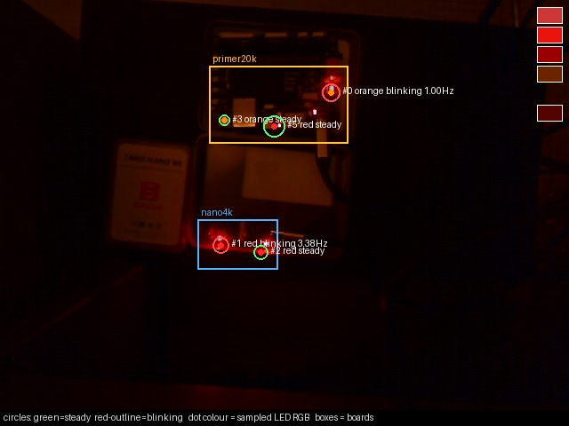

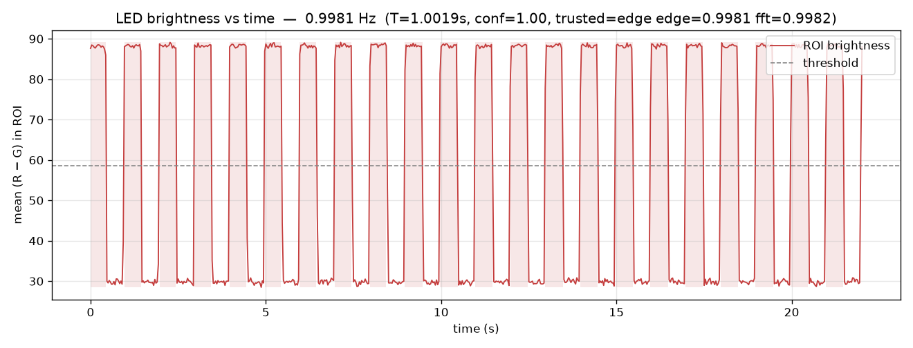

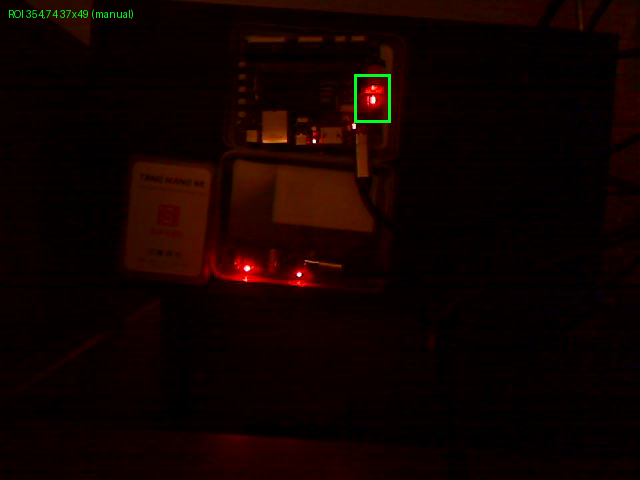

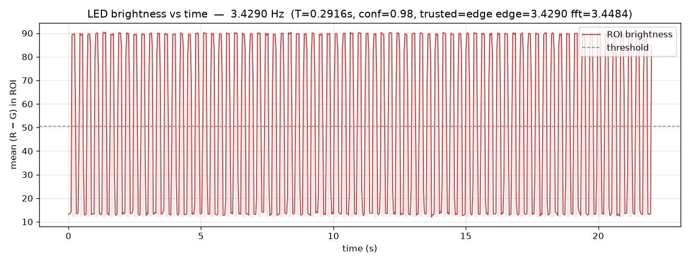

### N=262144 (predicted 3.433 Hz)

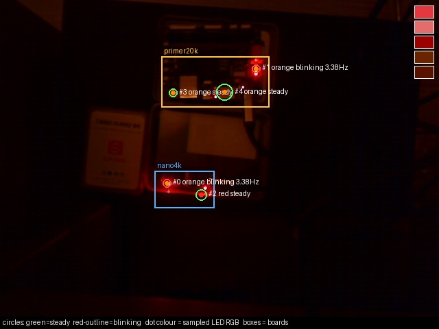

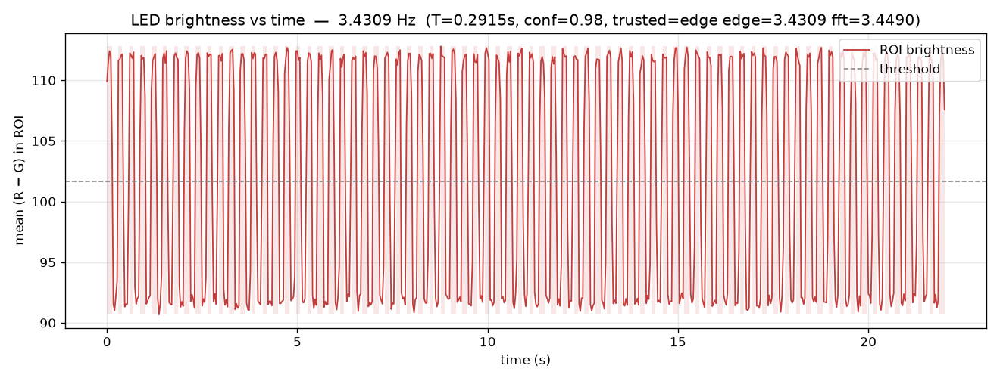

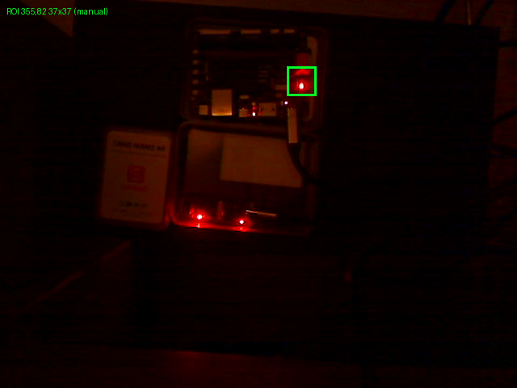

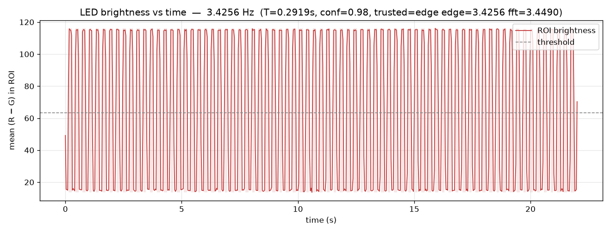

### N=131072 (predicted 6.866 Hz)

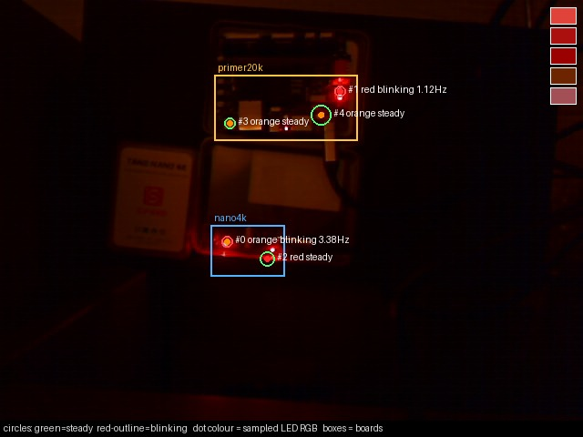

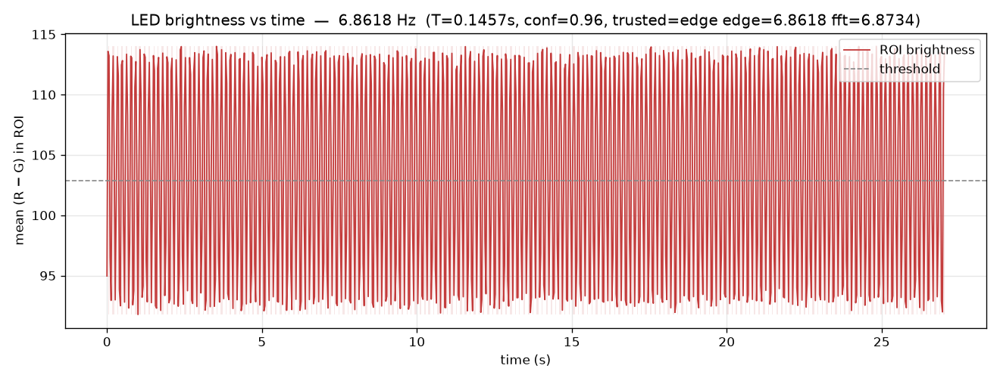

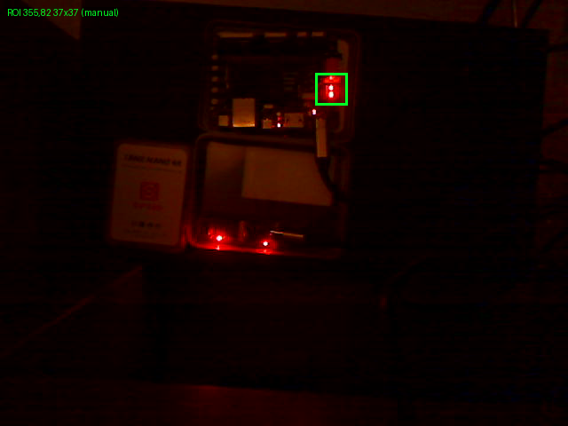

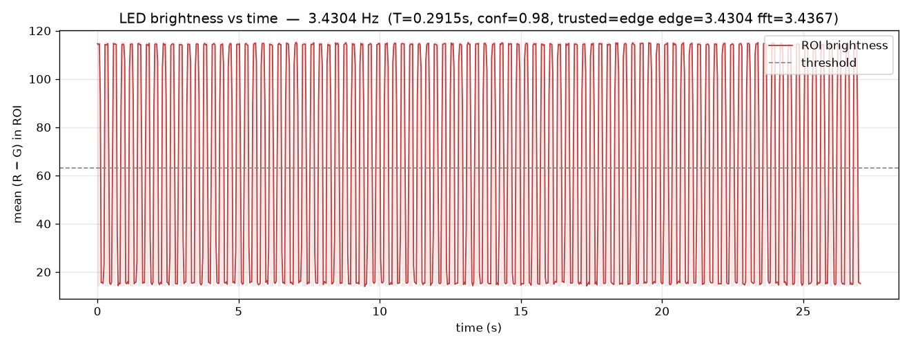

Stills (Logitech `/dev/video0`, raw):

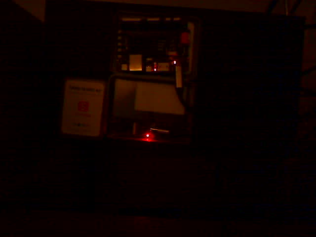

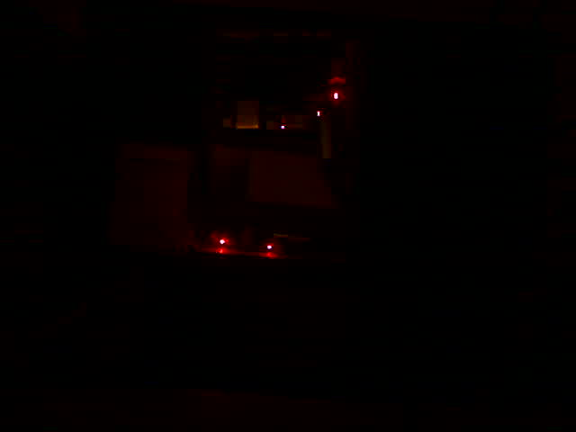
