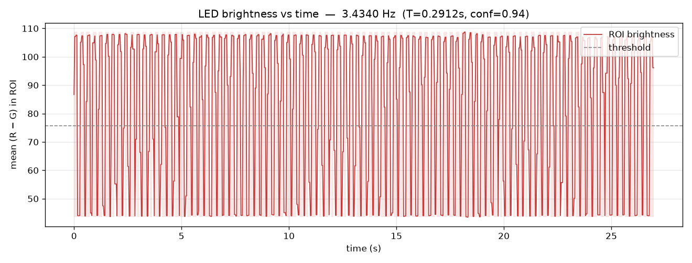
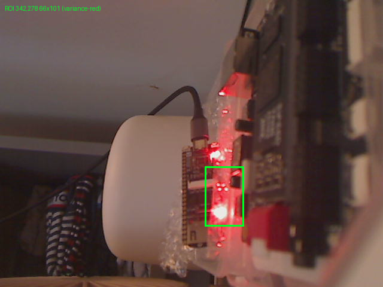
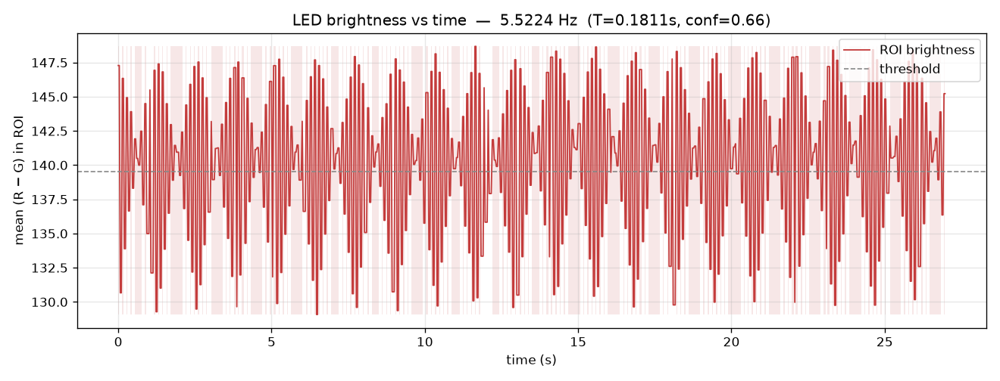
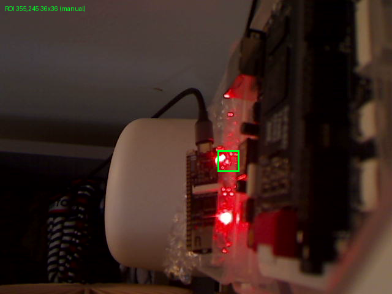
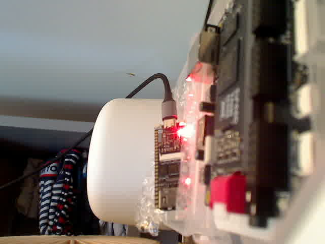
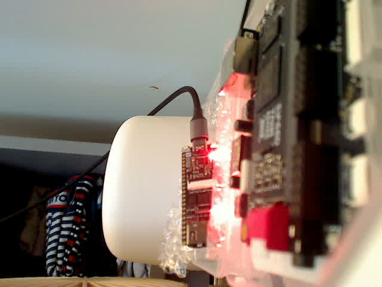
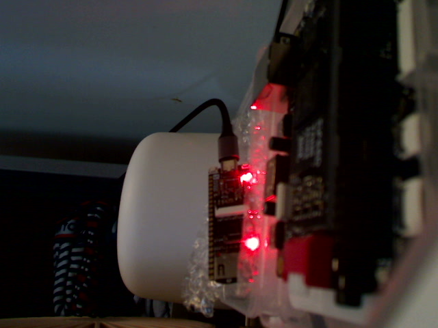

# Blink3 on the Tang Nano 4K (SRAM only)

Oberon `LightToggle` + `AMemoryMappedToggle`, linked by the Python loader,
running on `CPUSubset0` with the address-0 `BL` trampoline (AMMT BEGIN, then
LightToggle BEGIN). Loaded with `openFPGALoader -b tangnano4k -m`. **Never
flash.** The Primer 20K was not programmed.

`openFPGALoader --detect` on Bee: **GW1NSR-4C**. Pin 10 = `io_led`, pin 45 =
27 MHz clock through PLLVR (`tang-nano-4k.cst`). Gowin PNR: 2694 / 4608 LUT
(59%), 2 BSRAM.

## Prediction (sim RAM, 1-cycle)

From the N=5 Verilator trace after `BL` writes R15: skip-loop = 15 cycles,
Toggle iteration = 33 cycles, so an LED **edge** is `(N−1)×15 + 33 = 15N + 18`
cycles. Clock is 27 MHz. A full blink (on+off) is two edges. Gowin SPRAM
wait-states *may* slow the hardware loop; that would show up as measured Hz
below this number.

| N | MHI word | cycles/edge | predicted toggle Hz | predicted blink Hz |
|---|---|---:|---:|---:|
| 262144 | `0x60000004` | 3,932,178 | 6.866 | **3.433** |
| 131072 | `0x60000002` | 1,966,098 | 13.733 | **6.866** |

Predicted blink-rate ratio `Hz(131072) / Hz(262144)` = `3932178 / 1966098` ≈ **2.000**.

`tools/measure_blink.sh`'s built-in `expected` block still scales Blink2's
78-cycle / `maxIterations=524288` formula. **Ignore that field** for Blink3.

## Commands (Bee)

```sh
openFPGALoader --detect    # GW1NSR-4C; do not pass -b tangprimer20k

tools/gowin_build.sh
tools/sram_load.sh -b tangnano4k gowin/impl/pnr/blink3_n262144.fs
tools/measure_blink.sh --outdir docs/blink-measure/blink3/n262144 --duration 25 --warmup 8

BLINK3_MAXITER=131072 tools/gowin_build.sh
tools/sram_load.sh -b tangnano4k gowin/impl/pnr/blink3_n131072.fs
tools/measure_blink.sh --outdir docs/blink-measure/blink3/n131072 --duration 25 --warmup 8 \
  --roi 355,245,36,36
```

Webcam: MCP `http://127.0.0.1:8766/mcp`. `capture_still` raw. First N=262144
frame was bloomed (gain 255); `auto_adjust` brought mean luma to 119. For
N=131072 a manual ROI on the **Tang Nano 4K user LED** (next to USB-C) is
required: auto-ROI prefers a lower ~1.6 Hz red glow that is not the 4K LED.

## Results

| N | predicted Hz | measured edge Hz | measured FFT Hz | conf | vs prediction |
|---|---:|---:|---:|---:|---|
| 262144 | 3.433 | **3.434** | 3.444 | 0.94 | **matches** (edge 0.02% high) |
| 131072 | 6.866 | 5.522 | **6.852** | 0.66 | **FFT matches** (0.2% low) |

Ratio of FFT peaks: `6.852 / 3.444` = **1.989** (predicted **2.000**, 0.5% low).

SPRAM wait-states did **not** show an extra slowdown versus the sim `15N+18`
model. N=262144 implied 3,931,319 cycles/edge vs 3,932,178 predicted.

What does **not** match: the N=131072 *edge* detector at 30 fps. 6.87 Hz is
only ~4.4 frames per period, and LED bloom keeps some “off” samples above the
threshold, so the edge rate undershoots (5.52 Hz here; a looser ROI earlier
gave 3.51 Hz with an explicit “disagrees with FFT 6.852 Hz” warning). The FFT
on every 4K-LED ROI we tried was **6.852 Hz**. Prefer FFT at this rate.

N=262144 brightness (clean square wave, 3.434 Hz):





N=131072 brightness (4K user LED, FFT 6.852 Hz):





Stills (Logitech `/dev/video0`, raw):






