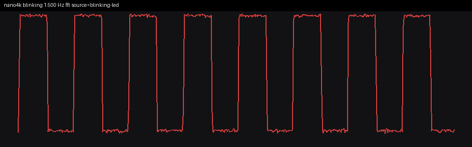
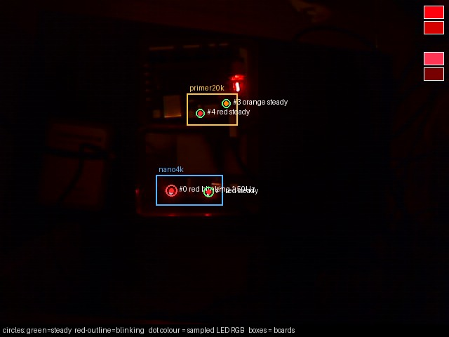

# Step 1: HyperRAM data port on the Tang Nano 4K

Fetch stays in block RAM. Data loads and stores go through Gowin's HyperRAM
controller (IPUG944) when the image is `hyperram`. `FPGA_IMAGE=blink3` is
still the block-RAM Blink3 and was not rebuilt for this step.

The prologue is a new machine-code block in `sim/build_hyperram_imem.py`.
No `.Mod` file and no `oberon/src` file was edited. The only change to the
Blink3 words, and only in this image's copy, is the setup `MOV` at `0x9C`:
`0x40000000` becomes `0x40001200`, so reset goes to the prologue. On a match
the prologue branches to address 0, which is still Blink3's trampoline. On a
mismatch it sits in a hold loop (`ADD R1, R1, 1` / `B` back, at `0x1390` /
`0x1394`) and never stores the LED.

## What a match has to get right

The prologue writes `1<<0 .. 1<<31` at `0x400+4*i` and the two's-complement
inverse at `0x500+4*i`. It then writes `0x11111111` at `0x114` and, last,
`0xA5A5A5A5` at `0x7F0`.

It reads every pattern word, then every complement, and folds each series
with XOR and with ADD. The four expected constants are immediates from the
Python that built the image, not values the CPU computed while writing:

| check | expected |
|---|---|
| pattern XOR | `0xFFFFFFFF` |
| pattern sum | `0xFFFFFFFF` |
| complement XOR | `0xFFFFFFFF` |
| complement sum | `0xFFFFFFE1` |
| load `0x14` (MT[1]) | `0x50` |
| load `0x18` (MT[2]) | `0x70` |
| load `0x114` | `0x11111111` |
| load `0x7F0` | `0xA5A5A5A5` |

Each compare stores `(got - expected)` at its own word, `0x7C0` through
`0x7DC`. `R10` is the OR of those eight differences. A non-zero `R10` branches
to the hold loop.

The HyperRAM elaboration also gates the pin. A store of zero to
`0x7C0+4*slot` sets one bit of an 8-bit mask. `io.led` is the Blink3 LED
state AND that mask equal to `0xFF`. The block-RAM elaboration does not
contain this gate. A program that falls into Blink3 with any difference
still non-zero leaves the LED dark.

## Why a wrong result cannot blink at this rate

- A zero RAM, an all-ones RAM, or "return the last write" misses at least
  one of the eight compares. The XOR of the walking bits and the XOR of the
  complements are both `0xFFFFFFFF`, so a 256-byte alias (the old block RAM)
  that returns the complement for both series matches the XOR and fails the
  sum (`0xFFFFFFE1` against `0xFFFFFFFF`). That same alias maps `0x114` onto
  `0x14`, so the module-table word is no longer `0x50`.
- The eight zero-difference stores are what arm the pin. A stuck branch that
  falls into Blink3 anyway stays dark unless every difference was zero.
- The one remaining software hole is a `SUB` that returns 0 for unequal
  operands. That would store zeros, arm the pin, and skip the hold. It would
  also make the delay compare (`counter - maxIterations`) return 0, so the
  "less than" branch would never skip the toggle. The LED would toggle every
  iteration, at about 55 kHz, not at 0.5 Hz. The measured period is the
  262144-iteration loop.

A Verilator run with `HYPER_CORRUPT` (reads return 0, same `rd_data_valid`
timing) produced no LED edges in 20000 cycles, never visited the success
branch at `0x138c`, and sat in the hold loop with `R10 = 0xFFFFFFFF`.

## Simulation (before the SRAM load)

The behavioural model is `sim/HyperRamUserModel.v`. It has the user ports
from IPUG944 Table 5-1 (`cmd`, `cmd_en`, `addr[21:0]`, `wr_data`, `rd_data`,
`rd_data_valid`, `data_mask`, `init_calib`, `clk_out`). The physical
`O_hpram_*` pins are not in the model. `clk_out` is tied to `clk`.
Calibration is 64 user clocks (the real one is milliseconds; the blink is
measured after it). The first `rd_data_valid` is 13 user clocks after
`cmd_en`, inside the 15-clock minimum gap, so the bridge is limited by that
gap. No `HYPER_TIMING_FAULT` was printed.

Block-RAM Blink3, N=5, still 93 cycles per edge (`15*5+18`). The stall input
is tied off on that elaboration.

HyperRAM, good model:

| N | cycles/edge |
|---|---:|
| 5 | 633 |
| 6 | 732 |
| 8 | 930 |

The slope is 99 cycles per extra iteration. `cycles_per_edge(N) = 99*N + 138`.
At N=5 the success branch was visited once, at cycle 3488, with `R10 = 0`,
`R12 = 0x10`, `R14 = 0x80`, the LED still off, and the hold loop never
visited. Edges then at 4202, 4835, 5468, 6101, 6734, 7367.

Each skip iteration does 4 data loads and 1 data store. The toggle iteration
does 8 loads and 4 stores. That is where the 99 comes from: the bridge holds
the CPU for the 15-clock command gap on every one of those accesses.

## Prediction, locked before the load

N = 262144. CPU clock is the controller's `clk_out`, which place-and-route
reports as 27.000 MHz.

- cycles per edge = `99*262144 + 138` = **25,952,394**
- edge rate = **1.040366 Hz**
- full blink (on + off) = **0.520183 Hz**
- full period = **1.922400 s**

The block-RAM figure at the same N is 3.433 Hz. This image is not that.

## Place and route

`hpram_pllvr`: `IDIV_SEL=0`, `FBDIV_SEL=1`, `ODIV_SEL=16`.
`VCO = 27*(1+1)*16/(0+1) = 864 MHz` (legal range 600–1200). `CLKOUT` is
54 MHz. The IP divides that by 2, and that 27 MHz clock is the CPU clock.
An earlier bitstream used `ODIV_SEL=4`, which is a 216 MHz VCO. Gowin warned
PA1019. That bitstream was not loaded. The loaded one has no PA1019.

The timing report for the loaded bitstream: 0 setup violations, 0 hold
violations, worst setup slack **+0.011 ns**. The embedded HyperRAM pins
landed on `p1-*` locations (the package SIP), not on the QFN user pins.

## SRAM load

`lsusb` / `openFPGALoader --detect`:

- `003:078` is the Tang Primer 20K (GW2A-18). Not programmed.
- `003:081` is the Tang Nano 4K (GW1NSR-4C, idcode `0x100981b`).

```sh
openFPGALoader --busdev-num 003:081 -b tangnano4k -m \
  gowin/impl/pnr/hyperram_n262144.fs
```

The log says `write to ram`, `Load SRAM 100%`, `CRC check: Success`.
`-f` was not passed. The `.fs` is not in git.

## Webcam

Prediction used above, made before this call: full blink **0.520 Hz**.

`measure_blink` on `http://127.0.0.1:8766/mcp`, `roi=nano4k`, duration 20,
warmup 2. Run directory `~/fpga/blink-measure/20261105-002543-mcp/`.
The tool's own JSON is `mcp-result.json` next to this file. Headline fields:

```json
{
  "frequency_hz": 1.5,
  "edge_frequency_hz": null,
  "fft_frequency_hz": 1.5,
  "trusted_method": "fft",
  "trusted_reason": "blinking LED FFT (edge detector found no in-band period)",
  "status": "blinking",
  "confidence": 0.88,
  "source": "blinking-led",
  "board": "nano4k",
  "n_leds": 2,
  "n_blinking": 1,
  "n_steady": 1,
  "colors": ["red"],
  "target_led_id": 0
}
```

The detector's blink band is 0.85–8 Hz (`MIN_BLINK_HZ` in the visualizer
tree). A 0.5 Hz square wave's fundamental is below that band, and its third
harmonic is exactly 1.5 Hz, which is the peak the FFT is allowed to return.
SNR on that peak was 73.64. The Primer 20K, in the same frame, was
`board present but not blinking`.

The clip the tool saved (`clip.mkv`, 661 frames, container duration 22.009 s,
30 fps) has rising edges of the Nano 4K LED at 0.1, 2.1, 4.1, 6.1, 8.1,
10.1, 12.1, 14.1, 16.1, 18.1, 20.1 seconds. Every gap is 60 frames.
That is a full-blink period of **2.000 s**, **0.500 Hz**. Against the
container's 30.033 fps it is 1.998 s, **0.5006 Hz**.

| | full blink |
|---|---:|
| locked prediction (15-clock floor) | 0.520183 Hz |
| rising edges in the MCP clip | 0.500 Hz |
| MCP headline FFT | 1.500 Hz (3rd harmonic) |
| block-RAM Blink3 at this N | 3.433 Hz |

The LED is blinking, so the eight compares matched and the pin was armed.
The rate is the stalled HyperRAM loop, not the 3.433 Hz block-RAM loop, and
not the dark hold.

The 3.8% gap (2.000 s measured against 1.922 s predicted) is one user clock
per read past the floor the model used. The skip loop has 4 loads; the
toggle iteration has 8. Adding one cycle to each load and none to the stores
gives `cycles_per_edge = 103*N + 142` = 27,000,974, which at 27 MHz is a
full period of 2.00007 s. That reading was made after the measurement. The
model was not changed, and 0.520 Hz remains the prediction this bitstream
was loaded against.





## Fitted read latency (after the measurement)

The numbers above are the pre-load model and were not edited to match the
board. `FIRST_VALID` defaults to 12: the first `rd_data_valid` is 13 user
clocks after `cmd_en`, inside the 15-clock command gap, and the bridge is
limited by that gap. That is the 0.520 Hz prediction.

`HYPER_FIRST_VALID=13` delays the read burst by one user clock. Each load
then stalls one cycle past the gap. A store does not, because a write is
released on the gap alone. This value was chosen after the clip showed a
2.000 s period. It is a fit, not a prediction made before the load.

Re-sim with that setting, same N=5 image otherwise:

| N | cycles/edge, FIRST_VALID=12 | cycles/edge, FIRST_VALID=13 |
|---|---:|---:|
| 5 | 633 | 657 |
| 6 | 732 (pre-load run) | 760 |
| 8 | 930 (pre-load run) | 966 |

The fitted slope is 103 cycles per extra iteration: `103*N + 142`.
The N=5 run with `FIRST_VALID=12` was repeated and is still 633, so the
old setting is unchanged. At N=5 the success branch was cycle 3556 with
R10 = 0, and the hold loop was not visited.

For this bitstream, N=262144, at the same 27 MHz CPU clock:

- cycles per edge = `103*262144 + 142` = **27,000,974**
- full blink = **0.499982 Hz**
- full period = **2.000072 s**

That is the 2.000 s period the rising edges already showed. The model was
not used to change the bitstream.

## Left as they were

The visualizer on port 8765 was not restarted and does not know this image.
The Primer 20K bitstream was not touched. Bitstreams and word ROMs are
gitignored.
