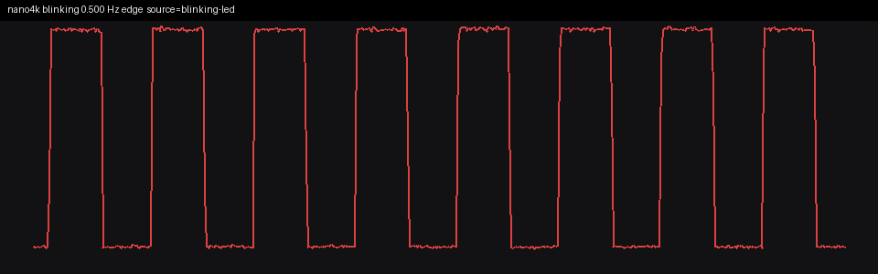
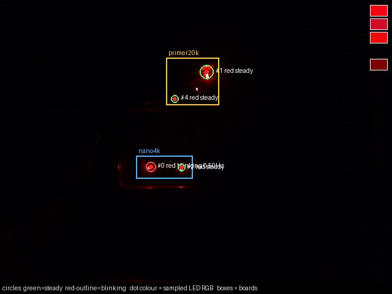

# Step 2: fixup ALU on the Tang Nano 4K

`tests/BlinkBoot.Mod` is a new file. No existing `.Mod` and nothing under
`oberon/src` was edited. The host has no Oberon compiler in this build, so
`sim/build_fixup_imem.py` emits the same ORG encodings (Put0, Put1, Put3)
the module describes. `FPGA_IMAGE=blink3` stays block RAM. `FPGA_IMAGE=hyperram`
stays the step-1 prologue. `FPGA_IMAGE=fixup` is both of those plus this ALU
block, and it is the only image loaded for this step.

The memory prologue is unchanged except its success branch, which now goes
to `0x1400` instead of address 0. Address 0 is still Blink3's trampoline.
The ALU block is the only new code that can branch there, and only after
its own compares. None of the new instructions sit in the delay loop.

## What has to come out right

The step-1 memory compares are still there: eight differences at `0x7C0`
through `0x7DC`. The ALU adds twenty differences at `0x800+4*slot`. Each
expected value is a Python immediate, not a value the CPU computed for
itself. `R10` is cleared on entry to the ALU and then ORs every difference.
A non-zero `R10` branches to a hold loop at `0x1708` (`ADD` / `B` back).
It does not execute `0xE7FFFFFF`.

| slot | operation | expected |
|---:|---|---:|
| 0 | F1 MOV of -1, v=1 (sign-extended) | `0xFFFFFFFF` |
| 1 | F1 LSL of 1 by 20 | `0x00100000` |
| 2 | F0 LSL of 1 by a register 20 | `0x00100000` |
| 3 | F1 ASR of `0x80000000` by 4 | `0xF8000000` |
| 4 | `0xA5F3C0DE` ASR 20, AND 15 (mno) | `0x0000000F` |
| 5 | same word ASR 12, AND 255 (pno) | `0x0000003C` |
| 6 | same word AND `0xFFF` (disp) | `0x000000DE` |
| 7 | LSL 8 then ROR 8 (`MOD 2^24`) | `0x00F3C0DE` |
| 8 | F0 ROR of that shifted word by a register | `0x00F3C0DE` |
| 9 | F0 ANN, `{0,1,2,3} - {1}` | `0x0000000D` |
| 10 | F1 ANN of `0x00010000` with sign-extended -1 | `0x00000000` |
| 11 | `WHILE i < 4`, exit is GE | `4` |
| 12 | `-2000000000 < 2000000000` (LT, needs V) | taken |
| 13 | `-1 + 1`, BCS | taken |
| 14 | `1 + 1`, BCS | not taken |
| 15 | MI after MOV -1 | taken |
| 16 | MI after MOV +1 | not taken |
| 17 | PL after MOV +1 | taken |
| 18 | LE after `SUB R, R` | taken |
| 19 | GT after `SUB R, R` | not taken |

The fixup elaboration widens the pin gate from 8 bits to 28. A store of
zero at `0x7C0+4*slot` arms one of the eight memory bits. A store of zero
at `0x800+4*slot` arms one of the twenty ALU bits. `io.led` is the Blink3
LED state AND that mask being all ones. One missing zero leaves the pin
dark. The block-RAM elaboration still has no gate.

## Why a wrong result cannot blink at this rate

The step-1 argument still holds for the eight memory words (alias, XOR
versus sum, last-write bypass, sentinel). On top of that:

- The success branch of the memory prologue goes to `0x1400`, not to
  Blink3. Falling into the delay loop without the ALU stores leaves twenty
  mask bits clear.
- Each ALU difference has its own store. Two wrong results cannot cancel.
- A zero-extended MOV of -1 yields `0x0000FFFF`. A 4-bit shift of 20 shifts
  by 4 and yields 16. A logical shift of the sign bit yields `0x08000000`.
  An ASR where the ROR should be sign-fills `0xFFF3C0DE` instead of
  `0x00F3C0DE`. AND instead of ANN yields 2 instead of `0xD`. A
  zero-extended ANN of -1 leaves `0x00010000`.
- GE never taken spins in the prologue (no edges). GE always taken, or GE
  decoded as LT, leaves `i = 0`.
- `-2000000000 - 2000000000` wraps to `0x1194D800` (positive). LT is
  `N xor V`, so it is taken only when V is set. V stuck at 0 leaves the
  result register at 0.
- C stuck at 0 fails the `-1 + 1` BCS. C stuck at 1 fails the `1 + 1` BCS,
  which is required not to be taken.
- MI, PL, LE and GT are conditions the previous CPU did not decode. A
  decoder that still only knows EQ, NE, LT, always and never fails this
  list.
- The remaining software hole is a SUB that returns 0 for unequal
  operands. That stores zeros, arms the pin, and skips the hold. It also
  makes the delay compare return 0, so the loop toggles every iteration,
  at about 55 kHz, not at half a hertz.

A `--break-slot 9` image (the ANN constant bumped by 1) stored
`0xFFFFFFFF` at `0x824`, entered the hold at cycle 4096 with `R10` nonzero,
never reached address 0, and produced 0 LED edges in 20000 cycles.

## Simulation, and the rate locked before synthesis

Model setting is the fitted one from step 1: `FIRST_VALID=13`. It was
fitted after the step-1 measurement and is not being fitted again. The
pre-load setting (`FIRST_VALID=12`, 0.520183 Hz) is still the default for
`SIM_IMAGE=hyperram`.

Block-RAM Blink3, N=5, after these ALU and condition changes: 93 cycles
per edge (`15*5+18`). Edges at 111, 204, 297, 390, 483, 576.

Fixup image, fitted latency, no `HYPER_TIMING_FAULT`:

| N | cycles/edge |
|---:|---:|
| 5 | 657 |
| 6 | 760 |
| 8 | 966 |

That is the same law as the fitted step-1 loop, `103*N + 142`. The ALU
only moves the first edge. At N=5 the memory prologue still entered the
ALU at cycle 3557 with `R10 = 0` and the LED dark. All 28 check words were
stored as zero. The branch to address 0 was cycle 4096, `R10` still 0.
The hold at `0x1708` was not visited. The first LED edge was cycle 4835.

The first synthesis did not fit. Three separate Verilog shifts took the
design to 4992 logic cells, and a shared 5-stage barrel only got that down
to 4909. The GW1NSR-4C stops at 4608. The instruction memory was a
combinational case statement, and the extra prologue words were LUT logic.
Fetch is now a clocked ROM (`InstrRom`) so the words can sit in BSRAM.
The address presented in a cycle is the next PC, and reset presents `0x80`,
so the registered output is the instruction at the current PC. The runs
above are after that change. Block-RAM Blink3 is still 93, and the fitted
fixup slope is still `103*N+142`, so the prediction is the same number.

N=262144 at the 27 MHz CPU clock, locked from that slope before this
bitstream was built:

- cycles per edge = `103*262144 + 142` = **27,000,974**
- one edge = 1.000036 s
- full blink = **0.499982 Hz**, period **2.000072 s**

Not the block-RAM 3.433 Hz, and not the pre-load 0.520 Hz. A dark hold is
the failure state.

## Hardware

PNR of `fixup_n262144` on the GW1NSR-4C: 3162/4608 logic (69%), 2011/2304
CLS (88%), 6/10 BSRAM of which 4 are the instruction pROM. Setup and hold
total negative slack are 0. The worst setup slack is +0.056 ns, on the
27 MHz `clkdiv` clock (period 37.037 ns). No illegal PLL VCO.

SRAM load, Tang Nano 4K only. `lsusb` still showed two FT2232s;
`--detect` on bus 003 device 081 returned idcode `0x100981b`, GW1NSR-4C.
The Primer 20K was not loaded.

```
openFPGALoader --busdev-num 003:081 -b tangnano4k -m \
  gowin/impl/pnr/fixup_n262144.fs
```

`write to ram`, SRAM load 100%, CRC check success. No `-f`.

`measure_blink` on `http://127.0.0.1:8766/mcp`, `roi=nano4k`, duration 20,
warmup 2. Run directory `~/fpga/blink-measure/20261105-010957-mcp/`.
The tool's own JSON is `step2-result.json`. Headline fields:

```json
{
  "frequency_hz": 0.5,
  "edge_frequency_hz": 0.5,
  "fft_frequency_hz": 0.5,
  "trusted_method": "edge",
  "trusted_reason": "blinking LED edge period is regular",
  "status": "blinking",
  "confidence": 1.0,
  "source": "blinking-led",
  "board": "nano4k",
  "n_leds": 2,
  "n_blinking": 1,
  "n_steady": 1,
  "colors": ["red"],
  "target_led_id": 0,
  "measure_roi": {"x": 222, "y": 254, "w": 46, "h": 37}
}
```

SNR on that LED was 202.71. The Primer 20K, in the same frame, was
`board present but not blinking` (frequency null, two steady red LEDs).
The fuller tool payload is `step2-mcp.json`.

| | full blink |
|---|---:|
| locked prediction | 0.499982 Hz |
| MCP edge and FFT | 0.500 Hz |
| block-RAM Blink3 at this N | 3.433 Hz |
| dark hold | not this |

The rate was not revised after the measurement. 0.500 Hz is the locked
half-hertz loop. It is not 3.433 Hz and it is not dark, so the 28
differences were zero and the widened pin gate was armed. A wrong shift,
a stuck V or C, or a GE that never exits cannot land on this rate.

The visualizer on port 8765 was not restarted and does not know this image.




