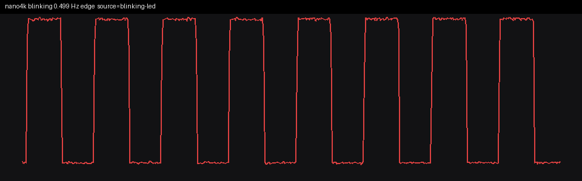
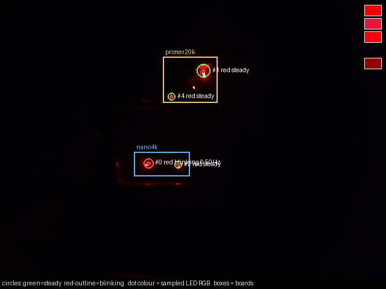

# Step 3: LDB, STB, and an .rsc header in HyperRAM

`tests/BlinkRsc.Mod` is a new file. `tests/BlinkBoot.Mod` was not edited.
Nothing under `oberon/src` was edited. The host has no Oberon compiler in
this build, so `sim/build_rsc_imem.py` emits the ORG encodings the module
describes: Put2 of `Ldr+1` and `Str+1` for LDB and STB, and Put1 of LSL 8
plus ADD for `Files.ReadInt`.

`FPGA_IMAGE=blink3` stays block RAM. `FPGA_IMAGE=hyperram` stays the step-1
prologue. `FPGA_IMAGE=fixup` stays the step-2 ALU and still branches to
address 0; its word image is unchanged. `FPGA_IMAGE=rsc` is the only image
loaded for this step. It is nano4k HyperRAM, the same top and PLL as the
previous HyperRAM images.

The chain is the memory prologue, then the ALU at `0x1400`, then the reader
at `0x1800`, then address 0. None of the new instructions sit in the delay
loop. The reader has its own hold (`ADD` / `B` at `0x1B44`). It does not
execute `0xE7FFFFFF`.

## Bytes

LDB is a word read. On the completion cycle the CPU zero-extends the lane
`adr[1:0]` selects, which is RISC5 `inbus1`:

| lane | bits |
|---:|---|
| 00 | `[7:0]` |
| 01 | `[15:8]` |
| 10 | `[23:16]` |
| 11 | `[31:24]` |

The stall is the LDW stall. STB places `A[7:0]` in that lane and zeros the
other three bytes of the bus, which is RISC5 `outbus`. The HyperRAM bridge
latches the byte flag and the lane, and clears one `data_mask` bit on the
selected beat. A mask bit of 0 writes that byte. The other three beats stay
masked (`0xF`). A word store still clears all four bits of its beat, so the
step-1 and step-2 writes are the same operation as before. The check-mask
gate arms only on a word store of zero. A byte store cannot arm it.

Block RAM has no byte enable. An STB there would write the placed word.
Blink3 never executes LDB or STB. After these edits its N=5 edges are still
111, 204, 297, 390, 483, 576, which is 93 cycles per edge.

## Header

The reader writes this record at `0x900` with STB only, then reads it back
with LDB. The expected name bytes, the key, the version and the size are
Python immediates.

| offset | bytes | meaning |
|---:|---|---|
| 0 | `42 6C 69 6E 6B 35 00` | `ReadString` of "Blink5" |
| 7 | `DF 9B 57 13` | `ReadInt` key `0x13579BDF`, little-endian |
| 11 | `01` | `versionkey`, which is `1X` |
| 12 | `00 01 00 00` | `ReadInt` size `0x100` |

`ReadInt` is `((x3*100H + x2)*100H + x1)*100H + x0`. ORG compiles `*100H`
as LSL 8, and the image does the same four shifts.

A second copy of the name is stored at `0x940` so the ORG string loop
(`LDB`, increment, `LDB`, increment, compare, `BNE`) actually runs. That
loop is not the proof. Both loads can return the same wrong byte and the
strings still compare equal. The name slot ORs each header byte against
its immediate, and then ORs in a failed loop. The loop's only extra job
is to refuse to fall through when the terminator never arrives.

The lane test is separate from the header, at `0x920`:

1. STB `11 22 33 44`. LDW must be `0x44332211`. Each LDB must be its byte.
2. STW `0xA5A5A5A5` at `0x924` (the next beat of the same 16-byte line).
3. STB `77` at `0x923`. The neighbour word must still be `0xA5A5A5A5`,
   byte 3 must be `77`, and byte 2 must still be `33`.

## The forty zeros

Eight memory differences stay at `0x7C0+4*slot`. Twenty ALU differences
stay at `0x800+4*slot`. Twelve byte and header differences occupy
`0x850` through `0x87C` (slots 20..31). `extraChecks` is 32, so the pin
gate is 40 bits. `io.led` is the Blink3 LED state AND that mask being all
ones. The block-RAM elaboration still has no gate. Slot 31 is address
`0x87C`; the slot adder keeps the carry, because 31 plus the 8 memory
slots is 39.

| slot | check | expected |
|---:|---|---:|
| 20 | LDW of the four lane bytes | `0x44332211` |
| 21 | LDB lane 0 | `0x11` |
| 22 | LDB lane 1 | `0x22` |
| 23 | LDB lane 2 | `0x33` |
| 24 | LDB lane 3 | `0x44` |
| 25 | LDW of the neighbour after the later STB | `0xA5A5A5A5` |
| 26 | LDB of the updated byte | `0x77` |
| 27 | LDB of the byte that had to survive | `0x33` |
| 28 | name immediates, plus the string loop | `0` |
| 29 | little-endian `ReadInt` of the key | `0x13579BDF` |
| 30 | version byte | `1` |
| 31 | little-endian `ReadInt` of the size | `0x100` |

## Why a wrong result cannot blink at this rate

The step-1 and step-2 arguments still hold. The memory prologue enters the
ALU, and the ALU enters the reader only when its own `R10` is zero. Falling
into Blink3 without the twelve new stores leaves those mask bits clear.

- An STB that ignores the mask and writes the whole beat leaves only the
  last byte. The LDW is not `0x44332211`, and the later `77` store wipes
  the `33` that slot 27 requires.
- A mask that writes every beat of the burst overwrites `0xA5A5A5A5`.
- An LDB stuck on lane 0 returns `0x11` for the other three lanes.
- An LDB that does not load leaves the previous register. After the LDW
  that value is `0x44332211`, not `0x11`.
- A big-endian `ReadInt` yields `0xDF9B5713` for the key and `0x00010000`
  for the size.
- Starting the key one byte late yields `0x0113579B`. Starting the size on
  the version byte yields `0x00010001`. Skipping the version byte makes
  that compare see `0x13` (the last key byte) or `0x00` (the first size
  byte) instead of `0x01`.
- The string loop against two memory copies is not enough. LDB of zero
  makes both strings look empty, the loop exits equal, and the immediate
  compare against `42` ("B") fails. LDB of one constant non-zero never
  sees the terminator, so the CPU never leaves the reader.
- A byte store of zero cannot arm a slot. The gate watches word stores.
- The same software hole as step 2 remains: a SUB that returns 0 for
  unequal operands stores zeros and skips the hold. It also makes the
  delay compare return 0, so the loop toggles every iteration, at about
  55 kHz, not at half a hertz.

The version slot was broken on purpose (`--break-slot 30` expects 2).
`R10` became `0xFFFFFFFF`, the CPU sat in the hold at `0x1B44`, and 20000
cycles produced 0 LED edges. That image was not loaded.

## Simulation, fitted model

`FIRST_VALID` stays 13. That is the step-1 post-measurement fit, one extra
user clock per load. It was not moved for this step. The HyperRAM model
was not edited.

| N | cycles between edges |
|---:|---:|
| 5 | 657 |
| 6 | 760 |
| 8 | 966 |

That is still `103*N + 142`. The reader only moves the first edge. At N=5
the ALU's success branch (now to `0x1800`, the same instruction that went
to address 0 in step 2) was cycle 4096, `R10` was 0, and the LED was dark.
All 40 check words were stored as zero. Neither hold (`0x1708`, `0x1B44`)
was visited. The first LED edge was cycle 6503. No `HYPER_TIMING_FAULT`.

The step-2 word file is byte-identical after the success-target parameter
was added (default target 0). Re-simulating it on this CPU, N=5, still
edges at 4835, 5492, 6149, 6806.

N=262144 at the 27 MHz CPU clock, locked from that slope before this
bitstream was built:

- cycles per edge = `103*262144 + 142` = **27,000,974**
- one edge = 1.000036 s
- full blink = **0.499982 Hz**, period **2.000072 s**

Not the block-RAM 3.433 Hz, and not the pre-load 0.520 Hz. A dark hold is
the failure state.

## Hardware

PNR of `rsc_n262144` on the GW1NSR-4C: 3185/4608 logic (70%), 2019/2304
CLS (88%), 1251/3612 registers, 6/10 BSRAM of which 4 are the instruction
pROM (plus one SDPB and one SDPX9B). Setup and hold total negative slack
are 0 on every clock. The worst setup slack is +0.006 ns, on the 27 MHz
`clkdiv` clock (period 37.037 ns), from the instruction ROM to a register.
The PLL is the same legal VCO as the loaded step-1 and step-2 images.
No illegal PLL VCO.

SRAM load, Tang Nano 4K only. `lsusb` still showed the two FT2232s.
`--detect` on bus 003 device 081 returned idcode `0x100981b`, GW1NSR-4C.
The Primer 20K was not loaded. This step does not port the reader onto
the Dock's DDR3.

```
openFPGALoader --busdev-num 003:081 -b tangnano4k -m \
  gowin/impl/pnr/rsc_n262144.fs
```

`write to ram`, SRAM load 100%, CRC check success. No `-f`.

`measure_blink` on `http://127.0.0.1:8766/mcp`, `roi=nano4k`, duration 20,
warmup 2. The server is the one whose band starts at 0.2 Hz and whose
regular edges win. Exposure was left to that tool's existing lock and
restore. Run directory `~/fpga/blink-measure/20261105-013057-mcp/`.
The tool's own JSON is `step3-result.json`. Headline fields:

```json
{
  "frequency_hz": 0.499,
  "edge_frequency_hz": 0.499,
  "fft_frequency_hz": 0.5,
  "trusted_method": "edge",
  "trusted_reason": "blinking LED edge period is regular",
  "status": "blinking",
  "confidence": 1.0,
  "source": "blinking-led",
  "board": "nano4k",
  "n_leds": 2,
  "n_blinking": 1,
  "n_steady": 1,
  "colors": ["red"],
  "target_led_id": 0,
  "measure_roi": {"x": 222, "y": 252, "w": 44, "h": 40}
}
```

SNR on that LED was 406.1. The Primer 20K, in the same frame, was
`board present but not blinking` (frequency null, two steady red LEDs).
The fuller payload, including that primer status, is `step3-mcp.json`.
The tool's `predicted_blink3_hz` field still compares against the
block-RAM 3.433 Hz. That field is not this prediction.

| | full blink |
|---|---:|
| locked prediction | 0.499982 Hz |
| MCP edge | 0.499 Hz |
| MCP FFT | 0.500 Hz |
| block-RAM Blink3 at this N | 3.433 Hz |
| dark hold | not this |

The rate was not revised after the measurement, and `FIRST_VALID` was
not moved. 0.499 Hz on a 30 fps clip is the locked half-hertz loop. It
is not 3.433 Hz and it is not dark, so the 40 differences were zero and
the widened pin gate was armed. A byte store that clobbers its
neighbours, a big-endian key, or a version byte other than `1X` cannot
land on this rate.

The visualizer on port 8765 was not restarted and does not know this image.




