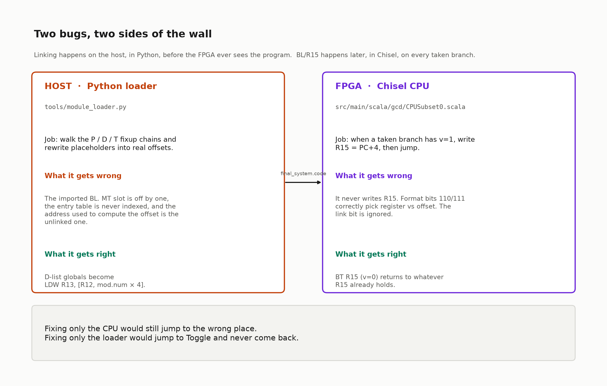
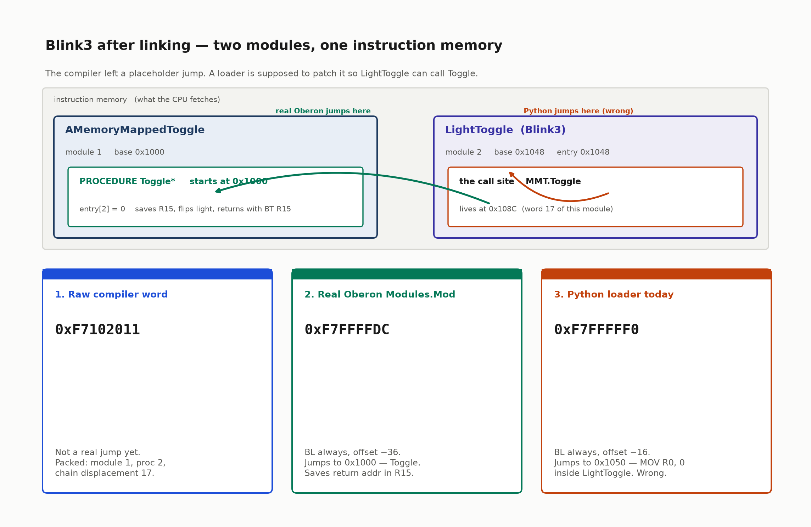
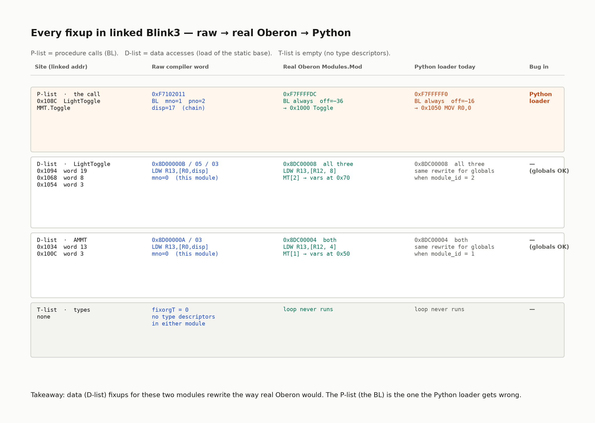
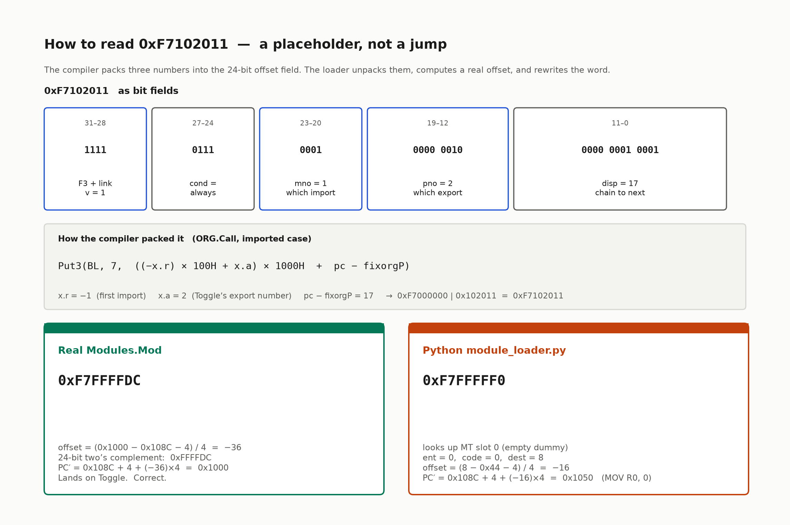
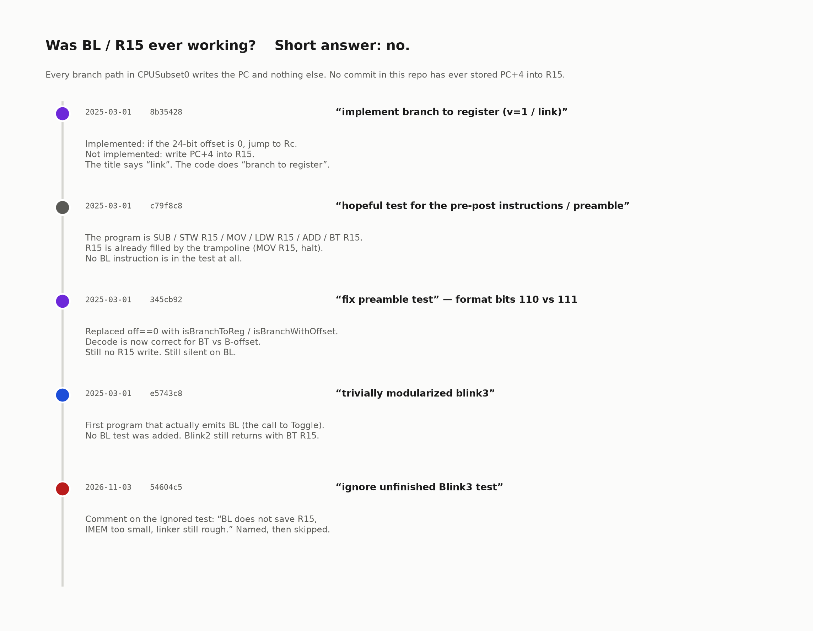
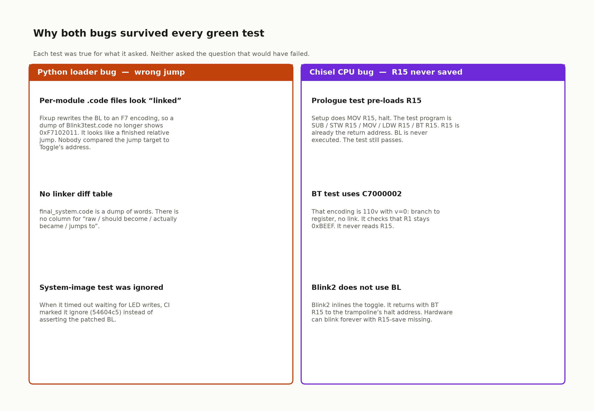

# Linking Blink3, explained

This is a learning document. It does not fix the Python loader or the Chisel CPU.
It exists so you can see, word by word, what the compiler emitted, what real
Oberon `Modules.Mod` would turn each word into, what this repo’s Python loader
actually produces, and why `BL` / `R15` was never working.

Blink3 is two tiny Oberon modules:

```oberon
MODULE AMemoryMappedToggle;          (* imported *)
  VAR light*: INTEGER;
  PROCEDURE Toggle*; BEGIN light := 1 - light END Toggle;
BEGIN light := 0 END AMemoryMappedToggle.

MODULE LightToggle;                  (* Blink3test.Mod *)
  IMPORT MMT := AMemoryMappedToggle;
  VAR counter, maxIterations: INTEGER;
BEGIN
  counter := 0; maxIterations := 5;
  WHILE TRUE DO
    INC(counter);
    IF counter >= maxIterations THEN
      MMT.Toggle;                    (* this is the call that has to be linked *)
      counter := 0;
    END
  END
END LightToggle.
```

Two independent bugs sit between that source and a blinking LED. Fixing only
one still leaves Blink3 dead.



| Where | File | What is wrong | What is already right |
|---|---|---|---|
| **Python loader** | `tools/module_loader.py`, `tools/rsc_parser.py` | The imported `BL` is patched to jump to the wrong address | D-list globals in the linked system image match `Modules.Mod` |
| **Chisel CPU** | `src/main/scala/gcd/CPUSubset0.scala` | A taken `BL` never writes `R15 = PC+4` | `BT R15` (no link) returns to whatever `R15` already holds |

---

## 1. The picture in one minute

The compiler cannot know where `Toggle` will live in memory, so at the call
site it writes a **placeholder**, not a real jump. A loader is supposed to
walk a chain of those placeholders, look up the imported module’s entry
table, and rewrite each one into a PC-relative `BL`.

This repo’s Python loader does rewrite the word — into a `BL` that jumps
**into LightToggle itself**, not into `Toggle`.



| Stage | Word at `0x108C` | Where it jumps | Saves return address? |
|---|---|---|---|
| Raw compiler output | `0xF7102011` | nowhere yet (packed `mno`/`pno`/chain) | n/a |
| Real Oberon `Modules.Mod` | `0xF7FFFFDC` | `0x1000` (`Toggle`) | yes, `R15 = 0x1090` (CPU’s job) |
| Python `module_loader.py` today | `0xF7FFFFF0` | `0x1050` (`MOV R0, 0` in LightToggle) | still the CPU’s job, and the CPU doesn’t |

The rest of this note unpacks that table.

---

## 2. Words you need

This CPU is **RISC5** (Project Oberon 2018), not RISC-V. The ISA is
[`risc_5_arch.txt`](risc_5_arch.txt). Four registers are software
conventions except `R15`, which hardware must honour:

| Register | Name | Role |
|---|---|---|
| `R12` | `MT` | pointer to the **module table** (one slot per loaded module) |
| `R13` | `SB` | **static base** of the module whose globals you are using |
| `R14` | `SP` | stack |
| `R15` | `LNK` | **link register**. `BL` must write `PC+4` here so `BT R15` can return |

A branch instruction is format F3. Two bits do two different jobs:

```
bits 31–28 = 110v     branch to a register (BT / BLT-to-reg)
bits 31–28 = 111v     branch with a 24-bit offset (B / BL)
                   ^
                   v = 0  do not touch R15
                   v = 1  first do R15 := PC+4, then jump
```

So the four common encodings are:

| Word prefix | Meaning |
|---|---|
| `C7……` (`1100`) | `BT` — jump to a register, **no** link |
| `D7……` (`1101`) | `BL` to a register |
| `E7……` (`1110`) | `B` with offset, **no** link |
| `F7……` (`1111`) | `BL` with offset — **this is a call** |

`v` is bit 28. It is **not** the same bit that chooses register vs offset
(that is bit 29). Mixing those two bits is how the CPU bug was born; see
[section 8](#8-bl--r15-was-it-ever-working).

The compiler’s object files (`.rsc`) do not contain final addresses. They
contain three **fixup chains**, anchored at the end of the file:

| Chain | Anchor | What it patches |
|---|---|---|
| **P-list** | `fixorgP` | imported **procedure calls** (`BL` placeholders) |
| **D-list** | `fixorgD` | **data** accesses: “load this module’s static base into `R13`” |
| **T-list** | `fixorgT` | type descriptors (empty in Blink3) |

Each placeholder’s low 12 bits are a **displacement back to the previous
site** in the same chain, in words. The loader starts at the anchor and
walks until the address hits the start of the code section.

A note on names: `tools/instruction_parser.py` prints `BL` always as
`BLT` (`BL` + condition `T` = always). That is **not** “branch less than”
(which is `0xE5……`). This document says `BL always` to keep the two apart.

---

## 3. The call site

After the Python loader places both modules in one image
(`tests/final_system.code`):

| Module | `module_id` | Code base | Code length | Entry |
|---|---|---|---|---|
| `AMemoryMappedToggle` | 1 | `0x1000` | 18 words (`0x48` bytes) | `Toggle` at `0x1000` |
| `LightToggle` | 2 | `0x1048` | 25 words (`0x64` bytes) | module body at `0x1048` |

`AMemoryMappedToggle`’s entry table, as compiled, is `[40, 0, 0]`:

| Index (`pno`) | Value | What it is |
|---|---|---|
| 0 | 40 | module body (`BEGIN light := 0`), byte offset 40 = `0x1028` |
| 1 | 0 | exported `VAR light*` (a data offset, not used by this `BL`) |
| 2 | 0 | exported `PROCEDURE Toggle*` — code offset **0**, so `Toggle` starts at the code base |

`LightToggle` has `fixorgP = 17`, `fixorgD = 19`, `fixorgT = 0`.
`AMemoryMappedToggle` has `fixorgP = 0`, `fixorgD = 13`, `fixorgT = 0`.

The one P-list site is LightToggle word 17:

```
linked address  0x108C  =  0x1048 + 17×4
raw word        0xF7102011
next word       0x40000000   MOV R0, 0     ← this is the return address a correct BL must save
```

---

## 4. Before / after, every fixup



Numbers below are computed two ways, which agree: by hand, and by the
small `Modules.Mod` reference in [section 5](#5-what-real-modulesmod-does).
The Python column is what `tests/final_system.code` actually contains.

### 4.1 P-list — the one `BL`  ·  **bug is in the Python loader**

**Raw compiler word `0xF7102011` at LightToggle word 17 / linked `0x108C`.**



| Field | Bits | Value | Meaning |
|---|---|---|---|
| opcode | 31–28 | `1111` | F3 offset form, **`v = 1` (link)** |
| cond | 27–24 | `0111` | always |
| `mno` | 23–20 | `0001` = 1 | first imported module (`AMemoryMappedToggle`) |
| `pno` | 19–12 | `0000 0010` = 2 | export number of `Toggle*` |
| `disp` | 11–0 | `0000 0001 0001` = 17 | chain: 17 words back → start of this module, so this is the only P-list site |

The compiler packed it in `ORG.Call` for an imported procedure:

```
Put3(BL, 7, ((−x.r) * 100H + x.a) * 1000H + pc − fixorgP)
```

Here `x.r = −1` (first import), `x.a = 2` (`Toggle`’s export number),
`pc − fixorgP = 17`. That is `0xF7000000 | 0x102011 = 0xF7102011`.
Until a loader rewrites it, the 24-bit “offset” is **not an offset**.

**What real `Modules.Mod` turns it into**

```
impmod     = LightToggle.imports[mno − 1]     = AMemoryMappedToggle
dest       = entries[pno] + impmod.code       = 0 + 0x1000 = 0x1000
offset     = (dest − adr − 4) DIV 4           = (0x1000 − 0x108C − 4) / 4 = −36
new word   = (offset MOD 1000000H) + 0F7000000H
           = 0xFFFFDC + 0xF7000000
           = 0xF7FFFFDC
```

Target the CPU would jump to:

```
PC′ = PC + 4 + offset × 4
    = 0x108C + 4 + (−36) × 4
    = 0x1000     →  PROCEDURE Toggle*
```

Table used: **AMemoryMappedToggle’s entry table**, index `pno = 2`.
Return address a correct CPU would write: `R15 = 0x1090`.

**What the Python loader actually produces**

`tests/final_system.code` has `0xF7FFFFF0` at `0x108C`.

```
impmod     = mt_table[mno − 1] = mt_table[0]   ← empty dummy (never stored)
ent        = module.get("entry_table", 0)      ← key does not exist; parser stored "entries"
dest       = ent + pno × 4 + impmod.code       = 0 + 8 + 0 = 8
adr        = 17 × 4                            = 0x44   ← module-relative, not 0x108C
offset     = (8 − 0x44 − 4) / 4                = −16
new word   = 0xF7FFFFF0
```

Target the CPU actually jumps to:

```
PC′ = 0x108C + 4 + (−16) × 4
    = 0x1050     →  LightToggle’s own  MOV R0, 0
                   (word 2 of LightToggle, just after the prologue)
```

Table used: **none**. Slot 0 of `mt_table` is a dummy with `code = 0`,
`ent = 0`. `Toggle`’s entry table is never read.

That is why a dump of `Blink3test.code` can look “linked” (it is an `F7`
word) and still be wrong. The word `0xF7FFFFF0` is a perfectly legal
`BL always, offset −16`. It just does not point at `Toggle`.

### 4.2 D-list — LightToggle’s three static-base loads  ·  **Python matches Oberon**

These are not jumps. They are `LDW R13, [R0, disp]` placeholders that
mean “please fill in this module’s slot in the module table.”

| Linked addr | Word index | Raw | `mno` | `disp` (chain) | Real `Modules.Mod` | Python `final_system.code` |
|---|---|---|---|---|---|---|
| `0x1094` | 19 | `0x8D00000B` `LDW R13, [R0, 0xB]` | 0 | 11 | `0x8DC00008` `LDW R13, [R12, 8]` | **same** |
| `0x1068` | 8 | `0x8D000005` `LDW R13, [R0, 0x5]` | 0 | 5 | `0x8DC00008` | **same** |
| `0x1054` | 3 | `0x8D000003` `LDW R13, [R0, 0x3]` | 0 | 3 | `0x8DC00008` | **same** |

Chain: 19 → 8 → 3 → 0. `mno = 0` means “this module”, so the rewrite is
`LDW R13, [R12, mod.num × 4]`. LightToggle is module 2, so the offset is 8.

At run time the CPU trampoline has already stored the actual data
addresses in the module table:

```
MOV R12, 0x10
MOV R13, 0x50
STW R13, [R12, 4]     →  MT[1] = 0x50   (AMemoryMappedToggle vars)
ADD R13, R13, 0x20
STW R13, [R12, 8]     →  MT[2] = 0x70   (LightToggle vars)
```

So `LDW R13, [R12, 8]` loads `0x70` into `SB`. The instruction itself
only names the **slot**. Real Oberon would have written `mod.data` into
that slot while loading; this CPU’s trampoline hard-codes `0x50` / `0x70`
as a stand-in. Python’s loader records `data_base` at `0x8000` / `0x8004`
but never puts those values where the CPU can see them. That mismatch is
a third, quieter story. It is **not** why the `BL` is wrong.

### 4.3 D-list — AMemoryMappedToggle’s two static-base loads  ·  **Python matches Oberon**

| Linked addr | Word index | Raw | `mno` | `disp` | Real `Modules.Mod` | Python |
|---|---|---|---|---|---|---|
| `0x1034` | 13 | `0x8D00000A` `LDW R13, [R0, 0xA]` | 0 | 10 | `0x8DC00004` `LDW R13, [R12, 4]` | **same** |
| `0x100C` | 3 | `0x8D000003` `LDW R13, [R0, 0x3]` | 0 | 3 | `0x8DC00004` | **same** |

Module 1, so `mod.num × 4 = 4`, which is `MT[1] = 0x50` on this trampoline.
`Toggle` then does `LDW R1, [R13, 0]` / `STW R0, [R13, 0]` against `light`.

### 4.4 T-list — empty

Both modules have `fixorgT = 0` and no type descriptors. Neither loader
walks a T-list for Blink3.

### 4.5 Sibling dump: per-module `.code` files

`tools/process_mod_files.sh` also runs `rsc_parser.py` with
`perform_fixup=True` on each `.rsc` **alone**, always as `mod_num = 1`.
That is how `tests/Blink3test.code` is produced. It is **not** the linked
system image:

| | `tests/Blink3test.code` (single-file dummy MT) | `tests/final_system.code` (multi-module loader) |
|---|---|---|
| `BL` at word 17 | `0xF7FFFFF0` (same wrong jump) | `0xF7FFFFF0` |
| LightToggle D-list | `0x8DC00004` (always module 1) | `0x8DC00008` (module 2, **correct**) |

The D-list in the per-module dump is wrong for a different, simpler
reason: there is no second module number. When this document says “the
Python loader”, it means `module_loader.py` → `final_system.code`.

---

## 5. What real `Modules.Mod` does

From `docs/OberonSources/Modules.Mod`, P-list then D-list (T-list omitted;
it does not run here):

```
adr := mod.code + fixorgP*4;
WHILE adr # mod.code DO
  SYSTEM.GET(adr, inst);
  mno := inst DIV 100000H MOD 10H;
  pno := inst DIV 1000H MOD 100H;
  disp := inst MOD 1000H;
  SYSTEM.GET(mod.imp + (mno-1)*4, impmod);           (* this module’s import list *)
  SYSTEM.GET(impmod.ent + pno*4, dest); dest := dest + impmod.code;
  offset := (dest - adr - 4) DIV 4;
  SYSTEM.PUT(adr, (offset MOD 1000000H) + 0F7000000H);
  adr := adr - disp*4
END;
```

And for a **global** (`mno = 0`) D-list site:

```
SYSTEM.PUT(adr, (inst DIV 1000000H * 10H + MT) * 100000H + mod.num * 4)
```

which is exactly `LDW R13, [R12, mod.num × 4]`.

A tiny reference that is the same algorithm, with Blink3’s numbers filled
in:

```python
def modules_mod_fix_bl(adr, inst, imports, modules):
    """imports[mno-1] is a module name; modules[name] has .code and .entries."""
    mno  = (inst // 0x100000) % 0x10
    pno  = (inst // 0x1000) % 0x100
    disp = inst % 0x1000
    imp  = modules[imports[mno - 1]]
    dest = imp["entries"][pno] + imp["code"]
    offset = (dest - adr - 4) // 4
    new = (offset % 0x1000000) + 0xF7000000
    return new, disp, dest, offset

ammt = {"code": 0x1000, "entries": [40, 0, 0], "num": 1}
lt   = {"code": 0x1048, "imports": ["AMemoryMappedToggle"], "num": 2}
new, disp, dest, offset = modules_mod_fix_bl(
    adr=0x108C, inst=0xF7102011,
    imports=lt["imports"],
    modules={"AMemoryMappedToggle": ammt},
)
# new == 0xF7FFFFDC, dest == 0x1000, offset == -36, disp == 17
```

Three properties of that algorithm, all of which Python has to match:

1. **`mno` indexes this module’s import list**, not a global table slot.
   `mno = 1` means “my first import”, which happens to be
   `AMemoryMappedToggle`.
2. **`pno` indexes that import’s entry table.** The loader *reads*
   `entries[2]`, it does not add `2 × 4` to the table’s address.
3. **`adr` is the relocated address** (`mod.code + word_index × 4`),
   because the offset is PC-relative at the address the CPU will fetch.

---

## 6. Four stacked mistakes in the Python loader

None of these are in the CPU. They are all in
`tools/module_loader.py` / `tools/rsc_parser.py`.

**1. The module table is addressed with an off-by-one, then overwritten.**

```python
if module["module_id"] == 1:
    mt_table[module["module_id"]] = ImportedModule(...)      # AMMT → slot 1
else:
    mt_table[module["module_id"] - 1] = ImportedModule(...)  # LightToggle → slot 1, clobbers AMMT
```

`fixup_bl` then looks up `mt.get(mno - 1)`. For the `BL`, `mno = 1`, so
it reads **slot 0**, which was never written. The dummy is
`ImportedModule(num=0, code=0, data=0, ent=0)`.

Real Oberon does not look up a global slot by `mno` at all. It looks up
`mod.imp[mno - 1]` — the import list of the module being fixed.

**2. The entry table is never attached.**

```python
ent=module.get("entry_table", 0)
```

`parse_rsc` returns the key `"entries"` (`[40, 0, 0]` for AMMT).
`"entry_table"` is missing, so `ent` is always `0`.

**3. `ent` is treated as an integer, not a table.**

```python
dest = impmod.ent + (pno * 4) + impmod.code
```

Real code: *load the word at* `impmod.ent + pno*4` (that word is the
procedure’s byte offset), *then* add `impmod.code`. Python adds `pno*4`
to `0` and calls that a destination. For `pno = 2` you get `dest = 8`.

**4. The address used for the offset is not relocated.**

`adr_byte = fixorg_p * 4` is `0x44`, the offset inside LightToggle.
The instruction will be fetched from `0x108C`. The difference is the
code base, `0x1048`. Using `0x44` makes the offset 16 words too small
(`0x1048 / 4 = 65`, plus the dummy `dest = 8` instead of `0x1000`, and
you land at `0x1050`).

Even if (2) and (3) were fixed, (4) alone would still produce a jump
into the weeds. All four have to be right together.

**What would happen if only the loader were fixed** (CPU still broken):
the `BL` would land on `Toggle`, `Toggle` would save whatever `R15`
already is (the trampoline’s halt address `0xB0`), flip the light
**once**, and `BT R15` would halt. One LED write, then silence.

**What happens today** (loader broken, CPU broken): the `BL` lands on
`MOV R0, 0` at `0x1050`, which is LightToggle resetting `counter`.
`Toggle` is never entered. The system-image test times out waiting for
LED writes. That timeout is why the test is `ignore`d.

---

## 7. The CPU side: `BL` never saves `R15`

ISA (`docs/risc_5_arch.txt`):

```
BL<cond> off     R15 = PC + 4, PC = PC + 4 + off * 4
```

`CPUSubset0` on a taken branch:

```scala
when (isBranchToReg) {
  pc := regs(targetReg) & ~(3.U(32.W))
} .elsewhen (isBranchWithOffset) {
  pc := pc + 4.U + (signedOff << 2)
}
```

There is no `regs(15) := pc + 4.U` on either path. `git log -G
'regs\(15\)\s*:=' -- src/main/scala/gcd/CPUSubset0.scala` is empty: no
commit in this repository has ever written `R15` on a branch.

`BT R15` (`0xC700000F`, `v = 0`) works. It jumps to whatever `R15`
already holds. Oberon procedure prologues **save** `R15` on the stack
and restore it before that `BT`, so a function can return — but only if
someone put the return address in `R15` **before** the prologue. That
someone is supposed to be `BL`.

```
correct BL at 0x108C
    R15 ← 0x1090          (the MOV R0, 0 that resets counter)
    PC  ← 0x1000          Toggle
Toggle prologue
    STW R15, [SP]         saves 0x1090
    … flip light …
    LDW R15, [SP]
    BT  R15               back to 0x1090
```

Today the trampoline does `MOV R15, 0xB0` once at reset. Every Oberon
prologue in Blink2 and in the preamble test is saving **that** halt
address, not a caller-return address.

---

## 8. BL / R15: was it ever working?

**No. It is not a regression. It was never implemented.**



### The commit that named “link” and shipped “branch to register”

`8b35428` (1 Mar 2025), subject:

> implement branch to register (v=1 / link)

What landed:

```scala
when (off === 0.U) {
  pc := regs(regC) & ~(3.U(32.W))     // branch to register
} .otherwise {
  pc := pc + 4.U + (signedOff << 2)   // branch with offset
}
```

The title says two things that are not the same. In the ISA, **`v = 1`
means link** (write `R15`). **Branch to register** is the `110v` format,
a different bit. The patch implements a third thing altogether: “if the
24-bit offset field is zero, treat this as a register branch.” It never
writes `R15`.

The test that came with it used this encoding as “`BT`”:

```
"E7000000", // BT: Branch always (cond=7) with off==0
```

`0xE7000000` is format `1110`: **offset** branch, `v = 0`, offset `0`.
Under the ISA that is `B always, PC+4` (fall through). Under the new
`off == 0` rule it became “jump to `Rc`”. The test passed for the rule
they wrote, not for the ISA.

### The preamble test that never executes `BL`

`c79f8c8` (1 Mar 2025), subject:

> claude bashed out a hopeful test for the pre-post instructions / preamble
> that we see oberon compiler generating (stack setup, subroutine return)

The program is:

```
SUB R14, R14, 4
STW R15, [R14, 0]
MOV R0, 0xAA
LDW R15, [R14, 0]
ADD R14, R14, 4
BT  R15
```

There is no `BL`. `R15` is a return address only because the trampoline,
added in the next commit, does `MOV R15, halt` before jumping to user
code. The test asserts `R0 == 0xAA` and `PC == 0xB0`. Both are true
without the CPU ever implementing link.

### Format bits were fixed; link was not

`345cb92` (1 Mar 2025), subject `fix preamble test`, body:

> fix register branching which was incorrectly decoded / encoded (early tests)

```scala
val isBranchToReg      = format(3, 1) === "b110".U
val isBranchWithOffset = format(3, 1) === "b111".U
```

That is the correct register-vs-offset split. The trampoline’s jump to
user code became `C7000000` (`BT R0`), which is the real encoding.
`R15` is still only written by `MOV`. The `v` bit is still ignored.

Today’s BT test uses `C7000002` (`BT R2`, `v = 0`). It checks that `R1`
stays `0xBEEF`. It never reads `R15`. The comment still says
“Branch to register with `off==0`” — leftover from `8b35428`.

### Blink3 arrived without a `BL` test

`e5743c8` (1 Mar 2025 / committed 11 Mar), subject:

> initial checkin of our next goal post: trivially modularized blink3

This is the first program in the tree that actually **emits** `BL`
(`0xF7102011` in the unfixed dump; see `tests/fixtures/unfixed/Blink3test.code`).
No test was added that executes that instruction. Blink2, which keeps
CI and the FPGA LED green, inlines the toggle and returns with `BT R15`
to the trampoline.

### The gap was named, then skipped

`54604c5` (3 Nov 2026):

> Make CI mill-only: drop sbt, ignore unfinished Blink3 test.

```scala
// Blink3/system-image is unfinished on main (BL does not save R15, IMEM too
// small, linker still rough). The test times out waiting for LED writes.
it should "correctly execute system image from final_system.code with trampoline" ignore {
```

That comment is accurate. It is also how both bugs stayed invisible in
CI: the one test that would have exercised the linked `BL` does not run.

`docs/main-forward-plan.md` says the same in as many words:

> `CPUSubset0` never writes R15 on a taken branch. […] `main` never
> implemented this; it remains an open issue, not something this branch invents.

---

## 9. Why both bugs survived every green test



Each passing test is true for the question it asked.

**Loader**

- After fixup, `Blink3test.code` no longer contains `0xF7102011`. It
  contains an `F7` word, so a hex dump looks linked. The target of that
  word was never compared to `Toggle`’s address (`0x1000`).
- `final_system.code` is a flat listing. There is no column for
  raw / should-become / actually-became / jumps-to.
- The system-image test that *would* have waited for LED writes from
  Blink3 is `ignore`d.

**CPU**

- The prologue test pre-loads `R15` in the trampoline. `BL` is not in
  the program.
- The BT test uses `C7000002` (`v = 0`) and never inspects `R15`.
- Blink2 does not emit `BL`. A board can blink forever with link missing.

The two bugs also hide each other. A correct `BL` landing on `Toggle`
with a broken CPU would still halt after one flip (return to `0xB0`).
A correct CPU with the current loader would `BL` to `0x1050` and spin
in LightToggle without ever touching `light`. You need a test that
checks **the patched word** and a test that checks **`R15` after `BL`**,
separately, or you cannot tell which side failed.

---

## 10. Visualizations and tests that would have made both bugs visible

Ranked by how much they teach, not by how fast they are to type. None of
these are implemented here; they are the punch list for whoever fixes
the bugs.

### 1. A linker diff table in CI  ·  loader  ·  highest leverage

For every P/D/T site, print four columns and fail on mismatch:

| site | raw | `Modules.Mod` (reference) | Python | PC′ / `SB` slot |
|---|---|---|---|---|
| `0x108C` P | `0xF7102011` | `0xF7FFFFDC` → `0x1000` | `0xF7FFFFF0` → `0x1050` | **FAIL** |

That is this document’s section 4, automated. It would have failed the
day `module_loader.py` first wrote `0xF7FFFFF0`, without needing a CPU
at all. The raw side is already pinned:
`tests/fixtures/unfixed/Blink3test.code` must keep `0xF7102011`
(see PR #8).

**Learning value:** you see that a legal `BL` can still be a wrong `BL`.
You also see that D-list globals already match, so you do not “fix”
them.

### 2. A one-instruction `BL` assertion test  ·  CPU  ·  isolates R15

A six-word program, no trampoline preload of a “useful” `R15`:

```
MOV R15, 0x0          ; poison
MOV R0,  target       ; or use a BL-with-offset to a known label
BL  always, +2        ; must set R15 = this_PC+4, then skip the poison store
MOV R1, 0xDEAD        ; skipped
MOV R1, 0xBEEF        ; landing pad
halt
```

Assert `R15 == address_of_BL + 4` **and** `R1 == 0xBEEF`. The current
BT test is this shape minus the link. Adding the `R15` check is the
smallest CPU test that `8b35428` should have included under its own
title.

**Learning value:** you cannot confuse “branch to register” with “link”
if the test reads `R15`.

### 3. A sim trace of `R15` at every `BL` / `BT`  ·  both bugs  ·  makes the calling convention visible

`tools/run_cpu_with_trace.sh` already writes `trace/cpu_trace.txt`.
Annotate each F3 with `v`, the computed `PC′`, and `R15` before/after.
For a correct Blink3 you want:

```
0x108C  BL always  v=1  R15: 0x00B0 → 0x1090   PC′=0x1000 Toggle
0x1024  BT R15     v=0  R15: 0x1090              PC′=0x1090 counter:=0
```

Today you would see:

```
0x108C  BL always  v=1  R15: 0x00B0 → 0x00B0   PC′=0x1050 MOV R0,0
```

Two facts on one line: wrong target **and** `R15` unchanged.

**Learning value:** the calling convention becomes a picture instead of
a rule you have to remember. Highest teaching value once the linker
diff exists; weaker alone, because a wrong `PC′` already drowns the
`R15` story.

### 4. Disassemble placeholders as placeholders  ·  loader  ·  cheap

`0xF7102011` should not print as `BLT, off=1056785`. Print:

```
BL placeholder  mno=1  pno=2  disp=17
```

After linking, print the target address next to every `BL`/`B`/`BT`.
`Blink3test.asm` currently says `BLT, off=-16` for `0xF7FFFFF0`, which
looks like a finished instruction.

**Learning value:** stops you from reading a packed chain as a jump.

### 5. An end-to-end Blink3 LED test that is allowed to fail red  ·  integration

Un-`ignore` the system-image test **after** (1) and (2) are green, not
before. Check: `light` / LED snoop at `0x50` toggles five times per
outer loop, and after each `BL` the next instruction is `MOV R0, 0` at
`0x1090`. If you turn it on first, you only know “Blink3 does not
blink”, which is what `54604c5` already recorded.

**Learning value:** proves the two halves compose. Poor as a first
diagnostic.

### 6. A golden `final_system.code` against the reference  ·  loader regression

Once (1) is green, check in the linked image (or a filtered table of
fixup sites) and refuse drift. Do **not** golden the current
`0xF7FFFFF0`; that would lock the bug in.

---

## 11. What this document is not

It does not change `module_loader.py`, `CPUSubset0.scala`, the
visualizer, or any test. The raw compiler words for Blink3 are pinned
by PR #8 (`0xF7102011` must remain in the unfixed dump). The linked
words are whatever the Python loader produces today.

When someone does fix the two bugs, this file is the acceptance
picture: the P-list cell must become `0xF7FFFFDC` → `0x1000`, and a
taken `BL` must leave `R15 = PC+4`.
