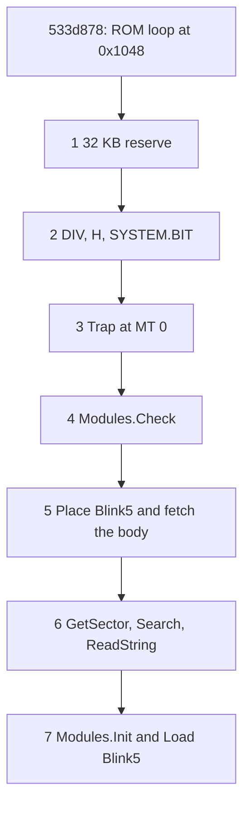
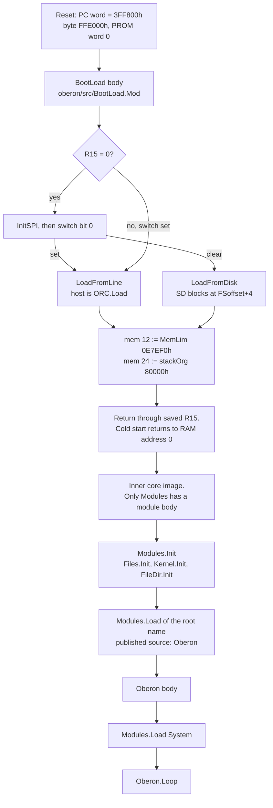
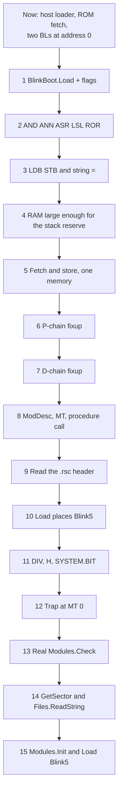

# From the static loader to `Modules.Load` of Blink5

Fifteen steps from today's Blink3 image to unmodified Project Oberon 2013 `Modules.Mod` running on the CPU and loading `Blink5`. This document is the plan. It does not change the CPU, the loader, or a bitstream.

Sources cited below live in [`oberon/src/`](../oberon/src/). Provenance and licence: [`oberon/PROVENANCE.md`](../oberon/PROVENANCE.md), [`oberon/LICENSE.txt`](../oberon/LICENSE.txt). The 2019 `Modules.Mod` on Wirth's page is the text this plan follows. `docs/OberonSources/Modules.Mod` is the 2016 copy (two differences, noted below).

The steady blink stays the Blink3 delay loop: `15N+18` cycles per LED edge at 27 MHz, **3.433 Hz** at `N = 262144` and **6.866 Hz** at `N = 131072`. Prologue checks run once, before that loop. A step that edits the loop publishes a new count from the Verilator trace before the webcam result is trusted.

## Work from this tip

The fifteen step headings under "## The steps" are still the original full bring-up. "## Where we are" is the baseline that plan was written against: Blink3, a ROM vector, and the 64-word aliasing SPRAM. From `533d878` the work is the seven proofs below. The order is those seven. It is not a first step that moves every fetch into DRAM.

What landed is the reduced ladder `docs/hyperram/step1` through `docs/hyperram/step8`, and the same software on the Primer 20K DDR3 ladder. The tip is `533d878`. That tip has a hand-built `Modules.Init` and a hand-built `Load` of Blink5, and an in-memory Files table. Proof 1 replaces that tip's 4 KB reserve. Unmodified Project Oberon 2013 `Modules.Mod`, `Modules.Check`, and the sector path of original steps 11–15 are still ahead. Nothing under `oberon/src` was edited.

Fetch is the instruction pROM. Data loads and stores go to HyperRAM on the Nano 4K and to DDR3 on the Dock. The same numeric address is a different word in those two memories. The files block occupies the low pROM (`0x00C0` through `0x06A4`) while the byte table at `0x600` is data. A store is not a later fetch, except the two cases below.

Reduced step 4 fetches one `BL`. The prologue stores the FixP word `0xF7FFFF3F` at `0x1F00` and the CPU reads that address as an instruction. The ROM at `0x1F00` is the hold `ADD R1, R1, 1`. Every other PC keeps the ROM read.

From step 5 the delay loop stays in the pROM. Ten sites in page `0x10` are overlaid onto the ROM output: `0x100C`, `0x1034`, `0x1054`, `0x1068`, `0x108C`, `0x1094`, `0x10AC`, `0x10B0`, `0x10C0`, `0x10C4`. A general 12-entry table of 32-bit address compares was 5367 logic cells (4720 LUT, 647 ALU) on the GW1NSR-4C. The limit is 4608. That netlist was not loaded.

The hand-built files have a code count of 0 and `fixorgT` of 0, for `AMemoryMappedToggle` and for Blink5. There is no code section to copy and no type chain to walk. `Load` ends at `BT R1` (`0xC7000001`) with R1 = `0x1048`. The next cycle is the ROM delay loop at `0x1048`.

The hand-built `Init` subtracts `8000H`, which is 32 KB. Address 16 reads back `0x0C00` (AllocPtr). Address 20 reads back `0x0020` (root). Address 24 reads back `0xA000` (stack origin). `DEC(limit, 8000H)` leaves `0x2000`. R14 is `0xA000`. The reserve is `0x2000` through `0xA000`. The low end sits above page `0x10`, because a word load from `0x1000` through `0x10FF` returns the pROM. The delay loop's link `STW` lands at `0x9FFC`, from PC `0x104C`. The behavioural model is 40 KB (10240 words), and `0x9FFC` is its last word. The Nano part is the embedded W956x8MKY, 8 MB. R12 is `0x10`. There is no trap at `MT[0]`.

The ALU executes `MOV`, `MHI`, `IOR`, `XOR`, `ADD`, `SUB`, `AND`, `ANN`, `LSL`, `ASR`, `ROR`, and `DIV`, plus `LDW`, `STW`, `LDB`, `STB`, and `MOV` from `H`. `N`, `Z`, `C`, and `V` update. MI is already a condition, from the step-2 prologue. `MUL` is absent.

The in-memory Files table is a two-entry directory at `0x600`. `AMemoryMappedToggle.rsc` is 72 bytes at `0x620`. `Blink5.rsc` is 83 bytes at `0x670`. `Files.Old` here matches a name word. It is not the disk `Old`.

An eight-item remaining list that starts by fetching Blink5 from the external copy is out of order. At this tip the success path is the ROM loop at `0x1048`, not a body that was copied into external memory. A full fetch move first would run the DDR3 eye trainer and the UART from DRAM before training. A fetch before training reads garbage. `SYSTEM.BIT` stays in the DIV prologue, and `Search` stays with `GetSector` and `ReadString`. Those seven are the list. They are not split back into eight.



Each proof is taken in the prove-ladder order. Simulation first: Verilator for the Nano 4K image (`tools/run_verilator_sim.sh`), and Icarus with the Micron `ddr3.v` model (`sim/run_ddr3_cpu_phy.sh`) when the step touches DDR3. The Verilator stand-in does not close that check. Then the Tang Nano 4K. Then the Primer 20K Dock. A step is done only when sim, 4K, and 20K agree. A dark LED is a fail. A step that edits the loop publishes a new count from the trace before the webcam result is trusted.

### Proof 1 — the 32 KB reserve

This is the first proof. The immediate becomes `8000H`. One store lands at each end of that gap, and both words read back. There is no new fetch path. The delay loop stays the pROM loop at `0x1048`.

The behavioural model grows past 8 KB. The chips already have the space. `FileDir.Init`'s `ARRAY 2000 OF DiskAdr` is 8000 bytes, and that frame is the later consumer. The published source subtracts `8000H`. A smaller constant means editing `Modules.Mod`, which these proofs do not do.

Done. The stack origin at address 24 is `0xA000`. `DEC(limit, 8000H)` leaves `0x2000`. The body stores `0xA11A` at `0x2000` and `0xE11D` at `0x9FFC`, and both words read back. The low end is `0x2000` because a word load in page `0x10` returns the pROM word, not the stored mark. The delay loop stays the pROM loop at `0x1048`. Its link `STW` from PC `0x104C` lands on `0x9FFC` and the saved link is `0x1FC4`. The behavioural model is 10240 words. AllocPtr stays `0x0C00`, so the span from AllocPtr to the limit crosses page `0x10`. This proof does not allocate a module block. A later placed body stays off that page.

Verilator of the modules image, `FIRST_VALID` 13, chainFix on:

| N | cycles between edges | first edge |
|---:|---:|---:|
| 5 | 657 | 13207 |
| 6 | 760 | 13310 |
| 8 | 966 | 13516 |

Those edges are 13207, 13864, 14521, then 13310, 14070, 14830, then 13516, 14482, 15448, 16414. The period is still `103*N+142`. The first edge is 87 cycles later than the 4 KB image (13120, 13223, 13429). `--break-dec` holds at `0x1D8C` with R14 still `0xA000` and does not fetch `0x1048`. `--skip-slot 40` reaches the delay loop (PC `0x1074`) and the LED stays dark. `CHAIN_FIX=0` holds with R5 `0xFFFFFFF4` and R9 `8`. `tools/run_verilator_sim.sh` reports six Blink2 edges at a mean of 84 cycles (98, 182, 266, 350, 434, 518). `IMAGE=ddr3modules sim/run_ddr3_cpu_phy.sh` prints `PHY_SCORE pass`: period 3668, first edge 60546, PC `0000101c`, R5 `00000000`, R9 `00000000`, mask `ffffffffff`. That period is still `576*5+788`. The loop was not edited. The full blink stays 0.499982 Hz on the Nano and 0.320373 Hz on the Dock.

`modules_n262144` placed at 23:30 (Europe/Amsterdam). Logic 3845/4608 (84%; 3637 LUT and 208 ALU), CLS 2146/2304 (94%, 158 free), registers 1491/3612, 6/10 BSRAM. Slow corner 1.14 V 85 C on `clkdiv`: 302 setup endpoints, 0 hold, TNS -453.319, worst slack -4.984 ns, Fmax 23.797 MHz against 27.000 MHz. The 27 MHz `clkdiv` constraint is the one already on this image. SRAM load was bus 3 address 081 only. Idcode `0x100981b`, GW1NSR-4C. CRC check success. Device 078 was not loaded.

```bash
openFPGALoader --busdev-num 003:081 -b tangnano4k -m \
  gowin/impl/pnr/modules_n262144.fs
```

Webcam `measure_blink`, `roi=nano4k`, duration 20, warmup 2: `blink-measure/20261106-233300-mcp`, status blinking, edge 0.499 Hz, FFT 0.5 Hz, trusted method edge, confidence 1.0, 661 frames, 29.991 fps, `/dev/video2`. The expected full blink is 0.499982 Hz.

`ddr3modules_n262144` placed at 23:34 (Europe/Amsterdam). 0 setup and 0 hold endpoints. `pclk` Fmax 98.031 MHz against 96.749. Worst listed setup slack is +0.135 ns. `cpu_clk` is 24.187 MHz. SRAM load was bus 3 address 078 only. Idcode `0x81b`, GW2A-18. The Nano 4K was not opened for that load. UART on FTDI channel B, 115200 8N1, reopened after the load. The boot line is `..0080`. The settled lines are `C.` (not held). PC stays in the delay loop (`1074`, `107C`, `1084`, `1088`). Mask `FFFFFFFFFF`, R5 `00000000`, R9 `00000000`. The trained steps on this boot are lane 1 `000C` and lane 0 `0008`. Pattern 0 at the write-level edge and the last pattern-0 read both came back `A55A`. `F` is `AB`. Locked backoff is `C0 00`, `C1 06`, `BO 07`.

```bash
openFPGALoader --busdev-num 003:078 -b tangprimer20k -m \
  gowin/primer20k/impl/pnr/ddr3modules_n262144.fs
```

`measure_blink`, `roi=primer20k`, duration 30, warmup 2: `blink-measure/20261106-233717-mcp`, status blinking, edge 0.321 Hz, FFT 0.312 Hz, trusted method edge, confidence 1.0, 961 frames, 29.973 fps, `/dev/video2`. The expected full blink is 0.320373 Hz. The same clip shows the Nano at 0.499 Hz.

### Proof 2 — `DIV`, `H`, and `SYSTEM.BIT`

`DIV` and `H` are multi-cycle. The circuit is a multi-cycle divider. The prologue is `58 DIV 29 = 2` and `58 MOD 29 = 0`, then `SYSTEM.BIT` of a known word: `LDW`, `ROR` by `bit + 1`, tested with MI. MI is already in the condition unit. This proof does not add one. A failed predicate holds the LED before the delay loop.

Done. `DIV` is one adder and 39 cycles: the issue, two absolute-value cycles, 32 restoring steps, two toward-zero sign cycles, and two floor-adjust cycles when the divisor is positive and the remainder is negative. `Ra` is the quotient and `H` is the remainder. `N` and `Z` follow the quotient. `C` and `V` are left as they were. `MOV Ra, H` is F0 with `u = 1` and op `MOV`. F1 `DIV` is the constant form. `MUL` is still absent.

The prologue runs F1 and F0 `58 DIV 29` (quotient 2, remainder 0), then `-5 DIV 3` (quotient -2, remainder 1), then `SYSTEM.BIT` of bit 0 of the word `1`. That test is `LDW`, `ROR` by 1, and MI. The rotated word is `0x80000000`, so a check of bit 0 of the result would miss. `--break-div` and `--break-bit` hold at `0x1D8C` / `0x1D90` and do not fetch `0x1048`. The delay loop was not edited.

Verilator of the modules image, `FIRST_VALID` 13, chainFix on:

| N | cycles between edges | first edge |
|---:|---:|---:|
| 5 | 657 | 13384 |
| 6 | 760 | 13487 |
| 8 | 966 | 13693 |

Those edges are 13384, 14041, 14698, 15355, then 13487, 14247, 15007, 15767, then 13693, 14659, 15625, 16591. The period is still `103*N+142`. The first edge is 177 cycles later than Proof 1. `tools/run_verilator_sim.sh` reports six Blink2 edges at a mean of 84 cycles (98, 182, 266, 350, 434, 518). `IMAGE=ddr3modules sim/run_ddr3_cpu_phy.sh` prints `PHY_SCORE pass`: period 3668, first edge 61314, PC `0000101c`, R5 `00000000`, R9 `00000000`, mask `ffffffffff`. That period is still `576*5+788`. The first edge is 768 pclk later than Proof 1. The loop was not edited. The full blink stays 0.499982 Hz on the Nano and 0.320373 Hz on the Dock.

`modules_n262144` placed at 00:55 (Europe/Amsterdam). Logic 4363/4608 (95%; 4121 LUT and 242 ALU), CLS 2258/2304 (98%, 46 free), registers 1634/3612, 6/10 BSRAM. Slow corner 1.14 V 85 C on `clkdiv`: 49 setup endpoints, 0 hold, TNS -20.435, worst slack -1.013 ns, Fmax 26.281 MHz against 27.000 MHz. The 27 MHz `clkdiv` constraint is the one already on this image. SRAM load was bus 3 address 081 only. Idcode `0x100981b`, GW1NSR-4C. CRC check success. Device 078 was not loaded.

```bash
openFPGALoader --busdev-num 003:081 -b tangnano4k -m \
  gowin/impl/pnr/modules_n262144.fs
```

Webcam `measure_blink`, `roi=nano4k`, duration 20, warmup 2: `blink-measure/20261107-005818`, status blinking, edge 0.4998 Hz, FFT 0.499 Hz, trusted method edge, confidence 1.0, 661 frames, 29.988 fps, `/dev/video2`. The expected full blink is 0.499982 Hz.

The congestion router placed the Dock image at 00:59 with `pclk` Fmax 96.889 MHz and worst slack +0.015 ns. That bitstream did not train. The boot line stayed `..0080`, `F` was `4B`, and pattern 0 at the write-level edge was `FF5A`. `gowin/primer20k/gowin_ddr3.tcl` now routes for timing (`route_option 1`).

`ddr3modules_n262144` placed at 01:07 (Europe/Amsterdam). Logic 5619/20736 (28%; 5247 LUT and 372 ALU), CLS 3769/10368 (37%), registers 2350/16173, 4/46 BSRAM. 0 setup and 0 hold endpoints. Slow corner 0.95 V 85 C. `pclk` Fmax 100.529 MHz against 96.749. Worst listed setup slack is +0.389 ns. `cpu_clk` Fmax is 44.735 MHz against 24.187 MHz. SRAM load was bus 3 address 078 only. Idcode `0x81b`, GW2A-18. The Nano 4K was not opened for that load. UART on FTDI channel B, 115200 8N1. The boot line is `..0080`. The settled lines are `C.` (not held). PC stays in the delay loop (`106C`, `1074`, `107C`, `1080`, `1084`). Mask `FFFFFFFFFF`, R5 `00000000`, R9 `00000000`. The trained steps on this boot are lane 1 `000C` and lane 0 `0009`. Pattern 0 at the write-level edge is `855A`. The last pattern-0 read is `A55A`. `F` is `AB`. Locked backoff is `C0 00`, `C1 06`, `BO 07`.

```bash
openFPGALoader --busdev-num 003:078 -b tangprimer20k -m \
  gowin/primer20k/impl/pnr/ddr3modules_n262144.fs
```

`measure_blink`, `roi=primer20k`, duration 30, warmup 2: `blink-measure/20261107-011046`, status blinking, edge 0.3202 Hz, FFT 0.312 Hz, trusted method edge, confidence 0.998, 962 frames, 30.006 fps, `/dev/video2`. The expected full blink is 0.320373 Hz.

### Proof 3 — the trap at `MT[0]`

R12 becomes `20H`. `Kernel.Install` writes the branch at `20H`, which is `MT[0]`. The blink image never enters `Trap`. A separate trace runs `ASSERT(FALSE)` and holds the LED. The boards load the blink image.

Done. The branch at `MT[0]` is `E7000203H`, which lands on `Trap` at `0x830`. `Trap` loads the instruction at `R15 - 4`, shifts it right by 4, and keeps the low nibble. Trap 0 is `BT R15`. Any other number branches to the hold at `0x1D8C`. The blink trace does not fetch `0x20` or `0x830`. `--assert-false` fetches `0x20`, arrives at `0x1D8C` with the trap number 7 in `R1`, and stays in that hold. Twenty thousand cycles of that trace have no LED edge. `--trap0` fetches `0x20`, returns, and blinks. The delay loop was not edited.

The first Dock load of this image locked the write-level cliff (lane 1 `0007`, lane 0 `0009`, `C1 01`, `BO 02`). The stored branch came back with its high byte replaced, the install compare failed, and the LED held. Stopping at the first three matches is that cliff when the cliff false-passes. Silicon now keeps the lane-0 row open and locks three matches at or above the write-level edge. The Micron model slips if a normal write lands on its own edge, so the sim path still locks its first three matches. `+eye_decide` is the silicon choice on that model.

Verilator of the modules image, `FIRST_VALID` 13, chainFix on:

| N | cycles between edges | first edge |
|---:|---:|---:|
| 5 | 657 | 13372 |
| 6 | 760 | 13475 |
| 8 | 966 | 13681 |

Those edges are 13372, 14029, 14686, 15343, then 13475, 14235, 14995, 15755, then 13681, 14647, 15613, 16579. The period is still `103*N+142`. The first edge is 12 cycles earlier than Proof 2. `--trap0` at `N = 5` is the same period, with edges 13418, 14075, 14732, 15389. `IMAGE=ddr3modules sim/run_ddr3_cpu_phy.sh` prints `PHY_SCORE pass`: period 3668, first edge 61238, PC `0000101c`, R5 `00000000`, R9 `00000000`, mask `ffffffffff`. That period is still `576*5+788`. The eye on that run is steps 22/23 (`run=16/17`), `rclkpos=1`, `rclksel=3`, at cycle 1984. There is no Micron `ERROR`. `sim/run_ddr3_phy.sh` also prints `PHY_SCORE pass`, and `+eye_decide` locks steps 22/28 (`run=16/1c`) at cycle 4234. The full blink stays 0.499982 Hz on the Nano and 0.320373 Hz on the Dock.

`modules_n262144` placed at 09:57 (Europe/Amsterdam). Logic 4363/4608 (95%; 4121 LUT and 242 ALU), CLS 2258/2304 (98%, 46 free), registers 1634/3612, 6/10 BSRAM. Slow corner 1.14 V 85 C on `clkdiv`: 49 setup endpoints, 0 hold, TNS -20.435, worst slack -1.013 ns, Fmax 26.281 MHz against 27.000 MHz. The 27 MHz `clkdiv` constraint is the one already on this image. SRAM load was bus 3 address 081 only. Idcode `0x100981b`, GW1NSR-4C. CRC check success. Device 078 was not loaded.

```bash
openFPGALoader --busdev-num 003:081 -b tangnano4k -m \
  gowin/impl/pnr/modules_n262144.fs
```

Webcam `measure_blink`, `roi=nano4k`, duration 20, warmup 2: `blink-measure/20261107-100203`, status blinking, edge 0.4989 Hz, FFT 0.499 Hz, trusted method edge, confidence 0.9983, 661 frames, 29.986 fps, `/dev/video2`. The expected full blink is 0.499982 Hz.

`ddr3modules_n262144` placed at 10:03 (Europe/Amsterdam). Logic 5647/20736 (28%; 5249 LUT and 398 ALU), CLS 3880/10368 (38%), registers 2376/16173, 4/46 BSRAM. 0 setup and 0 hold endpoints. Slow corner 0.95 V 85 C. `pclk` Fmax 98.380 MHz against 96.749. Worst listed setup slack is +0.171 ns. `cpu_clk` Fmax is 42.411 MHz against 24.187 MHz. SRAM load was bus 3 address 078 only. Idcode `0x81b`, GW2A-18. The Nano 4K was not opened for that load. UART on FTDI channel B, 115200 8N1, reopened after the load. The boot line is `..0080`. The settled lines are `C.` (not held). PC stays in the delay loop (`106C`, `1074`, `1078`, `107C`, `1080`, `1084`). Mask `FFFFFFFFFF`, R5 `00000000`, R9 `00000000`. The trained steps on this boot are lane 1 `000C` and lane 0 `0009`. Pattern 0 at the write-level edge and the last pattern-0 read both came back `A55A`. `F` is `AB`. Locked backoff is `C0 00`, `C1 06`, `BO 07`.

```bash
openFPGALoader --busdev-num 003:078 -b tangprimer20k -m \
  gowin/primer20k/impl/pnr/ddr3modules_n262144.fs
```

`measure_blink`, `roi=primer20k`, duration 30, warmup 2: `blink-measure/20261107-100819`, status blinking, edge 0.3204 Hz, FFT 0.312 Hz, trusted method edge, confidence 0.9982, 962 frames, 30.006 fps, `/dev/video2`. The expected full blink is 0.320373 Hz.

### Proof 4 — compiled `Modules.Check` on the ROM loop

Norebo compiles unmodified `Kernel`, `FileDir`, `Files`, and `Modules` in one session. The device runs real `Modules.Check("Blink5")` and real `Modules.Check("9bad")`. The first returns `res = 0`. The second returns `res = 1`. Those words replace the hand-built Modules encodings. The delay loop is still the ROM loop. `Check` does not need `DIV` or the trap, and it comes after both. The tail stays 40 checks. The 44-check netlist stays unloaded.

### Proof 5 — place Blink5 and fetch that body

This is the hard step, and it is the missing piece of original step 10. It is one placed body, not a move of every fetch. The image copies Blink5 into external memory, walks one real type-chain entry, and fetches that placed body. Reset, training, and the loader stay in the pROM. The body has its own addresses. It does not land on the data table. A fetch before training reads garbage.

The Nano is the harder board. `modules_n262144` placed for Proof 2 has worst slack -1.013 ns on `clkdiv`, CLS 2258/2304 (98%, 46 free), and the slow corner misses 27 MHz (Fmax 26.281 MHz). HyperRAM will not start a command more often than every 15 clocks. Paying that on every instruction of the placed delay loop, on top of `103*N+142`, pushes `N = 262144` near the webcam floor of 0.2 Hz. The Dock has timing room (`pclk` Fmax 100.5 MHz against 96.7, zero violated endpoints). The Dock rate `576*N+788` moves once the body is fetched from DDR3. The new count is the trace's count.

### Proof 6 — one sector step

`GetSector`, `Search`, and `ReadString` land together. Directory sector 29 holds `AMemoryMappedToggle` and Blink5. That page replaces the in-memory two-entry table at `0x600`. Sector numbers stay multiples of 29. The SPI window is the negative addresses, data `-48` and control `-44`. There is no card. The window stays off the Dock UART and off the training path. Splitting `Search` back out is optional once `GetSector` returns a page.

### Proof 7 — real `Modules.Init` and `Modules.Load("Blink5")`

This is last. It is the first proof that uses the reserve, the trap, the compiled module, and the sector reader together. Reset enters the real `Modules` body. The image copies the one string `Oberon` to `Blink5`. `oberon/src/Modules.Mod` stays unmodified. `Files.Init` runs real `Kernel.Init` and `FileDir.Init` once, before any load of Blink5. `Kernel.Init` installs the trap over `MT[0]`. `FileDir.Init` heapsorts the two sector numbers. `Init` subtracts `8000H` again. Addresses 12, 16, 20, and 24 hold `MemLim`, `AllocPtr`, `root`, and the stack origin. `Load` reads the file through real `Files`. Blink5 does not return, so `LED(res)` stays unreached. On the Nano this is feasible only if the netlist stays inside the current check width and the blink stays above the webcam floor.


## Where we are

Blink3 is `tests/LightToggle.Mod` importing `tests/AMemoryMappedToggle.Mod`, compiled by the pinned Norebo ORP (`tools/norebo.pin`). `tools/module_loader.py` is a host-side reading of `Modules.Load`: it walks imports, assigns `mod.num`, and runs the P, D, and T fixup chains in `tools/rsc_parser.py`. It does not build a `ModDesc`, does not call a module body, and does not read files on the device.

The image the FPGA runs is different from a PO memory:

- Code sits in a ROM vector. Fetch does not see stores. `MemoryController` is a separate 64-word SPRAM (`addr[7:2]` then `ad[5:0]`), so data addresses alias every 256 bytes.
- Reset PC is `0x80` (`CPUSubset0`, `RegInit`). The eight setup words there plant `R12 = 0x10`, `MT[1] = 0x50`, `MT[2] = 0x70`, `R14 = 0x80`, then branch to address 0. The Python loader's data bases (`0x8000` upward) are not the addresses the CPU uses.
- Address 0 is two `BL`s (`sim/imem_layout.py`, `blink3_startup_trampoline`): AMMT's body (`light := 0` at `0x50`), then LightToggle's body. That pair is the stand-in for `Load`'s `body` call.
- `io.led` is bit 0 of a store to `0x10` or `0x50`. PO's `LED` writes address `-60`.

Instructions the core actually executes today: `MOV` / `MHI`, `IOR`, `XOR`, `ADD`, `SUB`, `LDW`, `STW`, `B` / `BL` with a word offset, branch-to-register, conditions EQ, NE, LT, always, and never. `N` and `Z` update on a register write. `C` and `V` exist and stay 0, so LT behaves as "negative". Not implemented, and present in real Oberon output: sign-extended F1 immediates (`v = 1`), AND, ANN, LSL, ASR, ROR, MUL, DIV, `MOV Rd, H`, LDB, STB, the remaining conditions, and a store that a later fetch sees.

`ORG` (the 2018 file in `oberon/src/ORG.Mod`) turns the operators `Modules.Load` uses into a smaller set than the full ISA. `DIV` / `MOD` by a constant power of two become ASR, AND, LSL, and ROR. `x * 4` becomes a shift. Non-power-of-two `DIV` / `MOD` (Kernel's `DIV 29`, `MOD 29`) become the DIV instruction plus `MOV Rd, H`. String `=` is LDB. `SYSTEM.BIT` is LDW plus ROR, tested with MI. `NEW` and `ASSERT` are traps, not calls.

## Where the real boot comes from

PO2013 has three stages. The first is in the FPGA PROM. The second is a prelinked image of the inner core. The third is `Modules.Load`, which is the first load that reads a file.



### Stage 0 — `BootLoad` in the PROM

`oberon/src/verilog/RISC5.v` sets `StartAdr = 22'h3FF800`. The PC is a word address, so reset fetches byte `0xFFE000`. `RISC5Top.v` drives `codebus` from `PROM` when `adr[23:14] = 10'h3FF` (the top 16 KB of the 24-bit space). `PROM.v` is 512 words from `prom.mem`, indexed by `adr[10:2]`. At `0xFFE000` that index is 0, so the first PROM word is the first instruction of `BootLoad`.

The operative module is the first one in `oberon/src/BootLoad.Mod` (`NW 20.10.2013 / PR 4.2.2014`, boot from SDHC or the line). The same file also contains an older line-only `BootLoad` and three PROM test modules (`Counter`, `Shifter`, `TestInt`). Those are not the boot path.

On entry the body sets `R14` (`SP`) to `stackOrg = 80000H` and `R12` (`MT`) to `MTOrg = 20H`. Cold start is `R15 = 0` (reset leaves the link register clear; the prologue saved it). It lights `LED(80H)`, runs `InitSPI`, then:

- switch bit 0 set: `LoadFromLine`
- switch bit 0 clear: `LoadFromDisk`

`LoadFromDisk` reads SD block `FSoffset + 4` (`FSoffset = 80000H`, the Kernel comment's "256 MB in 512-byte blocks") into address 0, reads the word at address 16 as the image length in bytes, and reads further 512-byte blocks until that length is covered. `LoadFromLine` is the matching receiver for `ORC.Load` (`oberon/src/ORC.Mod`): a length, an address, the words, a zero length. `PCLink1.Mod` is the later file-transfer task inside a running system, not the boot receiver.

The body then stores `MemLim` (`0E7EF0H`) at address 12 and `stackOrg` at address 24, and returns through the saved link. A cold start therefore jumps to RAM address 0, which the load just filled. Addresses 16 and 20 are left as the image planted them.

I/O is the top 64 bytes (`RISC5Top.v`, `adr[23:6] = 18'h3FFFF`). The constants in `BootLoad` and `Kernel` match that decode: timer `-64`, LED and switches `-60`, RS232 data `-56`, RS232 status `-52`, SPI data `-48`, SPI control `-44`.

### Stage 1 — the inner core, already linked

`Kernel`, `FileDir`, `Files`, and `Modules` are the inner core (`projectoberon.net` calls them that). `Kernel`, `FileDir`, and `Files` have procedures and no module body. `Modules` is the only one whose body runs:

```oberon
BEGIN Init; Load("Oberon", M);
  LED(res); REPEAT UNTIL FALSE  (*only if load fails*)
END Modules.
```

`Init` calls `Files.Init`, which calls `Kernel.Init` and `FileDir.Init`. It then reads the contract `BootLoad` and the image left behind:

| Address | Who writes it | Who reads it |
|---|---|---|
| 12 | `BootLoad` stores `MemLim` | `Kernel.Init` → `MemLim`, used as `heapLim` |
| 16 | the boot image (also the byte length `LoadFromDisk` used) | `Modules.Init` → `AllocPtr` |
| 20 | the boot image | `Modules.Init` → `root` |
| 24 | `BootLoad` stores `stackOrg` (`80000H`) | `Kernel.Init` → `heapOrg`; `Modules.Init` → `limit`, then `DEC(limit, 8000H)` |

`DEC(limit, 8000H)` is unconditional. The 32 KB under the stack origin are the stack, growing down from `R14`. Module blocks are allocated from `AllocPtr` up to that limit. The heap starts at the stack origin and grows up to `MemLim`. `8000H` is in the source, so a smaller stack reserve means editing `Modules.Mod`, which these steps do not do. The final image needs that 32 KB of address space plus the inner core, `Blink5`, and a few 1 KB sectors. Budget on the order of 64–96 KB, confirmed by the size of the real `.rsc` files at step 13.

`Kernel.Init` plants a branch at address `20H` with `Install`:

```oberon
SYSTEM.PUT(at, 0E7000000H + (Padr - at) DIV 4 - 1)
```

`MTOrg` is `R12`, which `BootLoad` set to `20H`, so that word is `MT[0]`. `ORG.New` and `ORG.Assert` emit a trap: branch-and-link to `R12`, whose value is `20H`, with the trap number in the instruction. `Kernel.Trap` reads it back from `R15 - 4`. Trap 0 is `NEW`. Any other trap number stops in `LED` plus a tight loop. `System`'s body later replaces both that vector and address 0.

Module numbers of the inner core are assigned by the link that built the image. `Load` itself only numbers modules it allocates, as `root.num + 1`, and inserts them at the head of the list. `MT[0]` stays the trap. `SYSTEM.PUT(mod.num * 4 + MTOrg, data)` is how a new module publishes its static base.

There is no linker in the published sources. `Tools.Mod` opens viewers and dumps sectors. The boot file `ORC.Load` sends (`F.bin`: length, address, words) and the SD image are built results. `tools/module_loader.py` is the stand-in this repo already has. Step 15 extends that stand-in so the image satisfies the table above. These 15 steps do not put `BootLoad` in a PROM and do not bit-bang a physical card. They start the CPU in the state `BootLoad` returns into.

### Stage 2 — `Modules.Load`, then Oberon, then System

`Load` (`oberon/src/Modules.Mod`) searches `root` by name. On a miss it reads `name.rsc` through `Files`, recursively `Load`s each import, checks keys, allocates a `ModDesc` (`DescSize = 80`) from `AllocPtr` aligned up by `(p + size + 100H) DIV 20H * 20H`, copies type descriptors, zeroes variables, copies strings and code, builds the import, command, entry, and pointer tables, checks the trailing `"O"`, walks the P, D, and T chains, and calls `body`.

The comment above `Load` does not match the body. The assignments the body actually makes:

| `res` | Cause in the 2019 body |
|---|---|
| 0 | `error(0, name)` at entry; left alone on success or when the module was already loaded |
| 1 | `Check` rejected the name, or `Files.Old` returned NIL |
| 2 | version byte ≠ `versionkey` (`1X`) |
| 3 | an import's key does not match |
| 4 | the byte after the entry word is not `"O"` |
| 7 | `AllocPtr + size >= limit` |
| 5 | `ThisCommand` did not find the name (`Free` uses 1 when `refcnt # 0`) |

The 2019 body, which is the one in `oberon/src`, starts with `error(0, name)` and rolls import refcounts back when `res >= 3`. The 2016 text only rolls back `res = 3` and starts with `res := 0`.

`Load("Oberon")` is the first dynamic load. Oberon's body (`oberon/src/Oberon.Mod`) opens the display and the log, installs the garbage-collect task, then:

```oberon
Modules.Load("System", Mod); Mod := NIL; Loop
```

`System` (`oberon/src/System.Mod`) is the command toolbox. Its body opens the log viewer and installs `System.Trap` / `System.Abort` over Kernel's vectors. A command `M.P` reaches `Load` again through `Oberon.Call` and `ThisCommand`. `Blink.Mod` is the published blink: an `Oberon.Task` that calls `LED` every 500 ms, started by the command `Blink.Run`. It needs the outer core and `LED(-60)`.

`Blink5` is the payload these steps load instead. It is the same delay loop as `LightToggle` (store of `light`, snoop on bit 0), compiled as its own module, with no task and no `LED` call. The published `Modules` body loads `"Oberon"`, which pulls `Display`, `Viewers`, `Input`, `Fonts`, `Texts`, and then `System`, and enters `Loop`. Step 15 keeps that instruction stream and changes the one string constant in the loaded image from `Oberon` to `Blink5` (both 6 characters plus a NUL; the name occurs once in `Modules.Mod`). `oberon/src/Modules.Mod` stays byte-identical to Wirth's file. `Blink5`'s body does not return, so `LED(res)` after `Load` runs only when the load fails, which is the comment in the source.

## What has to be true on every step

**Blink.** The delay loop is still LightToggle's until step 10, and Blink5's from step 10 on, with the same `N`. The LED is bit 0 of `light`. Through step 9 the snoop addresses stay `0x10` and `0x50`. From step 10 the host prints the absolute address of `AMemoryMappedToggle.light` next to the image, and the bitstream's comparator uses that constant, OR'd with the old snoops so an older image still blinks.

**Failed checks do not blink.** Each prologue predicate has to be true before the delay loop starts. A wrong fixup, a bad key, or a trap takes the tight loop and the LED holds. The webcam is then a stuck trace, which is a failure, not a slow blink.

**Visualizer.** `tools/run_visualizer.sh` serves `127.0.0.1:8765` (the Bee process; the Mac reaches it with `ssh -N -L 8765:127.0.0.1:8765 bee`). Each step adds a trace `sim/visualizer/traces/sNN.json` and a program listing, selected with `/?p=sNN`. Stepping stays one retired instruction. The trace has to show the new opcode or the new store, and at least two LED edges at the predicted spacing. Regenerate with `make -C sim traces` extended for that image. If port 8765 is already the `~/fpga/blinky-vis` worktree, restart it from the tree that contains the new trace. Do not start a second server.

**Device.** SRAM only: `tools/sram_load.sh` (it passes `-m` and refuses `-f`). On Bee, the Dock: `BOARD=primer20k tools/gowin_build.sh` then `tools/sram_load.sh -b tangprimer20k <file.fs>`. The Nano 4K stays on the Pi and is loaded there with `-b tangnano4k`. Do not load the 4K from Bee. Then `tools/measure_blink.sh --roi primer20k` and `--roi nano4k`. Both boards blink at the predicted rate. This plan does not itself load a bitstream.

**Compiler.** `.rsc` files come from the pinned Norebo ORP, the same one that builds Blink3. `oberon/src/ORG.Mod` is the 2018 generator used to predict instructions. If a Norebo object file disagrees with that prediction, the object file wins and the step's trace is the record.

## The steps



### Step 1 — `BlinkBoot.Load` is the entry

**Changes.** Add `tests/BlinkBoot.Mod`. Its body is the program the setup branch reaches. The address-0 trampoline becomes one `BL` to that body. `PROCEDURE Load*(name: ARRAY OF CHAR)` calls `LightToggle.Run`. Move LightToggle's delay loop into exported `Run`, and call `Run` from LightToggle's body as well, so the old entry still blinks. Before `Run`, the body calls an exported `AMemoryMappedToggle.Reset` that does `light := 0`, which is what AMMT's body does today.

In the same image, a prologue implements the rest of the signed conditions, real `C` / `V`, and sign-extended immediates. `WHILE i < 4 DO INC(i) END` is the shape `ORG.CFJump` compiles with relation LT (`relmap[2] = 5`) and a branch on `negated(LT)`, which is GE (condition 13). `k := -1` is an F1 `MOV` with `v = 1` (`ORG.Put1`), the sign-extend the core does not do today. A third predicate uses variables, so it is not folded: `a := -2000000000; b := 2000000000; IF a < b`. Those literals do not fit a 16-bit immediate, so `ORG` emits `MHI` (already implemented) and a register `SUB`. The 32-bit result is positive (`294967296`) and `V` is 1 under the `RISC5.v` formula `(sa & ~sb & sc) | (~sa & sb & ~sc)`, so LT (`N xor V`) is true only when `V` works. The delay loop is unchanged, so the steady rate is unchanged.

**Files / procedures.** `tests/BlinkBoot.Mod` body and `Load`. `tests/LightToggle.Mod` `Run`. `tests/AMemoryMappedToggle.Mod` `Reset`. `sim/imem_layout.py` trampoline. `src/main/scala/gcd/CPUSubset0.scala` condition decode, F1 sign-extension, and the `C` / `V` assignments on `ADD` / `SUB` (the formulas in `oberon/src/verilog/RISC5.v` around `cx` and `vv`).

**Newly exercised.** Condition GE. `C` and `V` updated by `ADD` and `SUB`. Sign-extended F1 immediates (`k := -1`). One extra module body and one exported call on top of the `BL` the trampoline already uses.

**Risks.** GE decoded with a stuck `V` makes the overflow predicate fail and the LED holds. The condition field in the object word has to be checked before the step is called done; if this Norebo lays the `WHILE` out with a different condition, change the prologue until a condition outside {EQ, NE, LT, always, never} is actually fetched. The steady loop's cycle count has to stay `15N+18`.

**Visualizer.** `/?p=s01`. The trace shows one `BL` from address 0 into `BlinkBoot`, a GE branch in the prologue, `R` holding `-1` after the sign-extended `MOV`, the overflow compare taking the true path, then the same Toggle `BL` and LED edges as Blink3.

**Device.** SRAM-load both boards as in "What has to be true". Webcam: 3.433 Hz at `N = 262144` on the Dock and on the 4K. A dark or solid LED is a failed prologue.

### Step 2 — the fixup field extractors

**Changes.** `BlinkBoot` gains a procedure whose body is the arithmetic in the P-chain (`Modules.Mod` lines 138–140), run once on the known Toggle placeholder before the delay loop. The extracted `mno`, `pno`, and `disp` have to equal the values `tools/rsc_parser.py` already prints for that instruction. ANN is covered by a set subtraction of two variables (`s := {0, 1, 2, 3}; t := {1}; s := s - t`). Two constant sets would be folded in `ORG.SetOp` and would not emit ANN.

**Files / procedures.** `tests/BlinkBoot.Mod`, new procedure `Fields`. `CPUSubset0.scala` ALU ops 1–5 (LSL, ASR, ROR, AND, ANN) in F0 and F1. `ORG.DivOp` and `ORG.MulOp` are the compilers of constant power-of-two `DIV`, `MOD`, and `*`.

**Newly exercised.** AND, ANN, LSL, ASR, ROR. For `inst DIV 100000H MOD 10H` the compiler emits ASR 20 then AND 15. For `MOD 1000000H` (`2^24`, shift wider than 16) it emits LSL then ROR.

**Risks.** A shift that ignores the F1 `u`/`v` bits will extract a nonzero `disp` and the prologue will refuse to enter `Run`. ANN with the operand order swapped fails the set check the same way. None of this is inside the delay loop.

**Visualizer.** `/?p=s02`. The listing marks the ASR / AND / LSL / ROR / ANN words. The trace reaches `Run` only after those results match. LED edges follow.

**Device.** Same SRAM load and the same 3.433 Hz measurement on both boards.

### Step 3 — bytes and string equality

**Changes.** `Load` compares `name` with the string `"LightToggle"` and copies it into a 32-byte buffer. A mismatch does not call `Run`. The call site passes that literal, so a correct compare is the one that blinks.

**Files / procedures.** `BlinkBoot.Load`. `ORG.StringRelation` (LDB, ADD 1, CMP, BC NE) and the string-parameter path `ORG.StringParam`. `CPUSubset0.scala` byte load and byte store: `v = 1` on an F2 instruction. Byte lanes follow `RISC5.v` (`ben`, `inbus1`, `outbus`): the selected byte is the one `adr[1:0]` names, and a byte store leaves the other three bytes of the word alone.

**Newly exercised.** LDB and STB. String `=` as a loop, which `Modules.Load` uses for every module name and every import name.

**Risks.** A swapped byte lane makes the compare fail and the LED holds. STB that writes a whole word corrupts the adjacent characters; the visualizer's memory view of the 32-byte buffer is the check. The data RAM is still 64 words, so the buffer has to sit in the existing `0x50` / `0x70` variable blocks without colliding with `light`.

**Visualizer.** `/?p=s03`. Stepping through the compare shows LDB of `'L'`, `'i'`, … and a final EQ. The buffer contains the same bytes. LED edges follow.

**Device.** Same 3.433 Hz on both boards. A stuck LED means the bytes did not compare.

### Step 4 — a data memory that can hold the stack reserve

**Changes.** Replace the 64-word aliasing SPRAM with a RAM whose addresses are distinct across the range step 15 will need: the inner-core image, module blocks, the 32 KB stack reserve implied by `DEC(limit, 8000H)`, a small heap, and a few 1 KB sectors. Early steps only touch the low part. `R14` moves off `0x80` to the high end of that reserve and grows down. `Load` keeps its locals there (`mno`, `disp`, the name buffer). `light` stays at `0x50` so the snoop does not move.

This is the hardware step. Blink3's PNR is 2 BSRAM and 59% of the LUT budget on the GW1NSR-4C, and 1 BSRAM and 12% on the GW2A-18C Dock. A store of this size does not fit in those BSRAM blocks on the 4K. The 4K mapping uses the embedded PSRAM on the GW1NSR-4C; the byte count comes from that part's datasheet, checked while the step is built. The Dock uses BSRAM if PNR fits, and the Dock SDRAM if it does not. Fetch is still the ROM in this step.

**Files / procedures.** `src/main/scala/gcd/MemoryController.scala`, `GowinSP.scala`, and the board wrappers `gowin/blinky_top.v` and `gowin/primer20k/blink3_top.v`. `BlinkBoot.Load` locals. The setup words that load `R14`.

**Newly exercised.** No new opcode. New memory behaviour: a store to `R14` does not alias `light`, and a stack slot above address 256 is a different word from address 0. `LDW` / `STW` of locals are the traffic.

**Risks.** PSRAM on the 4K is the risk that can stop every later step. Bring it up here, while the program is still Blink3's loop, so a timing failure shows up as a wrong blink rate rather than as a bad fixup. Wait states change the `15N+18` assumption; if the measured rate drops, the trace's cycle count is the new prediction and both boards are remeasured against it. Do not shrink `8000H` to make the image fit.

**Visualizer.** `/?p=s04`. The trace shows `R14` decreasing from the new stack origin, locals at those addresses, and `light` stores still at `0x50`. LED edges at the (possibly updated) prediction.

**Device.** PNR report recorded for both parts, showing where the RAM went. SRAM-load both boards. Webcam matches the prediction on both. The 4K image still blinks; it is not left on the previous bitstream.

### Step 5 — one memory for fetch and store

**Changes.** Instruction fetch reads the RAM step 4 added. The host image is the initial contents. One store, executed once before the delay loop, patches the Toggle `BL` from the compiler's placeholder to the relocatable `0F7xxxxxx` form `FixP` would write for that single instruction. The following fetch of that address executes the patched word. The host still fixes every other instruction.

**Files / procedures.** `CPUSubset0.scala` fetch path. `BlinkBoot`, one `SYSTEM.PUT` of the patched `BL`, then the call. `Modules.Mod` lines 143–144 are the formula for that word.

**Newly exercised.** A store whose address is later the PC. That is the hardware `Load` needs for every fixup. Branch-to-register and `BL` are already in the core; the new fact is that the fetched word is the stored word.

**Risks.** A split bus that still fetches from the ROM will execute the placeholder and the call will not reach `Toggle`. The visualizer has to show the word change and the later fetch of the new word, not only the store. Self-modifying code on the 4K PSRAM has to be visible to the fetch port in the same order the trace shows.

**Visualizer.** `/?p=s05`. At the patch address the listing shows the before and after words. The PC visits that address after the store. LED edges follow.

**Device.** Same prediction, both boards, SRAM only. A stuck LED means the fetched `BL` was not the stored `BL`.

### Step 6 — the P-chain

**Changes.** The host stops rewriting `fixorgP`. `BlinkBoot.FixP` is the loop at `Modules.Mod` lines 134–146, including the walk `adr := adr - disp*4`. Anchors (`code`, `fixorgP`, the import descriptors, the entry table) are still constants the host plants. After `FixP`, the Toggle `BL` is the patched form and `Run` blinks. The single planted patch from step 5 goes away.

**Files / procedures.** `tests/BlinkBoot.Mod` `FixP`. `tools/module_loader.py` gains a switch to leave the P chain raw; `tools/rsc_parser.py` `fixup_bl` is what the device now does. `sim/build_blink3_imem.py` uses that switch.

**Newly exercised.** The backward chain walk and `SYSTEM.GET` / `SYSTEM.PUT` on a list of instructions, not one hard-coded address. The arithmetic is the step 2 set, now fed by words loaded from the code image.

**Risks.** An off-by-one on `(dest - adr - 4) DIV 4` produces a `BL` that returns to the wrong place; `R15` then misses the delay loop and the LED holds. The chain terminator is `adr = mod.code`, not a zero word. Patching the terminator loops forever, which the visualizer shows as a PC that never enters `Run`.

**Visualizer.** `/?p=s06`. Several code words (every imported `BL`, not only Toggle) change between the start of `FixP` and the call. The final Toggle word matches the step 5 formula. LED edges follow.

**Device.** Same prediction, both boards. Stuck LED means a `BL` was left as a placeholder or was given the wrong offset.

### Step 7 — the D-chain, including an import

**Changes.** The host stops rewriting `fixorgD`. `FixD` is `Modules.Mod` lines 147–164. LightToggle reads `MMT.light` once in the prologue (`IF MMT.light >= 0 THEN`), which is the import arm: two instructions, the second carrying `vno`, and the `ODD(inst DIV 100H)` test that decides whether the entry is code-relative. The global arm is the `LDW SB, [R12, mod.num*4]` that every module body already depends on. `MT` in that formula is register 12, the constant in `Modules.Mod`, not the address.

**Files / procedures.** `BlinkBoot.FixD`. `LightToggle` prologue. `rsc_parser.fixup_ldr_str_add` becomes the thing the device does. `ORG.GetSB` is what emitted the placeholder.

**Newly exercised.** The import form of the D fixup. `ODD` is AND 1 (`ORG.Odd`). The global form rewrites an instruction the very next procedure prologue fetches as `R13`.

**Risks.** A wrong static base stores `light` somewhere other than the snoop and the LED holds even though the loop is running. The trace has to show the store address, not only that the PC is in the loop. The import arm writes `adr` and `adr+4`; fixing only the first word leaves `R13` right and the displacement wrong.

**Visualizer.** `/?p=s07`. The D-list words change. The first use of `MMT.light` loads from `0x50`. LED edges follow from stores to `0x50`.

**Device.** Same prediction, both boards. Confirm with the webcam, and keep the snoop on `0x50`.

### Step 8 — descriptors, the module table, a procedure-variable call

**Changes.** `BlinkBoot` builds a `ModDesc` for AMMT and for LightToggle in the shape of `Modules.ModDesc` (`name`, `next`, `key`, `num`, `size`, `refcnt`, `data`, `code`, `imp`, `cmd`, `ent`, `ptr`). It links them from `root` and writes each static base with `SYSTEM.PUT(num * 4 + MTOrg, data)`. The setup ROM stops planting `MT[1]` and `MT[2]`; it still loads `R12` and `R14`, which is the pair `BootLoad` leaves in those registers. The body call becomes `body := SYSTEM.VAL(Command, code + entry); body`, the call at `Modules.Mod` line 180.

**Files / procedures.** `BlinkBoot` `Allocate` and the call. `ORG.Call` for a non-constant procedure (BL through a register). `Modules.Mod` lines 83–100 and 130.

**Newly exercised.** A `BL` whose target register holds a computed address (`mod.code + entry`), with `R15` returning to the next statement in `BlinkBoot`. A flag store after the call is what proves the return happened; AMMT's body returns, LightToggle's `Run` does not, so the flag is written for AMMT only. Record-field stores into the descriptor.

**Risks.** `MT[0]` is left alone (it becomes the trap in step 12). Numbering from 0 would overwrite it. `DescSize = 80` has to match the record the compiler lays out; if Norebo's record layout disagrees with 80, the step stops and the layout is measured from the `.rsc` rather than forced. The procedure-variable call with a zero address is a jump to 0, which re-enters the trampoline and looks like a reset.

**Visualizer.** `/?p=s08`. The trace shows the `STW` into the module table, the `BL` through the register, AMMT's body, the return flag, then `Run` and the LED edges.

**Device.** Same prediction, both boards. The snoop address is still `0x50` because this step still chooses the data bases.

### Step 9 — read an `.rsc` header

**Changes.** A byte array in the image holds the raw `LightToggle.rsc` (and, beside it, `AMemoryMappedToggle.rsc`). `Read`, `ReadInt`, and `ReadString` follow `Files` (`oberon/src/Files.Mod` `ReadByte`, `ReadInt`, `ReadString`): little-endian, `ReadInt` as four bytes combined with `* 100H`, which `ORG` compiles as LSL 8. `Load` parses the name, the key, the version byte, and the size. The delay loop runs only when the name is `LightToggle`, the version is `1X`, and the key matches the resident module. The code that runs is still the host-placed image.

**Files / procedures.** `BlinkBoot.Read`, `ReadInt`, `ReadString`, `ParseHeader`. The array is produced by the existing `tools/process_mod_files.sh` output. `docs/rsc_format_specification.txt` is the section order.

**Newly exercised.** A multi-byte integer assembled from LDB. The version check is a single-byte compare against `1X`. No new arithmetic beyond step 2 and step 3; the new code is the reader.

**Risks.** A big-endian `ReadInt` fails the key check and the LED holds. The `.rsc` embedded in the image has to be the unfixed file `process_mod_files.sh` writes before the host fixup, or the header key will not match the resident module.

**Visualizer.** `/?p=s09`. The trace shows four LDB/LSL steps building the key, the version byte equal to 1, and then the call into `Run`. LED edges follow.

**Device.** Same prediction, both boards.

### Step 10 — `Load` places Blink5 and calls it

**Changes.** Add `tests/Blink5.Mod`, the LightToggle delay loop as its own module, importing `AMemoryMappedToggle`. `BlinkBoot.Load("Blink5")` is now the whole placement `Modules.Load` does for one module and its imports: recursive load of AMMT, allocate from an `AllocPtr` bump with the `20H` alignment, copy type descriptors, zero the variable space, copy strings and code into the RAM, run `FixP`, `FixD`, and the T-chain (`Modules.Mod` lines 165–179), then call the body. The host no longer links these two `.rsc` files. `BlinkBoot` remains the resident entry.

`Blink5` declares a record and a global of that record so the T-chain has something to walk. If the compiler emits `fixorgT = 0` for that, add a second module that exports the record and have `Blink5` import the type. The step is done when the trace shows the T loop iterate once. A zero-length chain is a compiler fact to record, not a loop to invent.

The absolute address of `light` is no longer `0x50`. The image builder prints it, and the LED comparator uses it, OR'd with `0x10` and `0x50`.

**Files / procedures.** `tests/Blink5.Mod`. `BlinkBoot.Load` grows the copy loops from `Modules.Mod` lines 96–133 and the T loop. `tools/module_loader.py` stops being on the path for these two modules.

**Newly exercised.** Recursive `Load` (AMMT under Blink5) using the real stack. Zeroing a variable area with `STW` of 0. The T-chain's data-section rewrite (`adr` walks `mod.data`, not `mod.code`). A body call whose address came from the entry word of the file (`Files.ReadInt` of `w`, then `SYSTEM.VAL`).

**Risks.** The largest functional step. A wrong `AllocPtr` alignment collides the descriptor with the code. Forgetting to zero variables leaves `light` nonzero and the first edge inverted; the rate is still right, so the visualizer's first store has to be 0 before the loop. The LED comparator has to be rebuilt with the printed address or the board will run the loop in silence. The 16-import array in `Load` is enough (Blink5 imports one module).

**Visualizer.** `/?p=s10`. The trace shows `Load("Blink5")` calling `Load` for AMMT, the T-chain store, AMMT's body, Blink5's body, and LED edges at `15N+18`. The store address of `light` equals the printed constant.

**Device.** Rebuild so the comparator constant matches the image. SRAM-load both boards. Webcam 3.433 Hz at `N = 262144`. A stuck LED with a live PC in the delay loop is the snoop address, not the loop.

### Step 11 — division, `H`, and `SYSTEM.BIT`

**Changes.** A prologue predicate `58 DIV 29 = 2` and `58 MOD 29 = 0`, plus `SYSTEM.BIT` of a known word. Failure does not enter the delay loop. `29` is the divisor `Kernel.GetSector` and `Kernel.AllocSector` use, and sector numbers in the file system are multiples of 29 (`DirRootAdr = 29`).

**Files / procedures.** `BlinkBoot` prologue. `CPUSubset0.scala`: DIV (F0 and F1), the `H` register, and `MOV Rd, H` (F0, `u = 1`, op `MOV`), which is `ORG.H` and the `MOD` arm of `ORG.DivOp`. `SYSTEM.BIT` is `ORG.Bit`: LDW, ROR by `bit + 1`, condition MI. MI is new in the condition unit.

**Newly exercised.** DIV, `H`, `MOV` from `H`, condition MI. MUL can share the implementation if that is simpler, and a single `3 * 5 = 15` in the same prologue exercises it; `Modules.Load` itself does not need MUL (its multipliers are powers of two). `Kernel.AllocSector`'s `s * 29` does.

**Risks.** `MOD` that returns the quotient instead of `H` fails the predicate and the LED holds. MI implemented as "bit set in the result" rather than "sign after the rotate" fails `SYSTEM.BIT` of bit 0. Divide-by-zero is out of scope; both divisors are constants.

**Visualizer.** `/?p=s11`. The trace shows DIV, then `MOV` from `H`, then a taken MI branch, then the Blink5 loop and LED edges.

**Device.** Same 3.433 Hz on both boards.

### Step 12 — the trap at `MT[0]`

**Changes.** `R12` becomes `20H`, matching `BootLoad`'s `MTOrg`. `Kernel.Install`'s encoding is written at address `20H`: an unconditional branch (`0E7000000H` plus the word offset) to a `Trap` procedure with `Kernel.Trap`'s decode (`R15`, load the instruction at `R15 - 4`, trap number in `DIV 10H MOD 10H`). The blink image never traps. A second trace executes `ASSERT(FALSE)` (`ORG.Assert`, trap 7) and ends in the tight loop with the LED held. `NEW` (trap 0) is not on the blink path; `Load` allocates descriptors with `SYSTEM.VAL`, not `NEW`.

**Files / procedures.** `BlinkBoot.Trap`, `Install`. `oberon/src/Kernel.Mod` `Install` and `Trap`. `ORG.Trap` for the encoding (branch-and-link to register `R12`).

**Newly exercised.** `BL` to `R12` where `R12` holds `20H`, so the PC lands on the planted branch. Reading the trap number out of the instruction word. Returning from trap 0 is implemented even though the blink image does not take it, so a later `NEW` has a place to land; the second trace does not need to call `NEW`.

**Risks.** Using `R12` both as the module-table base and as the trap target only works because the branch is stored at `[R12]` and the link value is the address `20H`. A `BL` that jumps to the contents of a module-table slot instead of to `20H` will execute a data address. The blink trace must show zero visits to `Trap`.

**Visualizer.** `/?p=s12` blinks and never enters `Trap`. `/?p=s12trap` enters `Trap` with number 7 and holds the LED. The planted word at `0x20` disassembles as a branch to `Trap`.

**Device.** Load the blink image, not the trap image. Both boards keep 3.433 Hz. The trap image stays a simulator trace so a mistake cannot be the bitstream someone SRAM-loads and walks away from.

### Step 13 — the compiled `Modules.Check` runs

**Changes.** Norebo compiles unmodified `oberon/src/Kernel.Mod`, `FileDir.Mod`, `Files.Mod`, and `Modules.Mod`, in that order, in one session, so the import keys match. The device image gains `Modules`' code. The prologue calls real `Modules.Check("Blink5")` and real `Modules.Check("9bad")`. The first returns `res = 0`, the second returns `res = 1`. Only then does `BlinkBoot` enter the delay loop. `Load`, `Init`, `Files`, and the disk are not called yet.

**Files / procedures.** `oberon/src/Modules.Mod` `Check` (lines 34–43). The compile order in `tools/process_mod_files.sh`. A host check that `Modules.rsc` names `Files` and that the key equals `Files.rsc`.

**Newly exercised.** Real Oberon instructions from `Modules.rsc`, fetched and executed: the character-class tests in `Check` (ranges on `CHAR`, so LDB or a byte compare, plus LE/GE against character bounds). The `.rsc` of the inner core is in the image even though only `Check` runs.

**Risks.** This is where a Norebo-versus-2018-`ORG` mismatch shows up. `Check` is small enough that a disagreement is a few words in the trace, not a broken disk. Compiling `Modules` requires `Files`' symbol file from the same session; a stale `.sym` fails the key check on the host before a bitstream exists. `docs/OberonSources/Modules.Mod` must not be the file the compiler reads.

**Visualizer.** `/?p=s13`. The PC enters the real `Check` (the listing is the disassembly of `Modules.rsc`), `res` becomes 0 then 1, then Blink5's loop runs. LED edges follow.

**Device.** Same 3.433 Hz on both boards. Record the byte size of the four `.rsc` files against the RAM budget from step 4.

### Step 14 — `GetSector`, `Search`, and `ReadString`

**Changes.** A sector store answers `Kernel.GetSector`. The store is a handful of 1024-byte sectors. Directory sector 29 (`FileDir.DirRootAdr`) is one page with mark `DirMark` (`9B1EA38DH`) and two entries, `AMemoryMappedToggle` and `Blink5`. Each file header has mark `HeaderMark` (`9BA71D86H`). Sector numbers are multiples of 29 so `src DIV 29` leaves remainder 0 and `ASSERT(SYSTEM.H(0) = 0)` does not trap.

The SPI window is the real negative addresses: data `-48`, control `-44`, with bit 0 of the control word meaning "ready", as in `RISC5Top.v`. The model answers the sequences `Kernel.SDShift` and `Kernel.ReadSD` actually issue (CMD58, then CMD17, data token `254`, 128 words, two 512-byte halves per Oberon sector). `Kernel.Init` does not call `InitSPI`; the model is already in the state `BootLoad.InitSPI` would have left a card in. No physical SD lines.

The prologue calls real `Kernel.GetSector`, real `FileDir.Search("Blink5")`, and real `Files.Old` / `Files.Set` / `Files.ReadString`, and compares the returned name with `Blink5`. `FileDir.Init` is not called yet. Then Blink5's loop runs as before.

**Files / procedures.** `oberon/src/Kernel.Mod` `GetSector`, `SDShift`, `ReadSD`, `SPI`, `SPICmd`. `oberon/src/FileDir.Mod` `Search`. `oberon/src/Files.Mod` `Old`, `Set`, `ReadString`. A host tool writes the sector image from the `.rsc` files. `CPUSubset0` / the memory map decode `adr` with the top bits set as I/O, and only these two SPI words plus the existing LED snoop.

**Newly exercised.** Negative-address loads and stores. The real `DIV 29` and `MOV H` inside `GetSector`, followed by the step 12 trap if the remainder is nonzero. `FileDir.Search`'s binary search over one page. `ASSERT` not firing.

**Risks.** A SPI model that returns "ready" too early delivers a short sector and `Search` misses the name; the prologue then holds the LED. Byte order in the sector image has to be the order `Files.ReadInt` expects. `ASSERT` of a bad mark enters `Trap` and holds the LED; the trace of a good run shows no visit to `Trap`. Building the directory with sector numbers that are not multiples of 29 trips `SYSTEM.H(0) = 0` on purpose.

**Visualizer.** `/?p=s14`. The trace shows CMD-shaped stores to `-48` / `-44`, a `GetSector` return, `Search` finding the name, `ReadString` yielding `Blink5`, then the delay loop and LED edges. `Trap` is absent.

**Device.** Same 3.433 Hz on both boards. The sector BRAM or PSRAM is inside the step 4 budget; if PNR spills, the blink image is still this step's image, not the previous one.

### Step 15 — `Modules.Init` and `Modules.Load("Blink5")`

**Changes.** The entry is the real `Modules` body. The image builder copies the compiled string `Oberon` to `Blink5` in that body (the only occurrence in the module, same length) and records the patch. `oberon/src/Modules.Mod` is not edited; its checksum stays the one in `oberon/SHA256SUMS`. The host linker, extended from `tools/module_loader.py`, emits the inner-core image and the words `BootLoad` would have left: address 12 = `MemLim`, address 16 = `AllocPtr` (the end of the image, which is also the length `LoadFromDisk` would have used), address 20 = `root` pointing at the `Modules` descriptor, address 24 = stack origin. `R12 = 20H`, `R14` = stack origin. `MT` slots for the inner core are planted by that link. `MT[0]` is left for `Kernel.Init` to overwrite with the trap branch.

`Modules.Init` runs `Files.Init`, which runs `Kernel.Init` and `FileDir.Init`. `FileDir.Init` walks the one-page directory, heapsorts the two sector numbers, and marks them. Its local `ARRAY 2000 OF DiskAdr` is 8000 bytes and fits in the 32 KB reserve. `Load("Blink5")` then does what step 10 did, using the real procedure and the real `Files`. Blink5's body does not return, so the `LED(res)` after `Load` stays unreached.

**Files / procedures.** `Modules.Init`, `Modules.Load`, the body. `Files.Init`, `Kernel.Init`, `FileDir.Init` (`TraverseDir`, `MarkSectors`). The image builder in `tools/module_loader.py`.

**Newly exercised.** The real body as the reset path. `FileDir.Init`'s heapsort and the 8000-byte frame (deep `STW`/`LDW` at `R14`). `Kernel.Init`'s heap-list stores and `Install` of the trap, over the branch step 12 planted, now from the real procedure. Recursive `Load` of AMMT through real `Files.Old`. The failure path `LED(res)` is present and not taken.

**Risks.** `root = NIL` at `Init` makes `root.num` trap on the first allocation. The descriptor at address 20 has to be the real `Modules` descriptor, with `num` equal to the highest inner-core number. Calling `Kernel.Init` twice would reset the heap lists; the image runs it once, from `Files.Init`. A directory `Init` cannot mark (bad `HeaderMark`) traps and the LED holds. The string patch has to hit the string section of the image and no other bytes; the host check is that `"Oberon"` appears once and `"Blink5"` is what `ReadString` returns from that slot.

**Visualizer.** `/?p=s15`. PC enters `Modules`' body, `Init`, `FileDir.Init`, then `Load` with the name bytes `Blink5`, then AMMT's body, then Blink5's delay loop. The instruction after `Load` (`LED(res)`) has a fetch count of 0. LED edges at `15N+18`. `Trap` has a fetch count of 0.

**Device.** SRAM-load both boards. Webcam 3.433 Hz at `N = 262144` and 6.866 Hz at `N = 131072`, Dock and Nano 4K. A stuck LED is a failed `Load` (the `res` code in the trace) or a trap in `FileDir.Init`.

## What else of the real system belongs, and where

| Piece | When |
|---|---|
| `BootLoad` contract (registers, mem 12/16/20/24) | Step 15 plants it. The PROM and `InitSPI` stay off the board. |
| `Kernel.Init`, heap lists, `Install` | Step 15, because `Files.Init` calls them. |
| `Kernel.GetSector` and the SPI window | Step 14. |
| `FileDir.Search` | Step 14. `FileDir.Init` | Step 15. |
| `Files.Old`, `Set`, `Read`, `ReadInt`, `ReadString` | The reader is a copy at step 9; the real procedures take over at step 14 and are what `Load` calls at step 15. |
| `Modules.Check` | Step 13. `Load` and `Init` | Step 15. |
| `Modules.ThisCommand`, `Free` | After step 15, the first time a command name or an unload is needed. `Blink5` is a body, not a command. |
| `Kernel.New`, `Mark`, `Scan` | When a module uses `POINTER` or `NEW`. `Load` does not. `Oberon.GC` is what walks `mod.ptr`. |
| `Kernel` timer, `Time`, `Clock` | With `Oberon.Loop`. |
| `Oberon`, `System`, `Display`, `Viewers`, `MenuViewers`, `TextFrames`, `Fonts`, `Texts`, `Input`, `Edit` | A display project. `Load("Oberon")` is the published body argument and the reason step 15 substitutes `Blink5`. |
| `Blink.Mod` | The published blink task. It needs `Oberon.Install` and `LED(-60)`. Mapping `-60` onto `io.led` is a small follow-on once step 15 blinks, and it can sit beside the `light` snoop. |
| `ORC.Load` / `LoadFromLine`, `PCLink1` | A serial boot, after a PROM exists. |
| `SCC`, `Net`, the graphics editor, `ORP` on the device | They import the outer core. |
| A physical SD card | After the sector model matches `ReadSD`. The model is the executable specification. |
| Floating point, `ADC` / `SBC`, interrupts, `RTI` | Not on this path. `RISC5.v` has them; `Blink5` and `Modules.Load` do not fetch them. |

## What this plan leaves alone

The outer core, the garbage collector, `Modules.Free`, the PROM, a physical SD socket, and `LED(-60)` as the blink itself. The delay loop keeps its present instruction mix so the webcam numbers stay comparable across all fifteen steps.

The Python loader remains the inner-core image builder at step 15, because the published sources do not include the linker that produces `F.bin`. It is finished, as a tool, when the image it writes satisfies the memory contract in the table above and the visualizer's step 15 trace matches.
