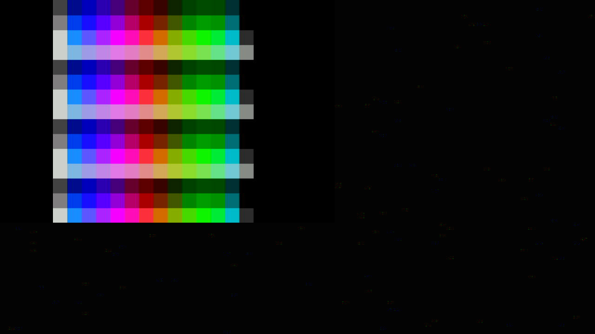

# BBC Micro Model B on the Tang Primer 20K Dock

hoglet67/BeebFpga `dev` at `49c63cc` ("Update MMFS to 1.61"), as the
submodule `retro/beebfpga`. The sources stay in that submodule. This
repo does not copy them. The BeebFpga header is a BSD-style licence
that is non-commercial: keep the copyright, no endorsement.

There is no published Primer 20K bitstream for this commit. The build
below is the one run on Bee with Gowin EDA 1.9.12.04 (`gw_sh`).

```sh
git submodule update --init retro/beebfpga
tools/build_beeb_primer20k.sh
tools/beeb_sram_load.sh retro/beeb/build/impl/pnr/tang20k.fs
```

`tools/beeb_sram_load.sh` is SRAM only, on USB bus 3 device 78
(`openFPGALoader -b tangprimer20k -m`). It refuses `-f` and it refuses
bus 3 device 81 (the Tang Nano 4K). The `.fs` is gitignored.

After a test, put Blink3 back:

```sh
tools/beeb_sram_load.sh /path/to/blink3_n262144.fs
```

## What the bitstream is

Model B only (`IncludeMaster` false, `IncludeBeeb` true). No ICE
debugger. `IncludeMixerResampler` is false (the upstream project turns
it off because the resampler does not fit). SID, Music 5000 and Video
NuLA stay at the nodebugger defaults (on). HDMI is on. The 1-bit PMOD
VGA output is enabled (`IncludeVGA`).

`bbc_micro_core` at this commit no longer has `clock_32`, `video_*`,
`hdmi_audio_*`, `vid_mode` or `hsync_ref`. The Primer 20K top in the
submodule was not updated. The build writes a patched copy under
`retro/beeb/build/` (gitignored) and uses that as the top. The patch
maps `vga_*` onto the existing VGA pins. `hsync_ref` is tied low,
because that port is gone and the old process that released the
pixel-clock divider on hsync never runs. `CLKDIV` for `clock_27`, and
the four `OSER10` serializers, stay in reset until `pll2_lock`.

## ROMs, without writing flash

Upstream loads a 48 KiB image from SPI flash at `0x300000`
(`roms/make_rom_image_tangnano.sh`, `IncludeBootStrap` true). This
build sets `IncludeBootStrap` false. `mem_tang_primer_20k` then reads
`roms/bbcb/os12_mmfs_basic.bit` with VHDL textio at synthesis and
initialises the ROM BSRAM. `gw_sh` needs `-looplimit 200000` (the
default 2000 trips `EX4701`) and `-bit_incl_bsram_init 1`.

The image is 49152 lines, one byte per line:

| Offset | Slot | Contents |
|---|---|---|
| `0x0000` | MOS (4) | OS 1.20. Banner `BBC Computer` at byte 772 |
| `0x4000` | D | Model B MMFS, `(C)2011 Mather`. Looks for `BEEB.MMB` |
| `0x8000` | E | BASIC II |

Gowin packs that byte-wide ROM as 24 one-bit SP primitives
(`r_mem_rom_<block>_<bit>`, 16 Ki addresses per block). The build
reconstructs those INIT bits and checks all 49152 bytes, including
the banner. Flash chip-select, SI and clock are tied high. The flash
balls stay constrained so they are not auto-placed, and the project
sets `use_mspi_as_gpio`. Nothing in this configuration issues a SPI
command. Do not pass `-f`.

The ROM file and the bitstream are not committed. The ROM stays inside
the submodule; the bitstream stays in `retro/beeb/build/`.

## Dock pins

Checked against `docs/primer20k/board-notes.md`. The overlay is
`retro/beeb/tang20k_dock.cst`. Place-and-route accepted it
(`cst_warn_to_error`) and the pin report matches.

| Function | Balls | Dock |
|---|---|---|
| 27 MHz | H11 | Crystal, LVCMOS33 |
| HDMI clock | G16 / H15 | Dock J3, LVCMOS33D via `ELVDS_OBUF` |
| HDMI data 0 | H14 / H16 | |
| HDMI data 1 | J15 / K16 | |
| HDMI data 2 | K14 / K15 | |
| SD clock | N10 | microSD SPI |
| SD MOSI | R14 | |
| SD MISO | M8 | |
| SD CS | N11 | DAT1 M7 and DAT2 M10 left unused |
| PS/2 clock | T11 | PMOD J12 (this repo's PMOD2). Upstream called it PMOD1 |
| PS/2 data | P11 | |
| Mouse | T12 / R11 | Same header |
| Reset (S1) | T10 | Active-low, pull-up. Holds the machine in reset if low |
| S2 | T3 | Bank 4, LVCMOS15, pull-up. HDMI/DVI toggle |
| S4 | D7 | 1.5 V bank, LVCMOS15, pull-up |
| UART | M11 / T13 | BL702. Left as the upstream UART |
| WS2812 | T9 | Was unconstrained; placed on the onboard LED data pin |
| Config flash | M9, L10, R10, P10 | Held idle. Not a flash writer |

HDMI stays a combined `IO_LOC` on the `_p` ports because the top uses
`ELVDS_OBUF` (O and OB). The pin report shows the pairs as LVCMOS33D
on those balls. 1-bit VGA stays on PMOD J14 (T6, P6, T7, R8, T8),
which is the mic header, not the Dock HDMI port.

## Utilisation and timing

Gowin 1.9.12.04, device GW2A-LV18PG256C8/I7 (`gw2a18c-011`). Reports:
`retro/beeb/build/impl/pnr/tang20k.rpt.txt` and `tang20k.tr`
(gitignored). STA model: setup slow 0.95 V 85 C, hold fast 1.05 V 0 C.

| Resource | Used | Device | |
|---|---:|---:|---:|
| Logic | 10441 | 20736 | 51% |
| of which LUT | 9399 | | |
| ALU | 976 | | |
| Register | 4719 | 16173 | 30% |
| BSRAM | 46 | 46 | 100% |
| DSP (MULT18X18 + ALU54) | 3.5 | 24 | 15% |
| rPLL | 2 | 4 | |

BSRAM is full: 48 KiB ROM plus 32 KiB RAM is about 640 Kbit of the
828 Kbit on this part, and the character/line-buffer RAMs take the
rest. That is the whole device. Do not turn the resampler back on
without deleting something else.

| Clock | Constraint | Fmax | Setup violations | Hold violations |
|---|---:|---:|---:|---:|
| `sys_clk` | 27.000 MHz (37.037 ns) | (no fabric paths) | 0 | 0 |
| `clock_27` | 27.000 MHz | 105.244 MHz | 0 | 0 |
| `clock_48` | 48.000 MHz | 62.995 MHz | 0 | 0 |
| `clock_96` | 96.000 MHz | 280.230 MHz | 0 | 0 |
| `i2s_clk` | 6.144 MHz | 311.770 MHz | 0 | 0 |
| `clock_135` | PLL 135 MHz, not in the SDC | (OSER10, no fabric Fmax) | | |

Setup-violated endpoints: 0. Hold-violated endpoints: 11, all in
`gen_i2s.p_i2s_clk_gen.r_acc`. Worst hold slack is -4.225 ns, from
`i2s_clk` into the other bits of that accumulator, which are clocked
by `clock_96`.

That is the failure noted in upstream `TODO.txt` ("timing fails on i2s
phase acc"). The SDC declares bit 0 of the phase accumulator as
`i2s_clk` (`clock_96` times 8/125). Those flops are also data in the
same `clock_96` process, so the hold check is the bit racing itself.
The pixel clock and the 48 MHz CPU clock meet their constraints. The
bitstream is still generated. HDMI does not depend on the I2S DAC.

## HDMI

Pixel clock `clock_27` is 27 MHz. Serial clock `clock_135` is 135 MHz.
The 720x480 counters in `hdmi.vhd` are commented out. The stream is the
scandoubler: 32 µs lines, a line buffer 864 deep, sampled at 27 MHz.
HDMI audio is enabled at power-up, and that path's active window is
720 by 576 lines with a vertical offset of 39. That is the upstream
50 Hz mode.

Reset lasts about 2^24 cycles of the 48 MHz clock (a third of a second)
after configuration, and for as long as S1 is held.

### Capture on 4 Nov 2026

The bitstream was SRAM-loaded on bus 3 device 78 (`-m`, RAM only).
After the reset interval the UGREEN 15389 (`/dev/video0`) was grabbed
at 720x480, 720x576 and 1280x720, in MJPG and YUYV, at 50 fps and at
60 fps. Commands are in [`docs/capture-card.md`](../capture-card.md).
Every frame was a flat field. The 720x576 YUYV frame is RGB (0, 0, 0).
The `BBC Computer 32K` / `BASIC` banner was not in the picture.


The same card and the same cable did lock a 1280x720 source. A SRAM
load of the local NESTang Dock bitstream (GW2A-18C, 1280x720, not part
of this repo) showed colour bars at 1280x720. Opening that source as
720x480 showed the card's "No Signal" overlay. 720p locks on this
card. This Beeb stream did not.



PMOD J12 had no PS/2 keyboard, so no key was sent. After the grabs the
20K was SRAM-loaded back to Blink3 (`blink3_n262144.fs`, N=262144, bus
3 device 78).

## Games on SD (not in git)

The two discs to load later are not in this repo. Do not commit the
images or a `BEEB.MMB`.

| Game | Year | Publisher | Page |
|---|---|---|---|
| Sphinx Adventure | 1984 floppy release (tape was 1982) | Acornsoft, Paul Fellows | <https://bbcmicro.co.uk/game.php?id=1636> |
| Quest | 1988, also on Play It Again Sam 08 | Superior/Acornsoft, Tony Oakden | <https://bbcmicro.co.uk/game.php?id=660> |

Both are Model B. This bitstream's filing system is the Model B MMFS
in slot D. It does not read a loose `.ssd` off the card. It looks for
one unfragmented file, `BEEB.MMB`, in the root of a FAT16 or FAT32
microSD card. Copy that file onto an empty card so it is not
fragmented.

An MMB slot is one 200 KiB (800x256) single-sided DFS image. Disc `n`
starts at byte `n * 204800 + 8192`. Build the file with MMFS
`mmb_utils` or MMB Imager: import each game's `.ssd` into its own
slot. A double-sided `.dsd` does not fit in one slot.

On the machine, after the BASIC prompt:

```text
*DCAT
*DIN <slot>
*CAT
*DBOOT <slot>
```

`*DCAT` lists the slots. `*DIN` inserts one into the current drive.
`*DBOOT` inserts it into drive 0 and boots it (`!BOOT` / the disc boot
option). A title works in place of the slot number when that title is
the one stored in the MMB. Shift-Break boots the disc already
inserted, when that disc has a boot option. `*CAT` after `*DIN` is the
list of files on that disc.

Sphinx Adventure's 1984 release is a floppy in its own right. Quest is
also on the Play It Again Sam 08 compilation, so the SSD for Quest may
be that compilation: the boot is then the compilation's menu, and
`*CAT` shows Quest's files on the same disc.

The Dock microSD SPI pins are the ones in the table above. The PS/2
keyboard is PMOD J12, clock T11, data P11.
