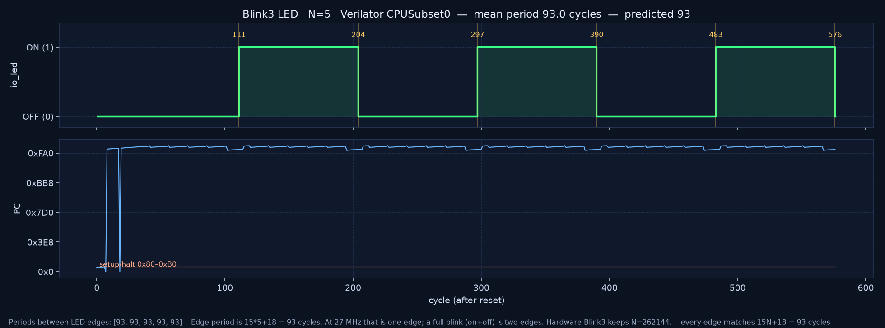
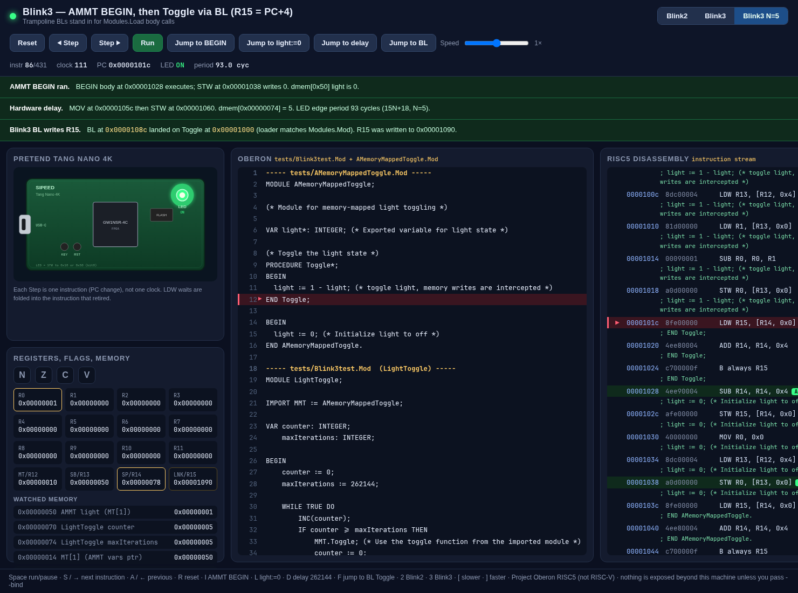
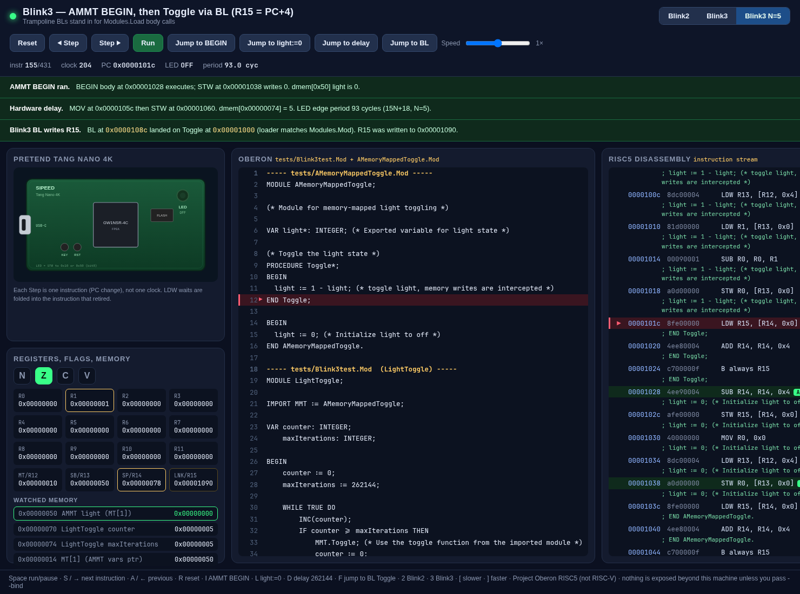
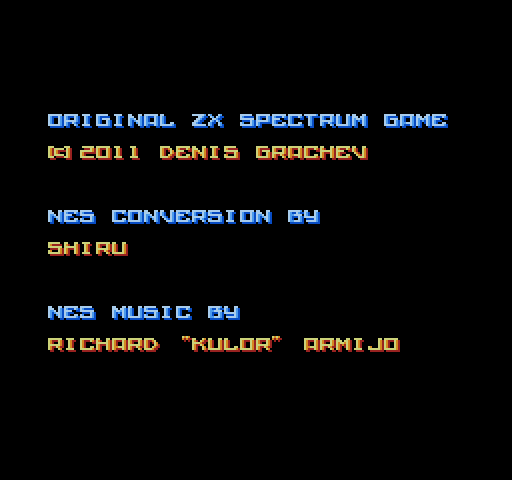
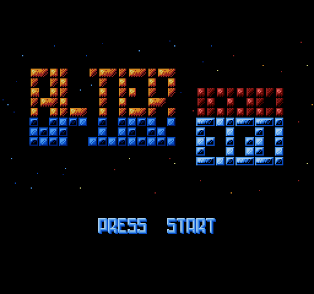
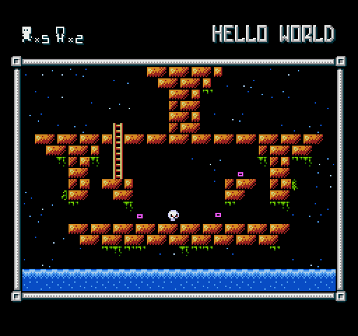

# Both sims on Bee

Verilator only. These commands do not SRAM-load or flash an FPGA.

Blinky `main` at the time of the run is `85b6e7a` (PRs #17–#19). NESTang is [nand2mario/nestang](https://github.com/nand2mario/nestang) `master` `5b24a71` in `~/fpga/nestang`, with local sim patches listed below. Its sources stay in that tree (GPL). This repo does not vendor them and does not carry the ROM.

## Blink3, N=5

Predicted LED edge period is `15N+18` cycles at 27 MHz. **N=5** is the sim chosen here: one `MOV R0, 5` (`0x40000005`) at PC `0x105C`, outside the skip loop, so the edge period is `15*5+18 = 93` cycles. The FPGA image is unchanged (`MHI` of `N=262144`, blink about 3.433 Hz).

| | |
|---|---|
| edges (cycle after reset) | 111, 204, 297, 390, 483, 576 |
| periods | 93, 93, 93, 93, 93 |
| match | yes |
| edge rate at 27 MHz | 290322.58 Hz |
| full blink (on+off, two edges) | 145161.29 Hz |

Numbers are also in [`blink3_n5.txt`](blink3_n5.txt). The first edge is at cycle 111 because reset and the trampoline run first; every gap after that is 93.



```sh
tools/run_blink3_period.sh 5          # or: make -C sim blink3-period
# N=8 predicts 138:  tools/run_blink3_period.sh 8
```

That writes the PNG and `docs/sim-bee/blink3_n5.txt`, plus `sim/visualizer/traces/blink3_n5.json`. Waveform CSVs, the FST, and `sim/obj_dir_blink3_n5/` stay out of git.

### Visualizer

Same page as `tools/run_visualizer.sh` (Python stdlib, loopback). On this machine port **8765** is already the long-running server from `~/fpga/blinky-vis`, which does not have the N=5 trace. Serve this checkout on another port:

```sh
PORT=8767 tools/run_visualizer.sh
```

- LED on, first edge: http://127.0.0.1:8767/?p=blink3n5&led=1 — clock **111**, LED **ON**, period **93.0 cyc**
- LED off, next edge: http://127.0.0.1:8767/?p=blink3n5&led=0 — clock **204**, LED **OFF**, period **93.0 cyc**

The delay banner reads `dmem[0x74] = 5` and `LED edge period 93 cycles (15N+18, N=5)`. The Oberon listing on the page still shows `maxIterations := 262144`; that is the `.Mod` source. The sim instruction and dmem value are N=5. Key `5` selects this trace.





## NESTang, Alter Ego

ROM on Bee: `~/fpga/nestang-v04/games/Alter_Ego.nes` (40976 bytes, iNES `4E 45 53 1A`, mapper 0, 32 KB PRG + 8 KB CHR, vertical mirroring). Same freeware ROM as the Primer 20K still in [`docs/primer20k/nestang.md`](../primer20k/nestang.md). The script turns it into `~/fpga/nestang/src/roms/alter_ego.hex` and points `game_data.v` at that file. The hex, the ROM, and the PPM dump are not committed.

```sh
tools/run_nestang_alter_ego.sh
```

Defaults: `NESTANG_ROOT=~/fpga/nestang`, `ROM=~/fpga/nestang-v04/games/Alter_Ego.nes`, `OUT=~/fpga/nestang-shots`, `FRAMES=320` (~240e6 half-cycles), `EVERY=5`, `JOY=40:25`, `JOY2=150:45`. Explicit form:

```sh
FRAMES=320 EVERY=5 JOY=40:25 JOY2=150:45 OUT=~/fpga/nestang-shots \
  tools/run_nestang_alter_ego.sh ~/fpga/nestang-v04/games/Alter_Ego.nes
```

`JOY` / `JOY2` are `START:HOLD` frame windows. The sim drives `sim_joy = 0x8` for those frames (SNES-layout bit 3 = Start, the bit the UART loader pulses). Stdin is `/dev/null`, so the sim stays headless and exits at the step limit. About 1.9 simulated frames per second, same ballpark as the 3 Nov nes15 run (27 frames from 20e6 steps).

Proof frames (2× nearest-neighbor, 256×240 NES):

| frame | what | non-black pixels |
|---|---|---|
| 40 | credits | 3681 / 61440 |
| 100 | title, `PRESS START` lit | 6236 / 61440 |
| 280 | first level, `HELLO WORLD` | 14283 / 61440 |

Frame 100 is the title with the prompt on (it blinks; nearby frames drop to 5469 non-black pixels when the prompt is off). Frame 280 is the same first level as [`hdmi-monitor-alter-ego.jpg`](../primer20k/hdmi-monitor-alter-ego.jpg).







Start is what leaves the credits. A control run of 187.5e6 steps with no `-j` pulse was still on the credits through frame 226, reached this title only at frame 239, and was still on `PRESS START` at frame 261. The proof run held Start on frames 40–64 and again on 150–194: the title was up by frame 64, and `HELLO WORLD` was on screen by frame 250.

### Local NESTang patches (not in this repo)

Already applied on the Bee tree. The script refuses to run if `sim_joy` is missing, and it rewrites only `INES_SIZE` and the active `$readmemh` when the ROM changes.

- `src/mappers/generic.sv` — drop the duplicate `prg_allow` so Verilator accepts the file
- `verilator/Makefile` — `-Wno-WIDTHTRUNC`; copy `src/roms` into `obj_dir/roms` without nesting
- `verilator/sim_main.cpp` — headless PPM dump (`-o` directory, `-e` every N frames, repeatable `-j START:HOLD`)
- `src/nestang_top.sv` — under `VERILATOR`, `input [11:0] sim_joy` and a joypad shift register (bit 3 = Start)
- `src/game_data.v` — `INES_SIZE` and `$readmemh("roms/alter_ego.hex")` for this ROM

`src/roms/alter_ego.hex` is listed in that repo's `.git/info/exclude`.
