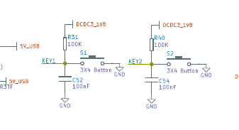
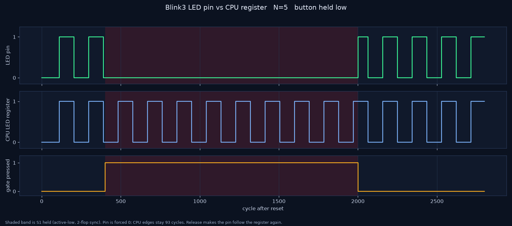
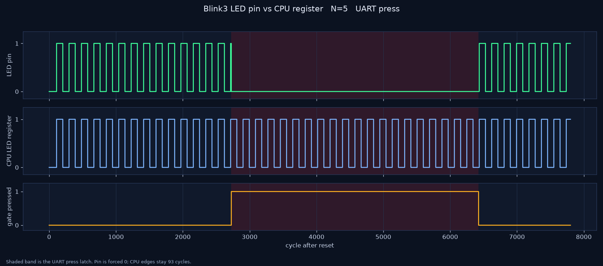
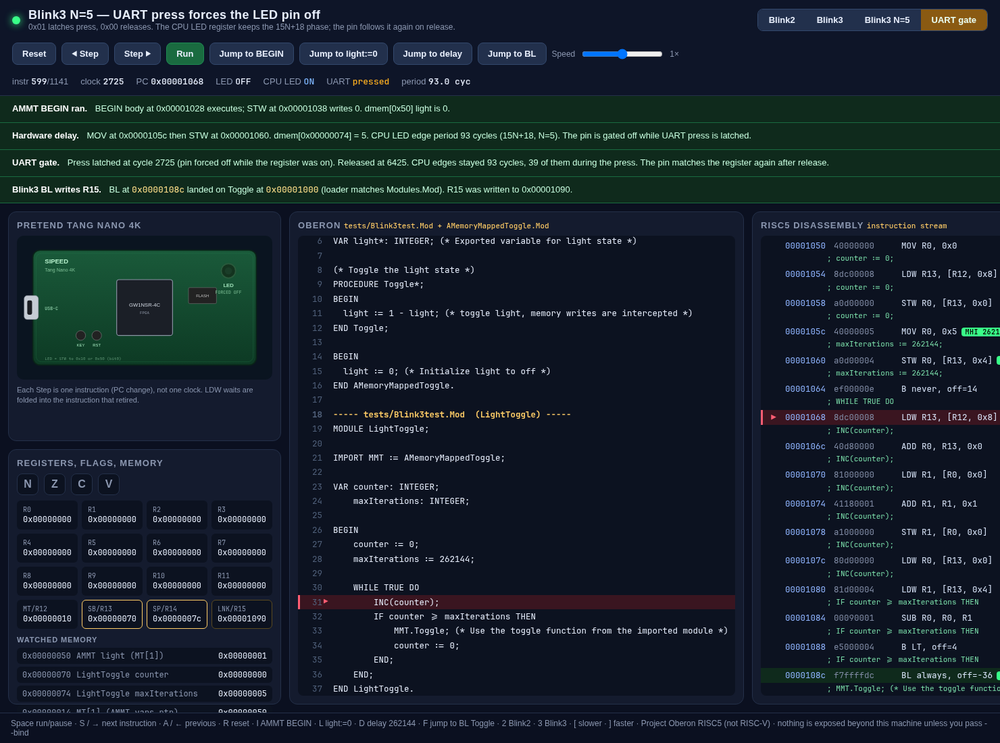
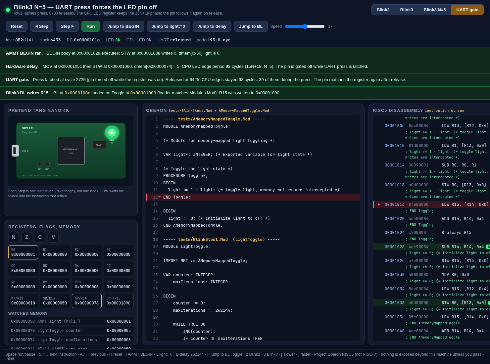

# Button or UART press gates the Blink3 LED

The gate sits in the SoC, after the CPU's LED register (`UartLedGate` in
`CPUMinimalWrapper` and in the Verilator top). While the gate is pressed the
pin is forced off. The core keeps fetching, and `ledState` keeps toggling, so
a release shows the phase the register is already in.

Pressed means the Tang Nano 4K button is held **or** a UART press byte is
latched. Either one is enough. The Primer 20K top ties the button high
(released) and still uses the UART pins.

## Tang Nano 4K button

Sipeed schematic `Tang_Nano_4K_3603`
([PDF](https://dl.sipeed.com/fileList/TANG/Nano%204K/HDK/02_Schematic/Tang_Nano_4K_3603_Schematic_.pdf)):

| switch | net | package pin | bank |
|---|---|---|---|
| S1 | KEY1 | **14** (`IOB4B`) | VCCO3, 1.8 V |
| S2 | KEY2 | 15 (`IOB5A`) | VCCO3, 1.8 V |

S1 is the gate. R31 is 100 kΩ from KEY1 up to `DCDC3_1V8`, the switch goes to
ground, and C52 is 100 nF to ground. Held means low. `tang-nano-4k.cst`
places `io_btn_n` on pin 14 as LVCMOS18 with pull-up. Two flops synchronise
it. The pin report for the N=262144 image lists `io_btn_n` at `14/3`,
`IOB4[B]`, LVCMOS18, pull-up, 1.8 V.

S2 stays the reset input on pin 15 (pull-down, active-high into the CPU).
Pressing it shorts an already-low net to ground, so it does not gate the LED
and it does not reset the CPU while that pull-down is on.



## Protocol

8N1, 115200 baud, 27 MHz (Nano 4K PLL bypass and Primer 20K H11). One bit is
234 cycles. The receiver is the existing `UartRx`.

| byte | latch |
|---|---|
| `0x01`, ASCII `1`, or space `0x20` | pressed, pin forced off |
| `0x00` or ASCII `0` | released, pin follows the CPU register |
| anything else | latch unchanged |

Later a host can send `0x01` on key-down and `0x00` on key-up. That host is
not part of this change.

## Where the pins are

Tang Nano 4K: `tang-nano-4k.cst` places RX on package pin 18 and TX on pin 19.
The onboard BL702 (bus 3 device 81) does expose a USB-UART on its second
interface, but schematic 3603 does not connect that UART to the FPGA, and
pins 18/19 are camera data. The SRAM test is written up in
[`hardware.md`](hardware.md).

Tang Primer 20K Dock: `gowin/primer20k/primer20k.cst` maps FPGA TX to **M11**
and FPGA RX to **T13**, the BL702 USB-UART balls (same as BeebFpga and
NESTang). L14 is still the active-low Blink3 LED, so a forced-off pin
(active-high 0) drives L14 high and the LED stays dark. This Dock build was
not loaded.

## Verilator, N=5

`tools/run_uart_led_gate.sh` uses maxIterations = 5 so an edge is
`15*5+18 = 93` cycles. The FPGA image is still N=262144. The same script
runs the UART frame and a button hold. Both checks print `match=yes`.

### Button

S1 is driven low from cycle 400 through 1999 (the testbench flag is
`--btn-up 2000`, exclusive). The synchroniser raises `pressed` at cycle
**401** and drops it at cycle **2001**. All 28 CPU edge gaps are 93 cycles,
including the 17 edges while the pin is forced off. At the release the CPU
register is already 1, and the pin comes back high on that same cycle, then
both fall together at 2064.



### UART

The button stays released for this run.

Press frame starts at cycle 500 and the latch sets at cycle **2725**, while
the CPU register is still 1 (it rose at 2715 and would have stayed 1 until
2808). The pin drops at 2725 and stays 0 for the whole latch. Release frame
starts at cycle 4200; the latch clears at cycle **6425** with both the pin
and the register already 0. The next edge of both is cycle **6435**, one
93-cycle step after the CPU edge at 6342 that happened while the pin was held
off.

| | |
|---|---|
| CPU edge period | 93, every gap, including the 39 edges inside the press |
| press latch | cycle 2725 through 6424 (3700 cycles) |
| pin while pressed | 0 |
| release | cycle 6425, pin = CPU LED = 0 |
| next shared edge | 6435 |



```sh
tools/run_uart_led_gate.sh
PORT=8768 tools/run_visualizer.sh
# pin forced off, CPU LED still on:
#   http://127.0.0.1:8768/?p=uartgate&gate=off
# pin high again, in phase with the register:
#   http://127.0.0.1:8768/?p=uartgate&gate=on
```





## Synthesis and the 4K SRAM load

The Nano 4K image was rebuilt with the button port and SRAM-loaded. The
Primer 20K was not rebuilt and not programmed.

| board | part | pins in the pin report | bitstream |
|---|---|---|---|
| Tang Nano 4K | GW1NSR-4C | button pin 14 (`IOB4[B]`, LVCMOS18, pull-up), reset pin 15, LED pin 10, UART RX/TX still 18/19 | `gowin/impl/pnr/blink3_n262144.fs` |
| Primer 20K Dock | GW2A-18C | previous build: RX **T13**, TX **M11**. Button tied high in the top, not a new bitstream | not reloaded |

```sh
tools/gowin_build.sh
openFPGALoader --busdev-num 003:081 -b tangnano4k -m gowin/impl/pnr/blink3_n262144.fs
```

The `.fs` files are gitignored. The loader was `-m` only. Log: `write to ram`,
`Load SRAM 100%`, `CRC check: Success`.

After that load the Logitech the webcam MCP uses
(`046d:0991`, `/dev/video2`) is aimed at the monitor light bar, not at the
boards. `check_all(duration=10)` reported both boards "present but not
blinking", and the frame has no red LED in it. That call is written up in
[`hardware.md`](hardware.md). The 4K was left running this SRAM image. The
button has not been held for a camera measurement yet.
