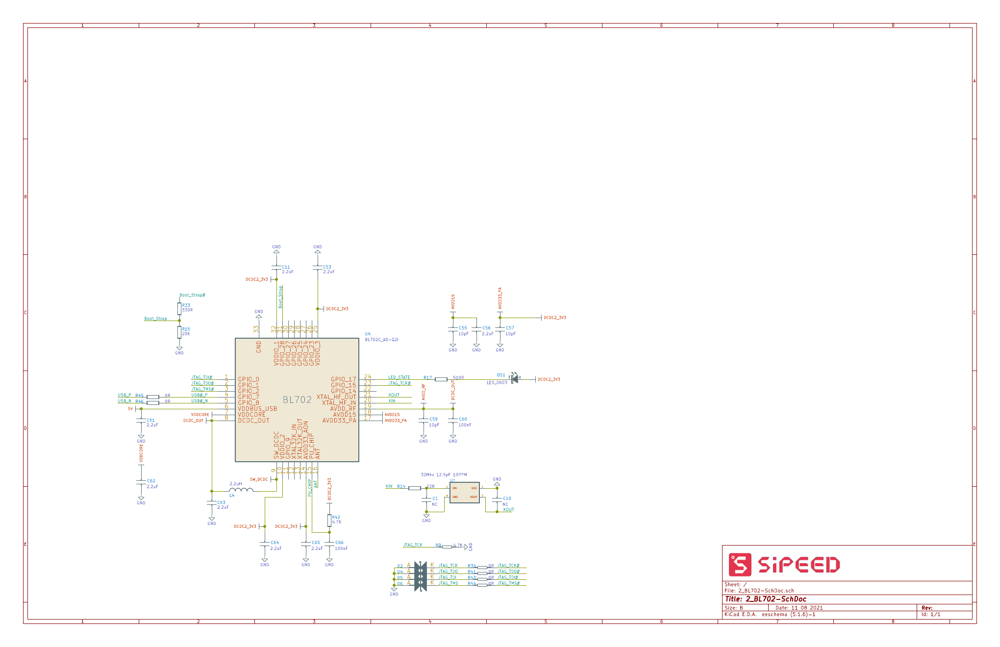
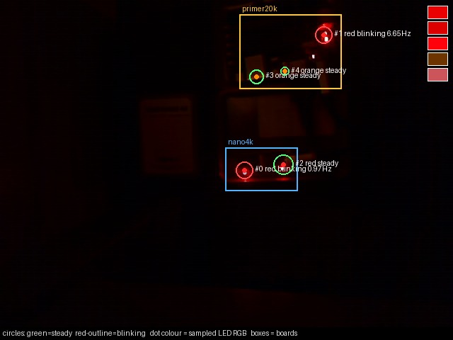
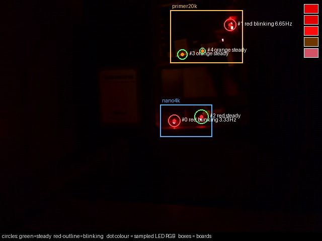
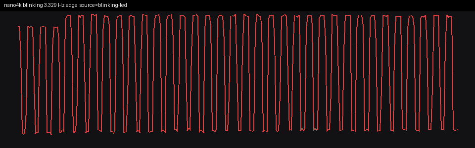
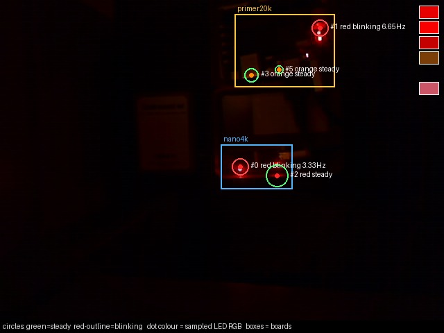
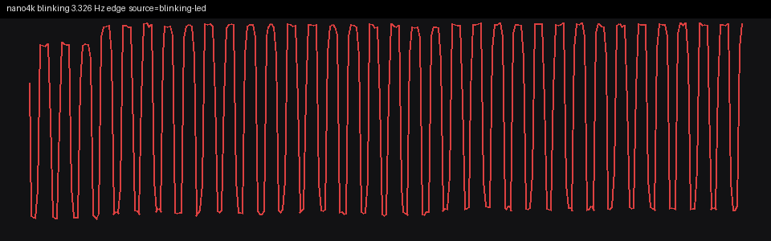
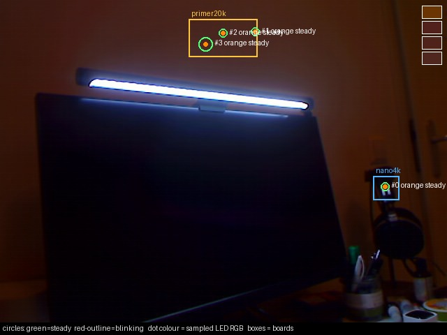

# Tang Nano 4K SRAM load and UART attempt

SRAM only, on the Nano 4K. The Primer 20K was not programmed and its tty was not opened. The 4K was left running this bitstream (Blink3 N=262144, latch clear, LED blinking).

## How a byte would have to travel

| hop | what |
|---|---|
| USB device | bus **3**, device **81**, `0403:6010`, product "SIPEED JTAG Debugger", serial "FactoryAIOT Pro". This is the Nano 4K's onboard BL702, which enumerates as an FT2232. The other debugger (bus 3 device **78**, USB path `3-3.3`) is the Primer 20K and was not opened. |
| JTAG (channel A) | USB interface **0**, sysfs `3-3.1.1:1.0`, tty `/dev/ttyUSB2` when `ftdi_sio` is bound. `openFPGALoader` uses this channel. |
| UART (channel B) | USB interface **1**, sysfs `3-3.1.1:1.1`, tty **`/dev/ttyUSB3`**. Confirmed with `udevadm` (`ID_USB_INTERFACE_NUM=01`, `ID_PATH=pci-0000:00:14.0-usb-0:3.1.1:1.1`). Not `/dev/ttyUSB0` or `/dev/ttyUSB1` (those are `3-3.3`, the 20K). |
| line | 115200 baud, 8 data bits, no parity, 1 stop bit. DTR and RTS cleared before any write, so opening the port does not pulse modem lines. |
| bytes | `0x01` press (force the pin off), `0x00` release. Same bytes the gate accepts, along with ASCII `1` / space and ASCII `0`. |
| FPGA pins in the bitstream | `tang-nano-4k.cst`: RX package pin **18** (`IOB13[A]`, LVCMOS18, pull-up), TX package pin **19** (`IOB13[B]`). LED is pin 10. |

IDCODE read on bus 3 device 81 before the load: `0x100981b`, Gowin GW1NSR-4C.

`libftdi` `usb_reset` returns -6 while channel B's `ftdi_sio` driver is attached. Both interfaces of **this** device were detached in userspace, then:

```sh
openFPGALoader --busdev-num 003:081 -b tangnano4k -m gowin/impl/pnr/blink3_n262144.fs
```

Log: `write to ram`, `Load SRAM 100%`, `CRC check: Success`. No `-f`. Channel B was reattached afterwards so `/dev/ttyUSB3` came back. The 20K interfaces stayed on `ftdi_sio` the whole time.

## What the schematic says

Sipeed `Tang_Nano_4K_3603` ([PDF](https://dl.sipeed.com/fileList/TANG/Nano%204K/HDK/02_Schematic/Tang_Nano_4K_3603_Schematic_.pdf)):

- Package pins 18 and 19 are `PIXDATA5` / `PIXDATA3` on the camera connector, not a UART.
- The BL702 page wires GPIO0/1/2/15 to JTAG and GPIO17 to the debugger LED. GPIO23–GPIO28, the usual UART pins on this chip, have no nets.



So the tty is real, and the bytes left the machine, but the board does not connect that UART to the FPGA pins this bitstream listens on.

## Webcam

Tool: `check_all(duration=10)` at `http://127.0.0.1:8766/mcp`. Each call records about 10 s and returns both boards. Predicted Blink3 rate is **3.433 Hz**. The 20K stayed near 6.65 Hz on every call.

| step | Nano 4K | Primer 20K |
|---|---|---|
| before SRAM load | 0.968 Hz blinking | 6.647 Hz blinking |
| after SRAM load, before any byte | **3.329 Hz** blinking | 6.648 Hz blinking |
| `0x01` then 10 s (try 1) | 3.326 Hz blinking | 6.653 Hz blinking |
| `0x00` then 10 s | 3.326 Hz blinking | 6.651 Hz blinking |
| `0x01` then 10 s (try 2) | 3.328 Hz blinking | 6.633 Hz blinking |
| `0x00` then 10 s | 3.319 Hz blinking | 6.641 Hz blinking |
| `0x01` then 10 s (try 3) | 3.328 Hz blinking | 6.656 Hz blinking |
| `0x00` then 10 s | 3.316 Hz blinking | 6.655 Hz blinking |

A 1.2 s read of `/dev/ttyUSB3` while the LED was toggling returned **0 bytes**. The logger in the bitstream sends a line on every LED store, so a connected TX pin would not have been silent.

The press windows were the failure: the pin was supposed to go dark for those 10 s. It kept the Blink3 rate. The MCP reported a real blink each time (edge and FFT agree, confidence 1.0). That is the board, not an MCP miss.











Clips (not committed, ~3.5 MB each) are under `~/fpga/blink-measure/20261104-213949-check` through `20261104-214232-check`.

That image was replaced by the button bitstream below. The last byte on the wire for this UART attempt was `0x00`. The LED was blinking at 3.316 Hz at the end of that measurement.

## Button gate (S1)

The UART attempt above is why the gate now also takes a button. S1 / KEY1 is package pin **14** (`IOB4B`). Schematic 3603 shows R31 = 100 kΩ to `DCDC3_1V8`, the switch to GND, and C52 = 100 nF to GND, so the button is active-low on the 1.8 V bank. S2 / KEY2 stays pin 15 and is still the reset input (`PULL_MODE=DOWN`). The pin report for this image:

```
io_btn_n    14/3   IOB4[B]   LVCMOS18   UP    1.8
reset       15/3   IOB5[A]   LVCMOS18   DOWN  1.8
io_led      10/0   IOT7[A]   LVCMOS33         3.3
```

The Chisel gate is `pressed = uartLatch || !btnSync`, then `led = cpuLed && !pressed`. The UART receiver is still in the design (a button or a press byte). On the Primer 20K top the button input is tied to `1'b1`. That board was not synthesized again and was not loaded.

SRAM only, same 4K probe, no `-f`:

```sh
openFPGALoader --busdev-num 003:081 -b tangnano4k -m gowin/impl/pnr/blink3_n262144.fs
```

IDCODE still `0x100981b`. Log: `write to ram`, `Load SRAM 100%`, `CRC check: Success`. Before the load, both interfaces of bus 3 device 81 were detached in userspace (a `libusb` reset of that device then succeeded). After the load they were attached again. Bus 3 device 78 (the 20K, `3-3.3`) was not opened. Its interface 0 stayed on `ftdi_sio`. Its interface 1 was already unbound before this load and was left that way.

## Camera after the button load

`check_all(duration=10)` at `http://127.0.0.1:8766/mcp` took 13.25 s and returned both boards as "present but not blinking" (`nano4k` and `primer20k` frequency null). The clip is `~/fpga/blink-measure/20261104-223623-check/clip.mkv`. The annotated frame is the monitor light bar. A scan of that frame for red LED pixels (R > 80 and well above G and B) found one pixel. The previous clip that actually saw the boards, `20261104-214232-check`, measured the 4K at 3.316 Hz with the user LED around pixel (344, 243).

The MCP was not modified. A direct grab of `/dev/video2` (Logitech `046d:0991`, the camera `check_all` uses) is the same monitor view. `/dev/video0` is the UGREEN HDMI stick and returned a black frame. The camera stays on the monitor for the Primer 20K BBC work, so it was not turned back to the 4K.

## Hardware proof

Alex confirmed by eye that holding **S1** on the Tang Nano 4K cuts the LED off. That is the button gate on the SRAM image above: pin 14, active-low, after the CPU LED register. The 4K was left running that image.


