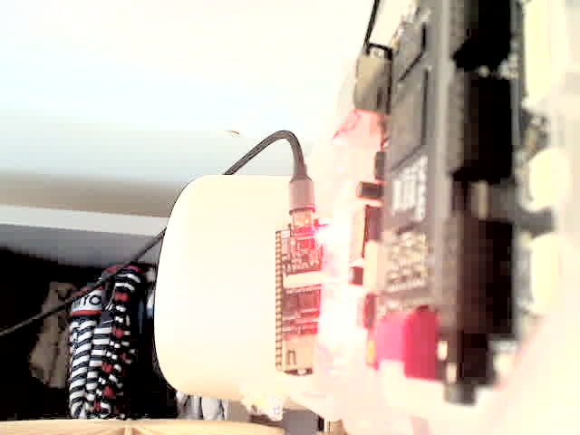
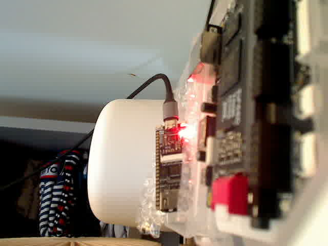
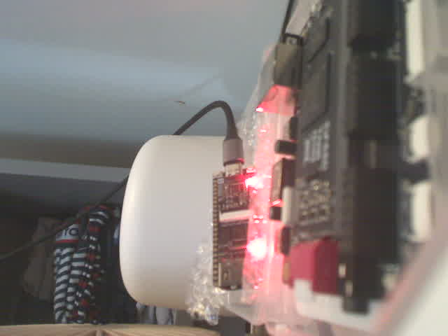

# Webcam MCP

Small streamable-HTTP MCP server so Cursor agents on Bee can grab webcam stills
(FPGA LEDs, HDMI monitor) and adjust the Logitech QuickCam without holding
`/dev/video0`. Same capture path as `tools/webcam_still.sh`: `ffmpeg -f v4l2`,
one JPEG, then the device is closed.

Listens on **127.0.0.1:8766** (`/mcp`). Port 8765 is already the Blink2
visualizer (`tools/run_visualizer.sh`).

Does not touch the FPGA, serial ports, or `openFPGALoader`.

## Tools

| Tool | What it does |
|---|---|
| `list_cameras` | V4L2 `/dev/videoN` nodes and kernel names (no device open) |
| `capture_still` | One JPEG: MCP image content + path under `~/fpga/captures/` |
| `capture_burst` | N stills at an interval; returns paths only |
| `get_camera_controls` | Current v4l2 values and ranges (brightness, contrast, gain, exposure, auto-exposure, white balance, …) |
| `set_camera_controls` | Set one or more real camera controls via `v4l2-ctl` |
| `reset_camera_controls` | Restore driver defaults and clear saved settings |
| `auto_adjust` | Capture, measure mean luma / clipping, nudge gain/brightness/exposure |

`capture_still` / `capture_burst` arguments: `device` (default `/dev/video0`),
optional `resolution` (`640x480`), optional `warmup_frames` (default 8,
discard AE settle frames; `0` matches `webcam_still.sh`), optional
`enhance` (default **`false`**). The returned still is the raw camera JPEG.
Pass `enhance=true` only if you want optional software `ffmpeg` eq
(`eq=brightness=0.25:contrast=1.6:gamma=1.8`, overridable with `enhance_vf`).
That boost is no longer applied by default; it washed out the Logitech.

Prefer the V4L2 tools when a frame looks washed out or too dark. Settings are
written to `~/.local/state/webcam-mcp/controls.json` (or `$WEBCAM_MCP_STATE_DIR`)
and re-applied before each capture and when the service starts, so they persist
across shots and restarts.

On this machine the camera is a **Logitech QuickCam Pro for Notebooks**
(`046d:0991`) at `/dev/video0`. Typical controls:

| Control | Range (this cam) | Driver default | Notes |
|---|---|---|---|
| `brightness` | 0–255 | 128 | Always writable |
| `contrast` | 0–255 | 32 | |
| `gain` | 0–255 | 0 | AE often parks this near max |
| `auto_exposure` | 1=Manual, 3=Aperture Priority | 3 | Set 1 before `exposure` |
| `exposure` / `exposure_time_absolute` | 1–10000 | 166 | Inactive while AE is on |
| `white_balance_automatic` | 0/1 | 1 | |
| `white_balance` / `white_balance_temperature` | 0–10000 step 10 | 4000 | Inactive while AWB is on |

`set_camera_controls(exposure=200)` switches `auto_exposure` to Manual first.
`reset_camera_controls` restores the driver defaults above.

`auto_adjust` nudges **gain**, then **brightness**, then (if needed) switches
AE to Manual and moves **exposure** until mean Rec.601 luma is near 115 without
highlight clipping. Dark-room backgrounds are expected. It persists the
exposure knobs.

`tools/measure_blink.sh` is unchanged and still records a raw clip.

Camera access is serialised with an `flock` on `$XDG_RUNTIME_DIR/webcam-mcp.lock`.
ffmpeg / `v4l2-ctl` are started and waited on per shot, so the V4L2 node is free
afterwards and `tools/measure_blink.sh` can run in between.

A later HDMI capture stick (UGREEN 15389, UVC) will show up from
`list_cameras`; pass its `/dev/videoN` as `device`.

## Install (once)

From this directory:

```sh
python3 -m venv .venv
.venv/bin/pip install -r requirements.txt
mkdir -p ~/.config/systemd/user
ln -sfn "$PWD/webcam-mcp.service" ~/.config/systemd/user/webcam-mcp.service
systemctl --user daemon-reload
systemctl --user enable --now webcam-mcp.service
```

Start at boot without logging in (needs sudo, one shot):

```sh
sudo loginctl enable-linger lypanov
```

Parser / exposure-loop tests (no camera, no mcp extra):

```sh
python3 tools/webcam-mcp/test_controls.py
```

Cursor on Bee: `~/.cursor/mcp.json` should contain (keep any other servers):

```json
{
  "mcpServers": {
    "webcam": {
      "url": "http://127.0.0.1:8766/mcp"
    }
  }
}
```

## How agents use it

Call `list_cameras`, then `capture_still` with the Logitech (`/dev/video0`) or
the HDMI stick. The still returned to the model is the **raw** frame. If it
looks washed out or too dark, call `get_camera_controls` and
`set_camera_controls` (or `auto_adjust`). Timestamped `-raw.jpg` files are left
in `~/fpga/captures/`; `-enhanced.jpg` is written only when `enhance=true`.

```sh
systemctl --user status webcam-mcp.service
systemctl --user restart webcam-mcp.service
journalctl --user -u webcam-mcp.service -e
```

## Proof on Bee (2026-11-04)

Logitech QuickCam Pro for Notebooks `046d:0991` at `/dev/video0`. Tang Nano 4K and Primer 20K in frame. FPGA / serial / `openFPGALoader` were not touched. Tools were called over `http://127.0.0.1:8766/mcp` after `systemctl --user restart webcam-mcp.service`.

| Shot | What | Controls | mean luma | highlight clip |
|---|---|---|---|---|
| 1 | Old `capture_still` default (`enhance=true`, `eq=brightness=0.25:contrast=1.6:gamma=1.8`) | v4l2: brightness=128, contrast=32, gain=234, auto_exposure=3 | 184.3 | 26.5% |
| 2 | New `capture_still` default (raw, no software eq) | same v4l2 as (1) | 120.2 | 0.8% |
| 3 | After `set_camera_controls` + **service restart** (persistence) | brightness=132, contrast=40, gain=72, auto_exposure=1, exposure=180 | 3.1 | 0% |
| 4 | `auto_adjust` from (3) | brightness=172, gain=255, auto_exposure=1, exposure=185 | 123.8 | 0.2% |







