# Webcam MCP

Small streamable-HTTP MCP server so Cursor agents on Bee can grab webcam stills
(FPGA LEDs, HDMI monitor) and adjust the Logitech QuickCam without holding
`/dev/video0`. Same capture path as `tools/webcam_still.sh`: `ffmpeg -f v4l2`,
one JPEG, then the device is closed.

Listens on **127.0.0.1:8766** (`/mcp`). Port 8765 is already the Blink2
visualizer (`tools/run_visualizer.sh`).

Does not touch the FPGA, serial ports, or `openFPGALoader`.

## Tools

| Tool | What it does |
|---|---|
| `list_cameras` | V4L2 `/dev/videoN` nodes and kernel names (no device open) |
| `capture_still` | One JPEG: MCP image content + path under `~/fpga/captures/` |
| `capture_burst` | N stills from **one** open camera; returns paths only |
| `capture_video` | Continuous clip from **one** open camera; returns `.mkv` path |
| `get_camera_controls` | Current v4l2 values and ranges (brightness, contrast, gain, exposure, auto-exposure, white balance, …) |
| `set_camera_controls` | Set one or more real camera controls via `v4l2-ctl` |
| `reset_camera_controls` | Restore driver defaults and clear saved settings |
| `auto_adjust` | LED-priority exposure: compact unclipped red/orange blobs, manual WB (not mean luma) |
| `detect_leds` | Clip → LED coordinates, colour, blinking vs steady, board assignment + annotated JPEG |
| `measure_blink` | Record via `capture_video` (or analyze a clip it returned); edge **and** FFT, graphs, JSON |

Three capture tools stay separate:

- `capture_still` — one JPEG, then the device is released (same as `webcam_still.sh`).
- `capture_burst` — opens the camera **once** and pulls N JPEGs at `interval_s`
  (warmup discarded at the start). It used to call `capture_still` per shot,
  which reopened V4L2 and cost 2–4 s/frame.
- `capture_video` — one ffmpeg v4l2 session for `duration` seconds (`-c:v copy`
  to `~/fpga/captures/<stamp>-video0.mkv`). Optional `lock_exposure=true` freezes
  AE like `measure_blink.sh`.

`measure_blink` is built on that recorder (same `record_continuous_clip` as
`capture_video`, camera held open). Pass `video=` to analyze a clip
`capture_video` already returned instead of recording again.

`capture_still` / `capture_burst` arguments: `device` (default `/dev/video0`),
optional `resolution` (`640x480`), optional `warmup_frames` (default 8,
discard AE settle frames; `0` matches `webcam_still.sh`), optional
`enhance` (default **`false`**). The returned still is the raw camera JPEG.
Pass `enhance=true` only if you want optional software `ffmpeg` eq
(`eq=brightness=0.25:contrast=1.6:gamma=1.8`, overridable with `enhance_vf`).
That boost is no longer applied by default; it washed out the Logitech.

Prefer the V4L2 tools when a frame looks washed out or too dark. Settings are
written to `~/.local/state/webcam-mcp/controls.json` (or `$WEBCAM_MCP_STATE_DIR`)
and re-applied before each capture and when the service starts, so they persist
across shots and restarts.

On this machine the camera is a **Logitech QuickCam Pro for Notebooks**
(`046d:0991`) at `/dev/video0`. Typical controls:

| Control | Range (this cam) | Driver default | Notes |
|---|---|---|---|
| `brightness` | 0–255 | 128 | Always writable |
| `contrast` | 0–255 | 32 | |
| `gain` | 0–255 | 0 | AE often parks this near max |
| `auto_exposure` | 1=Manual, 3=Aperture Priority | 3 | Set 1 before `exposure` |
| `exposure` / `exposure_time_absolute` | 1–10000 | 166 | Inactive while AE is on |
| `white_balance_automatic` | 0/1 | 1 | |
| `white_balance` / `white_balance_temperature` | 0–10000 step 10 | 4000 | Inactive while AWB is on |

`set_camera_controls(exposure=200)` switches `auto_exposure` to Manual first.
`reset_camera_controls` restores the driver defaults above.

`auto_adjust` no longer chases mean luma (that washed the dark desk and bloomed
the LEDs). It switches AE and AWB to manual, raises saturation, drops
brightness off the previous 220 wash, then searches **gain** / **exposure**
(and a couple of white-balance / saturation variants) to maximise compact
red/orange LED blobs without clipped white cores. Orange vs red has to remain
in the JPEG. On Bee's QuickCam Pro the delivered MJPEG rate is
`fps ≈ exposure_time_absolute / 10` until it caps at 30, so the search stays
at shutter ≥ 250 (25–30 fps). A pretty still at exposure 60 is ~6 fps and
aliases Blink3's 3.43 Hz to ~2.56 Hz. Returns the before and after stills.
Persists the knobs.

`detect_leds(duration=4)` records a short clip (or pass `video=`), finds LED
blobs (numpy, no OpenCV), classifies each as **blinking** or **steady** over
time, and assigns boards from the **LED pattern** (not USB cords):

- five LEDs, three steady and two blinking
- the cluster of **three** (orange user LEDs) is **primer20k**
- the cluster of **two** (red) is **nano4k**
- relative layout (20K above 4K) is only a tie-break
- colour (hue / G÷R) is a feature: Primer 20K orange vs Nano 4K red

Results (coordinates, RGB, hue, state, board) plus an annotated debug image
are returned and cached in `~/.local/state/webcam-mcp/leds.json`.

`measure_blink(duration=25, warmup=8, roi=auto)` records with `capture_video`
(`lock_exposure=true`, clip length = warmup + duration + 2 s) then runs the
same analyzer as `tools/measure_blink.sh` (the script is **kept**). It writes the same
`result.json` + `brightness.png` + `roi.png` under `~/fpga/blink-measure/<stamp>-mcp/`
and returns both detectors:

| Field | Meaning |
|---|---|
| `edge_frequency_hz` | hysteresis threshold + long-baseline edge period |
| `fft_frequency_hz` | rFFT peak (needed when edges undercount; historically **6.852 Hz** vs a low edge count at ~6.9 Hz) |
| `trusted_method` | `edge`, `fft`, or `untrusted` (edge and FFT disagree — do not adopt FFT leakage from the other board) |
| `frequency_hz` | the trusted value, or `null` when untrusted |
| `predicted_blink3_hz` | 3.433 Hz for Blink3 N=262144 at 27 MHz |

`roi` is optional: `auto` (default), `full`, `top`, `bottom`, `nano4k`,
`primer20k`, or `x,y,w,h`. `nano4k` / `primer20k` run `detect_leds` on the
same clip and meter that board's **blinking** LED only (never a steady LED;
ROI is clipped away from the other board). Missing blinker or edge/FFT
disagreement is `untrusted`. `top` / `bottom` still split the frame in half
as a fallback. The tool still meters **one** LED.

`tools/measure_blink.sh` is unchanged and still records a raw clip.

Camera access is serialised with an `flock` on `$XDG_RUNTIME_DIR/webcam-mcp.lock`.
ffmpeg / `v4l2-ctl` are started and waited on per shot, so the V4L2 node is free
afterwards and `tools/measure_blink.sh` can run in between.

A later HDMI capture stick (UGREEN 15389, UVC) will show up from
`list_cameras`; pass its `/dev/videoN` as `device`.

## Install (once)

From this directory:

```sh
python3 -m venv .venv
.venv/bin/pip install -r requirements.txt
mkdir -p ~/.config/systemd/user
ln -sfn "$PWD/webcam-mcp.service" ~/.config/systemd/user/webcam-mcp.service
systemctl --user daemon-reload
systemctl --user enable --now webcam-mcp.service
```

Start at boot without logging in (needs sudo, one shot):

```sh
sudo loginctl enable-linger lypanov
```

Parser / exposure-loop / blink-arbitration tests (no camera, no mcp extra):

```sh
python3 tools/webcam-mcp/test_controls.py
python3 tools/test_blink_trust.py
python3 tools/test_led_detect.py
python3 tools/analyze_blink.py --self-test   # needs system numpy/matplotlib/PIL + ffmpeg
```

Cursor on Bee: `~/.cursor/mcp.json` should contain (keep any other servers):

```json
{
  "mcpServers": {
    "webcam": {
      "url": "http://127.0.0.1:8766/mcp"
    }
  }
}
```

## How agents use it

Call `list_cameras`, then `capture_still` with the Logitech (`/dev/video0`) or
the HDMI stick. The still returned to the model is the **raw** frame. If it
looks washed out or too dark, call `get_camera_controls` and
`set_camera_controls` (or `auto_adjust`). Timestamped `-raw.jpg` files are left
in `~/fpga/captures/`; `-enhanced.jpg` is written only when `enhance=true`.

```sh
systemctl --user status webcam-mcp.service
systemctl --user restart webcam-mcp.service
journalctl --user -u webcam-mcp.service -e
```

## Proof on Bee (2026-11-04)

Logitech QuickCam Pro for Notebooks `046d:0991` at `/dev/video0`. Tang Nano 4K and Primer 20K in frame. FPGA / serial / `openFPGALoader` were not touched. Tools were called over `http://127.0.0.1:8766/mcp` after `systemctl --user restart webcam-mcp.service`.

| Shot | What | Controls | mean luma | highlight clip |
|---|---|---|---|---|
| 1 | Old `capture_still` default (`enhance=true`, `eq=brightness=0.25:contrast=1.6:gamma=1.8`) | v4l2: brightness=128, contrast=32, gain=234, auto_exposure=3 | 184.3 | 26.5% |
| 2 | New `capture_still` default (raw, no software eq) | same v4l2 as (1) | 120.2 | 0.8% |
| 3 | After `set_camera_controls` + **service restart** (persistence) | brightness=132, contrast=40, gain=72, auto_exposure=1, exposure=180 | 3.1 | 0% |
| 4 | `auto_adjust` from (3) | brightness=172, gain=255, auto_exposure=1, exposure=185 | 123.8 | 0.2% |


## Blink-rate proof on Bee (2026-11-04, Blink3 N=262144)

Tang Nano 4K loaded from the Pi (predicted **3.433 Hz**). Primer 20K is the upper board; 4K LEDs are the lower pair. FPGA / serial / `openFPGALoader` were not touched. Same scene, `duration=20` `warmup=8`. After deploy, `webcam-mcp.service` was restarted; `list_cameras`, `capture_still`, and `measure_blink` all responded. After the `capture_video` / burst-reopen change the service was restarted again; all three capture tools plus `measure_blink` responded:

| Call | wall |
|---|---|
| `capture_still` (`warmup_frames=2`) | 3.65 s (one reopen, expected) |
| `capture_burst(n=12, interval_s=0.2)` | **5.75 s** (was 2–4 s *per frame*) |
| `capture_video(duration=3, lock_exposure=true)` | 4.09 s, 1.3 MB `.mkv` |
| `measure_blink(video=<that clip>)` | 0.83 s analyze, 3.387 Hz on a 2.4 s window |
| `measure_blink(duration=8, warmup=2, roi=nano4k)` | 14.56 s wall / 12.9 s record via `capture_video`, edge **3.426 Hz** (−0.22% vs 3.433) |

| Source | trusted | edge Hz | FFT Hz | vs 3.433 Hz |
|---|---|---|---|---|
| `tools/measure_blink.sh` | edge | 3.437 | 3.449 | +0.10% |
| MCP `measure_blink` | edge | 3.440 | 3.455 | +0.21% |

Edge and FFT agree here (toggle rate ≈ 6.87 Hz). FFT-as-fallback is unit-tested with the historical undercount: edge 3.45 Hz vs FFT **6.852 Hz**.

Script `brightness.png` / `roi.png`:

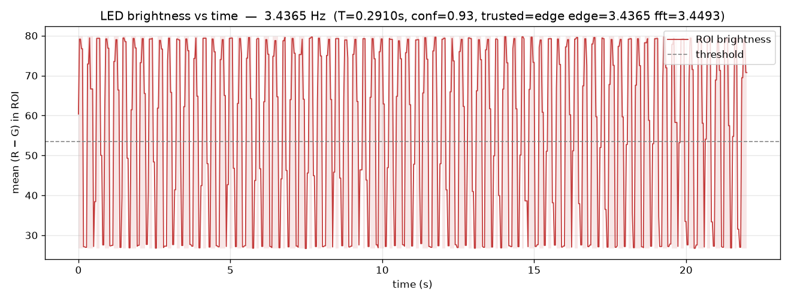

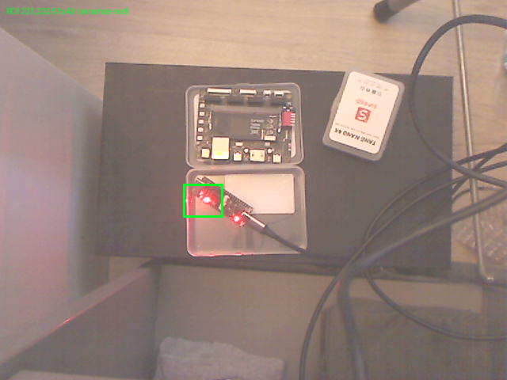

MCP `brightness.png` / `roi.png` (inline image content was also returned over `/mcp`):

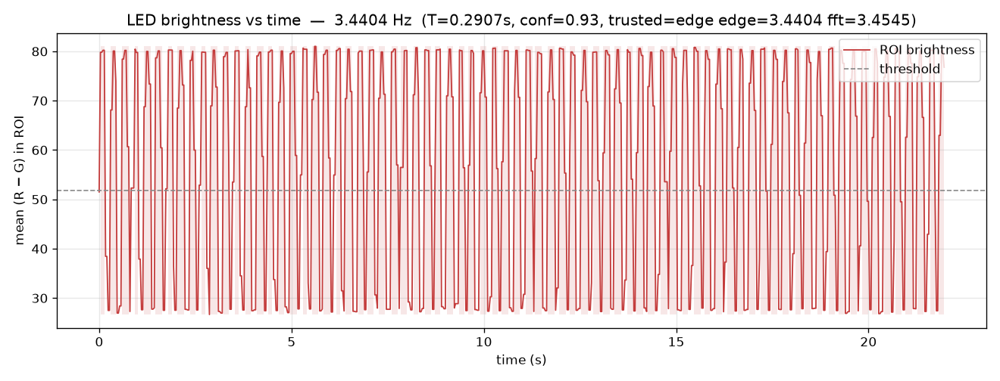

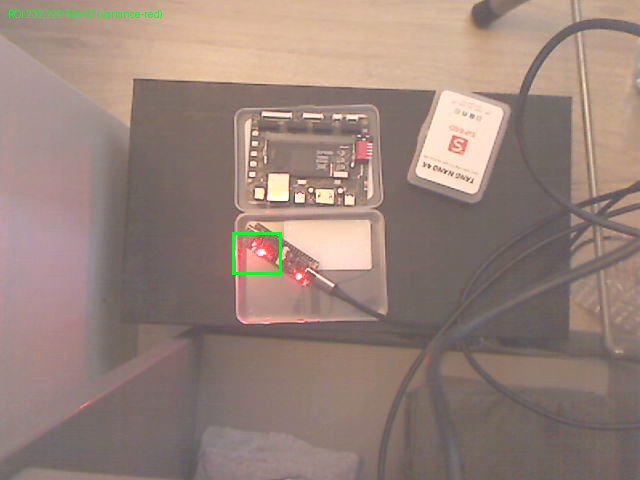

## LED alignment and colour on Bee (2026-11-04)

Same scene, still no FPGA / serial / `openFPGALoader`. Board identity is the
**LED pattern** (five LEDs, three steady and two blinking, orange vs red) plus
relative geometry (20K above 4K). USB cords are not used.

`auto_adjust` landed on gain 48, exposure 310, saturation 80, WB 3800
(score 280, 6 compact blobs, both colours). Delivered capture rate is **30.08 fps**
(361 frames in 12 s). Peak RGB from the after still:

| LED | RGB | hue | class |
|---|---|---|---|
| Nano 4K | 245, 0, 0 | 0 | red |
| Nano 4K | 255, 22, 25 | 359 | red |
| Primer 20K USB | 250, 2, 0 | 0 | red |
| Primer 20K user | 165, 66, 0 | 24 | **orange** |
| Primer 20K user | 246, 72, 105 | 349 | orange (G÷R) |

`detect_leds` assigned `upper=primer20k` / `lower=nano4k` from that geometry.
`measure_blink(roi=nano4k)` used the detected 4K bbox `278,274,46,47`:

| | Hz | vs 3.433 Hz |
|---|---|---|
| edge (trusted) | **3.417** | −0.47% |
| FFT | 3.383 | −1.5% |

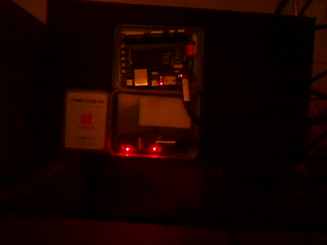

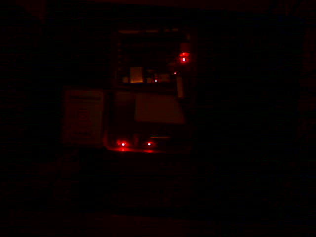

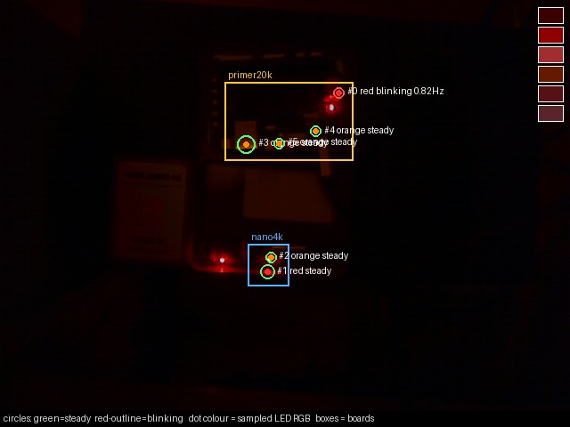

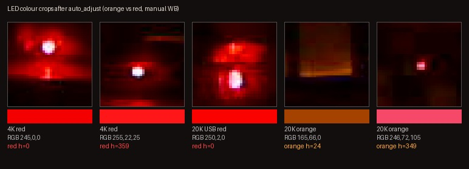

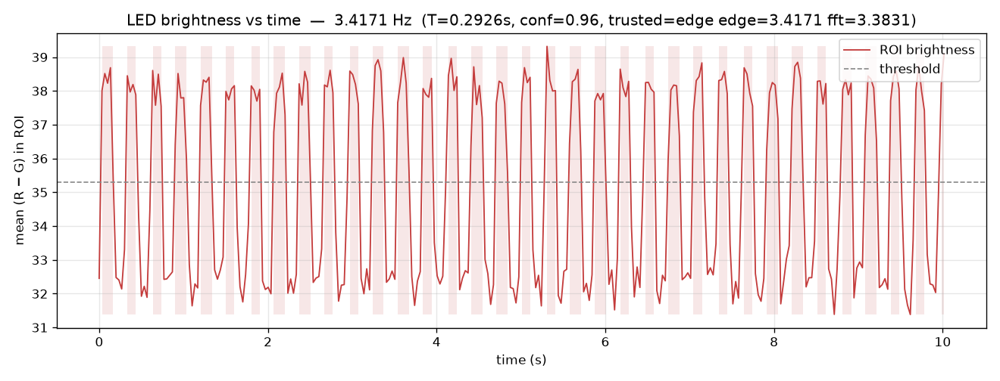

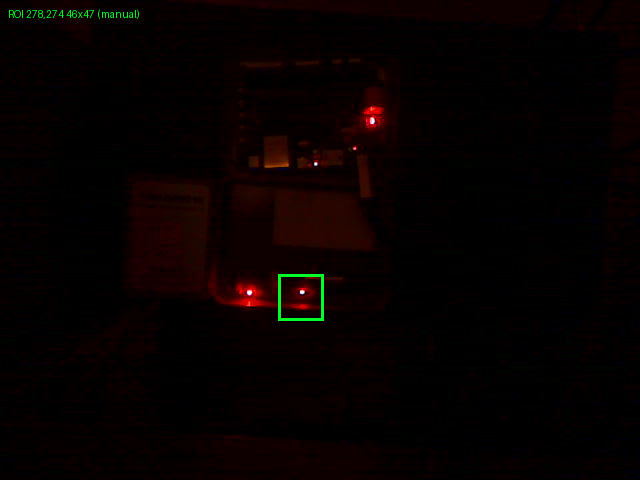

## Reliability, falling room light (2026-11-04 18:28–18:31 CET)

Five cycles of `auto_adjust` + `detect_leds` + `measure_blink(nano4k)` +
`measure_blink(primer20k, video=same clip)`. Both boards in view, no FPGA /
serial / `openFPGALoader`. Predicted Blink3 on the Nano 4K is **3.433 Hz**.
The Primer 20K blinker is ~1.0 Hz.

Fixes after the 17:37–18:00 run (that one trusted FFT 3.430 Hz on a *steady*
20K orange at `(274,137)` with conf 0.30, same as good 1.0 Hz readings):

- never meter a steady LED; no blinker → `untrusted`
- edge vs FFT relative disagreement > 12% → `untrusted` (no silent FFT leakage)
- confidence uses regularity / edges / agreement / SNR (good ~0.98–1.0, untrusted ≤ 0.15)
- blinker ROI is padded around the variance peak and clipped at the board gap
- blobs: merge split cores, local-maxima of temporal (R−G) std, NMS so silk at
  ~(274,140), (315,134), (299,280), (304,263) is not a sixth LED
- `auto_adjust` hysteresis on the persisted gain/exp, no WB hunt when both
  colours are already visible, gain 16 only if cores are already too bright

| cycle | gain / exp / WB | luma | n 20K+4K | 20K Hz (conf) | 4K Hz (conf, vs 3.433) | fps |
|---|---|---|---|---|---|---|
| 1 | 48 / 305 / 4000 | 2.13 | 3+2 | 0.994 (0.996) | 3.418 (0.983, −0.44%) | 30.08 |
| 2 | 112 / 305 / 4000 | 4.84 | 3+2 | 0.995 (0.996) | 3.420 (0.983, −0.38%) | 30.08 |
| 3 | 112 / 310 / 4000 | 5.73 | 3+2 | 0.998 (1.000) | 3.420 (0.983, −0.39%) | 30.08 |
| 4 | 112 / 305 / 4000 | 5.39 | 3+2 | 0.998 (1.000) | 3.429 (0.982, −0.13%) | 30.08 |
| 5 | 112 / 310 / 4000 | 5.65 | 3+2 | 0.995 (0.996) | 3.420 (0.983, −0.40%) | 30.08 |

5/5 both boards trusted on the blinking LED (20K ~`(370,95)`, 4K ~`(243,267)`).
Assignment stayed `upper=primer20k` / `lower=nano4k`. `auto_adjust` left gain 16
and raised gain 48→112 as the stills needed brighter cores, then held 112 / WB
4000 / sat 64 (no 3200/4000 flip). JSON: `proof/reliability-5cycle.json`.

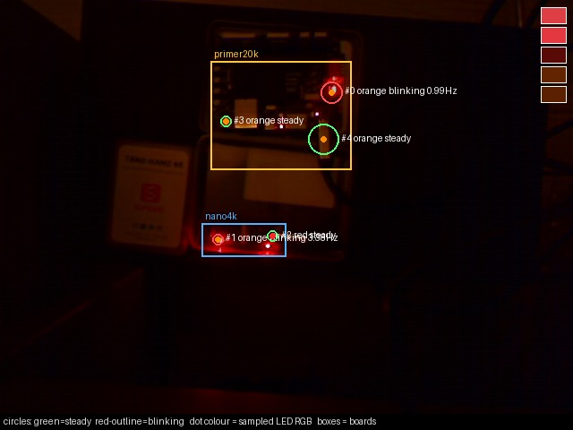

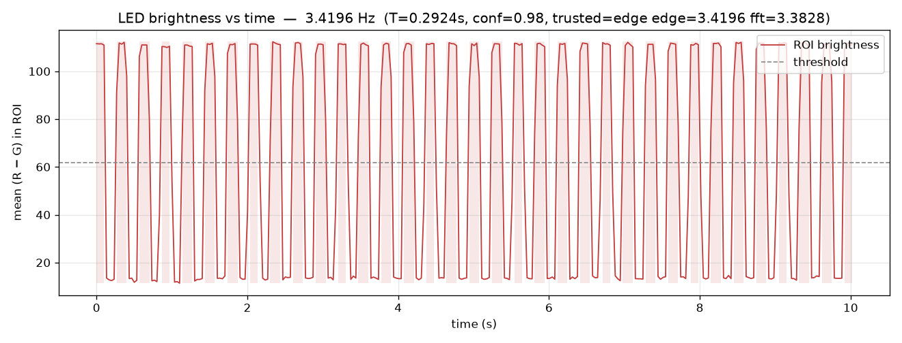

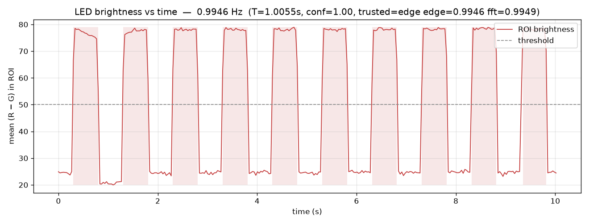
